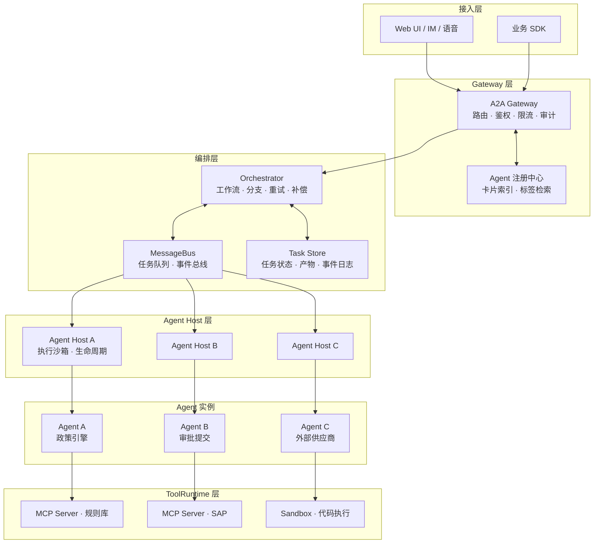
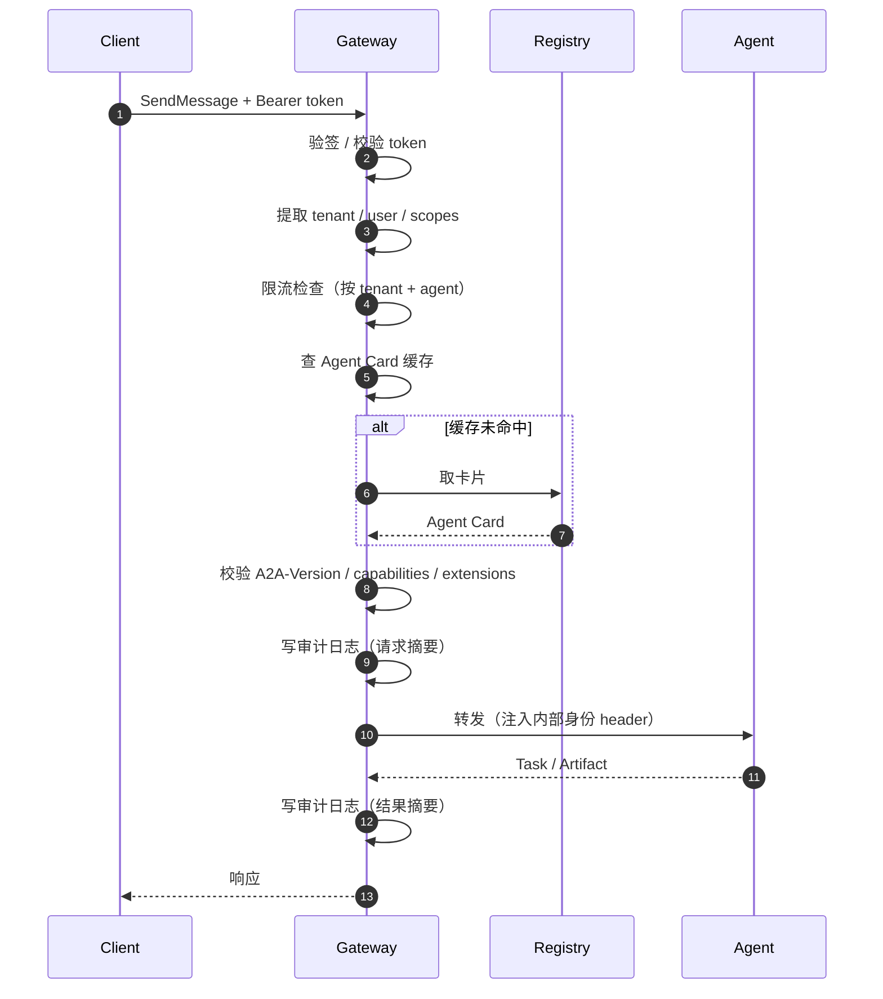
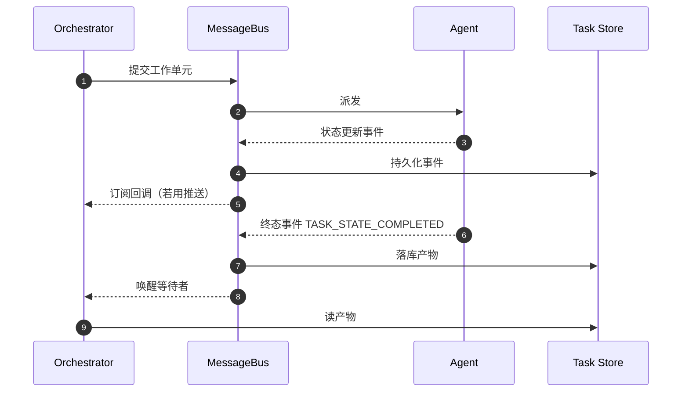
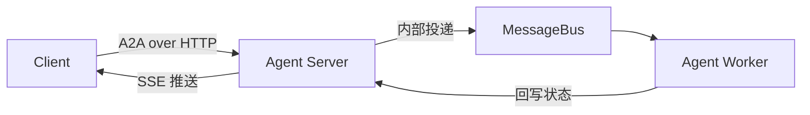
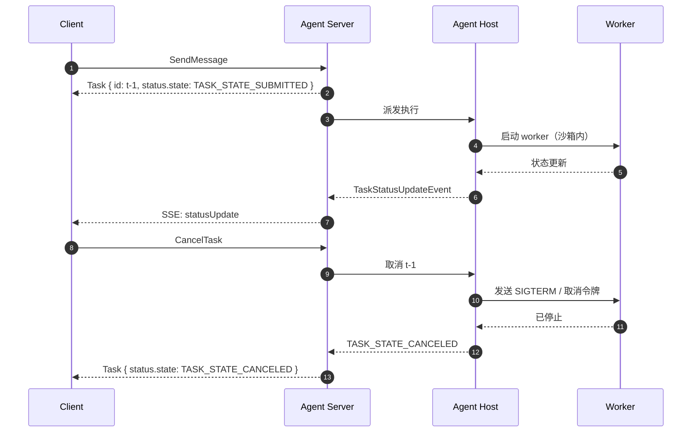
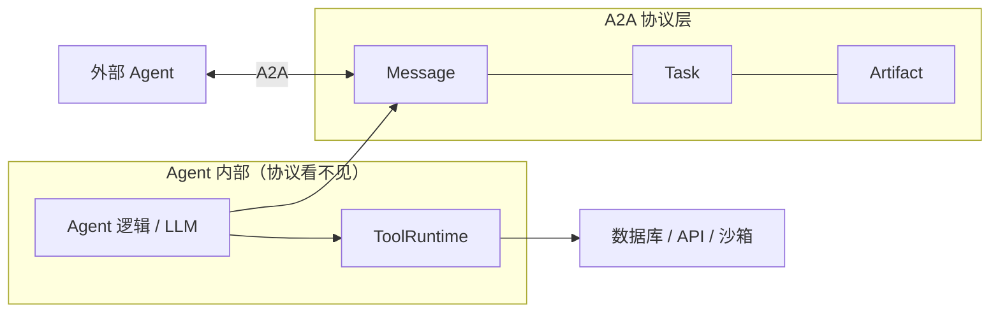
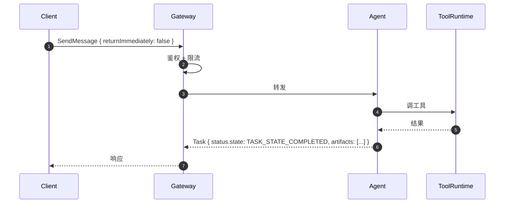
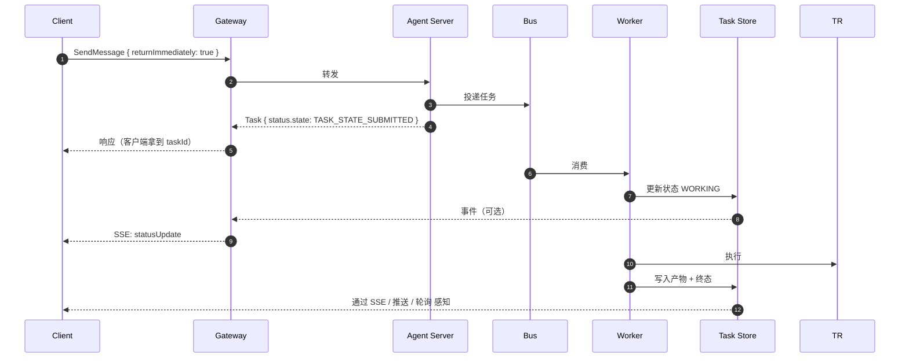
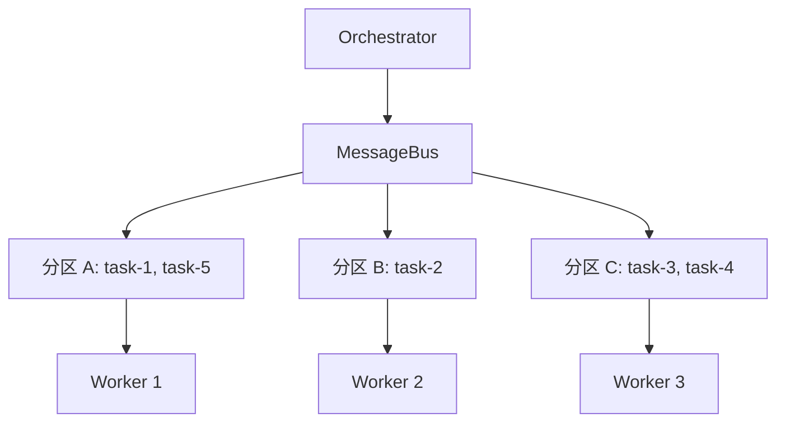

# 成熟 A2A 系统架构拆解

前四篇讲的是协议本身。这一篇往上抬一层：**协议落到一个真实的企业
系统里，需要哪些部件、每个部件负责什么、边界在哪。**

## 一、整体架构



这五层，每层解决一类问题。逐层拆。

## 二、Gateway 层

### 2.1 职责

Gateway 是所有 A2A 流量进入系统的唯一入口。它**不理解业务**，只做
通用治理。

| 职责 | 具体做什么 | 为什么放在这层 |
| --- | --- | --- |
| **协议终结** | 解析 JSON-RPC、校验方法名与参数、路由到对应 Agent | 避免每个 Agent 各写一遍解析 |
| **统一鉴权** | 校验 token、注入租户与用户身份、强制 HTTPS | 身份是横切关注点 |
| **限流与配额** | 按调用方、按 Agent、按租户限流 | 需要全局视角 |
| **审计日志** | 记录谁在什么时候调了哪个 Agent、传了什么、结果如何 | 合规要求 |
| **协议版本协商** | 校验 `A2A-Version`，不匹配直接拒绝 | 避免把版本不兼容的问题带到下游 |
| **能力缓存** | 缓存 Agent Card，降低发现开销 | 卡片变化不频繁 |
| **统一响应头** | 注入 `A2A-Extensions`、追踪 ID、审计 ID | 保证一致 |

### 2.2 一条典型的鉴权链



**Gateway 往内部转发时会注入自己的身份**：外部 token 在 Gateway 校验，
下游 Agent 收到的是内部可验证的身份（mTLS 客户端证书 + 签名的内部
token）。这样 Agent 内部完全不用处理外部身份体系。

### 2.3 Gateway 的两个变体

| 变体 | 说明 |
| --- | --- |
| **透传型** | 只做鉴权、限流、审计，请求原样转发。Agent 自己处理协议 |
| **终结型** | Gateway 自己终结 JSON-RPC，把请求转成内部调用（如 gRPC、消息队列消息） |

**透传型简单，适合 Agent 数量少。终结型多一层转换，适合要接 gRPC
Agent、要统一做流式代理的场景。**

一个常见的终结型实现：

```python
class A2AGateway:
    async def handle_rpc(self, request: JsonRpcRequest, ctx: RequestContext):
        self._audit(request, ctx, phase="inbound")
        card = await self._registry.get_card(ctx.agent_name)
        self._validate(request, card, ctx)
        upstream = await self._bus.publish(
            topic=f"agent.{ctx.agent_name}.execute",
            payload=self._to_internal(request, ctx),
        )
        return await self._await_response(upstream, ctx)
```

## 三、Orchestrator 层

### 3.1 职责

编排器是**流程的负责人**。它处理协议不管的那部分：

| 职责 | 协议不管，编排器要管 |
| --- | --- |
| **执行顺序** | 串行、并行、条件分支、扇出汇聚 |
| **失败处理** | 重试次数、退避、换 Agent、补偿 |
| **超时管理** | 每步的超时、整体 deadline |
| **人工介入** | 审批节点、编辑、驳回 |
| **跨任务聚合** | 汇总多个 Task 的产物 |
| **状态持久化** | 流程状态存哪、怎么恢复 |

### 3.2 编排器与 A2A 客户端的关系

**编排器同时是所有下游 Agent 的 A2A Client。** 它的 A2A 客户端职责：

- 读 Agent Card（走注册中心，走缓存）；
- 选接口、建连接、带 `A2A-Version`；
- 发 `SendMessage`；
- 跟踪 Task（轮询 / 流式 / 推送三选一）；
- 处理 Task 状态（`INPUT_REQUIRED` → 挂起流程等人工输入；
  `AUTH_REQUIRED` → 走凭据流程；`FAILED` → 触发重试或补偿）；
- 取 Artifact。

**关键点**：编排器**必须**处理 `INPUT_REQUIRED`。一个只会发消息、
等结果的编排器，遇到需要澄清的 Agent 就会卡死。

```python
async def call_agent(ctx, agent_name, parts, timeout=300):
    card = await registry.get_card(agent_name)
    iface = pick_interface(card, client_supports)
    resp = await a2a_client.send_message(
        url=iface["url"],
        message=build_message(ctx, parts),
        return_immediately=True,
        timeout=timeout,
    )
    task = resp.task
    while True:
        if task.status.state == "TASK_STATE_INPUT_REQUIRED":
            answer = await ctx.human_input(task.status.message)
            task = await a2a_client.send_message(
                url=iface["url"],
                message=build_message(ctx, answer, task_id=task.id),
            ).task
            continue
        if task.status.state == "TASK_STATE_AUTH_REQUIRED":
            await ctx.provide_credentials(task.status.message)
            continue
        if task.status.state in TERMINAL_STATES:
            return task
        await asyncio.sleep(poll_interval)
```

### 3.3 编排器的持久化

编排器的状态**必须**持久化，否则进程重启流程就丢了。持久化的内容：

| 内容 | 为什么需要 |
| --- | --- |
| 流程实例状态 | 知道走到哪个节点了 |
| 各 Task 的 `taskId` | 重启后能继续跟踪同一个任务 |
| 人工输入的中间产物 | 恢复时不用重新问人 |
| 幂等键 | 重启后重发不产生重复副作用 |

**Task Store 的三种典型实现**：

| 实现 | 适合 |
| --- | --- |
| 关系型数据库（PostgreSQL） | 状态量不大、需要事务和查询 |
| 文档数据库（MongoDB） | 产物结构多变、量大 |
| 事件溯源 + 物化视图 | 需要完整历史和回放 |

### 3.4 长任务的编排：两种范式

**范式 A：阻塞等待。** 编排器发消息后一直等。简单，但长时间占用
连接和线程。

**范式 B：事件驱动。** 编排器订阅任务事件，收到终态事件后继续流程。



**范式 B 是长任务场景的正解**，它把"等待"从连接上挪到了存储上，
进程可以随时重启后恢复。

## 四、MessageBus 层

### 4.1 职责

消息总线负责**跨进程的可靠投递**。A2A 协议本身不提供可靠投递，
需要这一层补。

| 能力 | 作用 |
| --- | --- |
| **任务队列** | Agent 实例的请求分发、负载均衡 |
| **事件总线** | 任务状态变化的广播（给编排器、给订阅者） |
| **延迟队列** | 超时、重试、退避调度 |
| **死信队列** | 重试耗尽的任务进这里，人工介入 |

### 4.2 消息总线与 A2A 的关系

一个关键理解：**消息总线在 A2A 架构里通常位于 Agent 的一侧。**
客户端一侧保持无状态，消息只存在于浏览器与编排器之间。



也就是说，**对外是标准 A2A，对内用自己顺手的队列**。这是 A2A 生态里
非常常见的形态：

- 对外：`POST /rpc`，`method: SendMessage`，返回 Task。
- 内部：把任务扔进 Kafka/RabbitMQ，多个 worker 消费。
- worker 完成后更新任务状态，Gateway 通过 SSE 把事件推给客户端。

**这解决了 A2A 协议没有覆盖的一个真实问题**：Agent 内部的水平扩展。
如果 Agent 的执行是重 CPU 的，同一个 A2A 端点后面挂 N 个 worker
是自然需求。

### 4.3 消息体的选择

队列里传什么，有两种做法：

| 做法 | 消息体 | 优点 | 缺点 |
| --- | --- | --- | --- |
| **透传** | 完整的 `SendMessageRequest` | worker 拿到全部信息 | 消息体大 |
| **引用** | `{ taskId, agentName, payloadRef }` | 消息体小 | worker 要回查存储 |

实践中常用折中：**大内容放对象存储，队列里只放引用**。

```json
{
  "taskId": "t-1a2b",
  "contextId": "c-9f3e",
  "agent": "policy-engine",
  "input": { "url": "https://s3.example.com/tasks/t-1a2b/input.json" },
  "attempt": 1,
  "deadline": "2026-03-01T10:05:00Z"
}
```

注意 `attempt` 和 `deadline` 两个字段：**它们不在 A2A 协议里**，是
内部实现细节。Agent Host 从队列消息里解析它们。

### 4.4 顺序与并发

MessageBus 层的两个经典问题：

| 问题 | 处理 |
| --- | --- |
| **同一任务的事件乱序** | 队列按 `taskId` 分区（partition key），保证同 key 单进单出 |
| **多任务并行隔离** | 不同 `taskId` 落到不同分区，天然并行 |

**同一任务的并行是危险的**——两个 worker 同时改一个任务的状态，
状态机就会错乱。按 `taskId` 分区是标准解法。

## 五、Agent Host 层

### 5.1 职责

Agent Host 是 Agent 实例的**运行环境**。它管的是"怎么把一段代码
安全地跑起来"。

| 职责 | 具体内容 |
| --- | --- |
| **执行隔离** | 每个任务在独立沙箱/容器里跑，资源限额 |
| **生命周期管理** | 启动、就绪探针、优雅停机 |
| **并发控制** | 单实例并发上限、队列背压 |
| **超时与取消** | 收到 `CancelTask` 时真正打断执行 |
| **资源配额** | CPU、内存、GPU、token 预算 |
| **密钥注入** | 按最小权限注入凭据 |

### 5.2 Agent Host 与协议的接口

Agent Host 承担了协议里"取消任务"这个承诺的落地。



**取消要能真正打断执行**，这是 Agent Host 的硬要求。如果 Worker 跑的是
一个不可中断的同步调用，取消就只是一个状态标记，实际计算还在烧钱。
实现手段：协作式取消（传递 `context` 取消令牌）+ 超时兜底 +
进程级终止。

### 5.3 弹性伸缩

Agent Host 是扩缩容的决策单元。指标与策略：

| 指标 | 用途 |
| --- | --- |
| 队列积压深度 | 主要扩缩容信号 |
| 任务平均等待时长 | SLA 相关时用这个 |
| 任务平均执行时长 | 预测扩容量的输入 |
| 并发任务数 | 硬上限约束 |
| token 消耗速率 | 有预算约束时用这个 |

**两类 Agent 的伸缩策略不同**：

| 类型 | 特征 | 策略 |
| --- | --- | --- |
| **短任务**（秒级） | 无状态、启动快 | 快速扩，缩容保守（保留最小副本） |
| **长任务**（分钟级以上） | 有状态、启动慢、可能存中间态 | 扩容需要预热；缩容必须先排空 |

长任务的缩容要特别小心：**直接杀掉实例等于杀掉正在执行的任务**。
正确做法是：先停止接新任务，等存量任务跑完或被转移，再终止实例。

## 六、ToolRuntime 层

### 6.1 职责

ToolRuntime 是 Agent 用来接触外部世界的通道。它把工具、资源、代码
执行环境统一起来。

| 组件 | 说明 |
| --- | --- |
| **MCP Server** | 暴露工具给 Agent 内部调用 |
| **代码沙箱** | 执行 Agent 生成的代码 |
| **数据库/缓存客户端** | Agent 访问持久化状态 |
| **外部 API 客户端** | 调用第三方服务 |

### 6.2 ToolRuntime 与 A2A 的分工

这是最容易搞混的一层。**ToolRuntime 属于 Agent 内部，不属于 A2A。**



| 问题 | 归属 |
| --- | --- |
| 对方 Agent 在哪、怎么调 | A2A |
| 任务现在什么状态 | A2A |
| 我内部用哪个数据库查 | ToolRuntime |
| 我生成的代码在哪跑 | ToolRuntime |
| 我调 LLM 提示词怎么写 | Agent 内部 |

**A2A 的"不透明执行"原则保证了这条边界**：对端 Agent 只知道你的
`skills` 声明，不会知道你的 ToolRuntime 里有什么。

### 6.3 一个 Agent 内部同时使用 A2A 和 MCP

典型的 Agent 同时用两种协议：

```text
对外（A2A）：我是"差旅报销审核 Agent"，接收发票，产出合规结论。
对内（MCP）：我调用 OCR 服务、差旅政策知识库、ERP 查询接口。
```

```python
class ExpenseAgent:
    def __init__(self, mcp_client, policy_index):
        self.mcp = mcp_client
        self.policy_index = policy_index

    async def review(self, invoice: Part) -> Artifact:
        ocr = await self.mcp.call("ocr_invoice", {"image": invoice})
        rules = self.policy_index.retrieve(ocr["category"], ocr["amount"])
        decision = await self.mcp.call("policy_evaluate", {"rules": rules, "invoice": ocr})
        return Artifact(
            artifact_id=uuid4().hex,
            name="报销结论",
            parts=[Part(data=decision, media_type="application/json")],
        )
```

### 6.4 工具调用的可观测性

ToolRuntime 里的调用**必须**单独埋点，因为它是"Agent 出错"的
主要来源：

| 埋点 | 捕获什么 |
| --- | --- |
| 调用耗时分布 | 哪个工具是瓶颈 |
| 失败率 | 哪个工具在超时或报错 |
| 参数大小 | 有没有把大对象直接塞进工具参数 |
| token 消耗 | 成本归因 |

**A2A 协议层面看不到这些**。`Task` 只知道"我完成了"或"我失败了"，
不知道"我在第 3 个工具调用上失败了"。这就是[不透明执行](/a2a/core-concepts#五、协议的-不透明执行-如何落地)
带来的代价——必须由平台补齐。

## 七、层间交互的三条主线

### 7.1 同步短任务



**全程一条连接**。适合秒级任务。Gateway 后面可以挂多个 Agent 实例，
由 Gateway 做负载均衡。

### 7.2 异步长任务



**关键**：客户端拿到 `taskId` 后完全脱离。后续通过三种机制之一跟进。

### 7.3 多任务并行隔离



**隔离的三个维度**：

| 维度 | 隔离什么 | 实现手段 |
| --- | --- | --- |
| **状态隔离** | 不同任务的状态互不干扰 | 存储层按 `taskId` 分区 / 独立键 |
| **资源隔离** | 一个任务跑飞不能拖垮别人 | 容器 + 资源限额 + 并发上限 |
| **故障隔离** | 一个 Agent 挂了不影响别人 | 每个 Agent 独立部署与健康检查 |

**状态隔离最容易被忽略。** 如果多个任务共用一个内存字典存状态，
重启就全丢；如果共用一个数据库表而不按 `taskId` 索引，并发查询会打架。

## 八、哪些能力放哪一层

做架构决策时的一张速查表：

| 需求 | 放哪层 | 理由 |
| --- | --- | --- |
| 外部调用方鉴权 | Gateway | 横切关注点，避免重复实现 |
| 按调用方的配额 | Gateway | 需要全局计数 |
| Agent 能力检索 | Registry | 需要跨 Agent 索引 |
| 流程分支与重试 | Orchestrator | 协议不覆盖 |
| 任务状态持久化 | Task Store | 幂等与恢复的基础 |
| 任务队列 | MessageBus | 跨进程可靠投递 |
| 执行沙箱 | Agent Host | 资源与安全 |
| 取消执行 | Agent Host | 需要真正的中断能力 |
| 工具调用 | ToolRuntime | Agent 内部实现 |
| 工具调用埋点 | ToolRuntime | 协议层看不到 |
| 业务审计日志 | Gateway（+ 编排层） | 合规要求 |
| Agent Card 签名验证 | Gateway | 路由决策的输入可信 |

## 九、一份架构决策清单

在动手搭之前，这几个问题要有明确答案：

1. **对外只暴露一种绑定还是多种？** 只暴露 JSON-RPC 最省事；要接
   内部 gRPC Agent 就得做终结型 Gateway。
2. **Agent 是长驻还是按需拉起？** 长驻简单但贵；按需拉起适合低频 Agent。
3. **任务状态存哪？** 至少要能重启后继续跟踪。
4. **客户端怎么知道任务完成了？** 流式、推送、轮询，三选一或组合。
5. **同一个 Agent 允许多少并发？** 直接决定容量规划。
6. **谁来兜底 webhook 丢失？** 需要一个扫描器。
7. **跨 Agent 的凭据怎么流转？** 带外直送，不能穿消息。
8. **Agent 崩溃了任务怎么办？** 租约 + 重投 + 死信队列。

## 十、小结

- 五层：Gateway（治理）、Orchestrator（流程）、MessageBus（投递）、
  Agent Host（执行环境）、ToolRuntime（工具）。
- Gateway 终结协议、统一鉴权限流审计；Agent 之间不需要互相认识。
- Orchestrator 是所有下游 Agent 的 A2A Client，必须处理
  `INPUT_REQUIRED` / `AUTH_REQUIRED` / 终态三种情况。
- MessageBus 通常在 Agent 内部，作用是水平扩展与可靠投递。
  按 `taskId` 分区解决同任务事件乱序。
- Agent Host 要能真正打断执行，否则 `CancelTask` 只是纸面承诺。
- ToolRuntime 属于 Agent 内部，协议层看不到，必须单独埋点。
- 可靠性靠分层兜底：Gateway 审计、Orchestrator 持久化、
  MessageBus 重试、Task Store 状态、Agent Host 隔离。

下一篇：[全流程调用时序](/a2a/sequence)——把架构图变成一张张具体的
时序图，包括异常分支。
