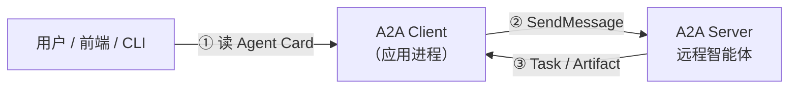
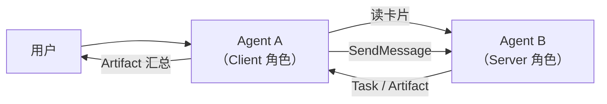
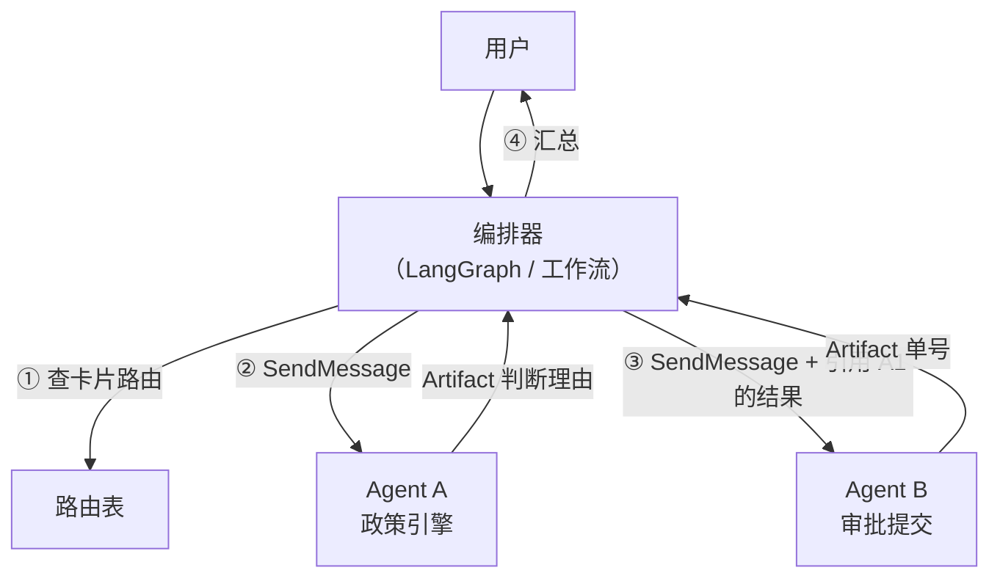
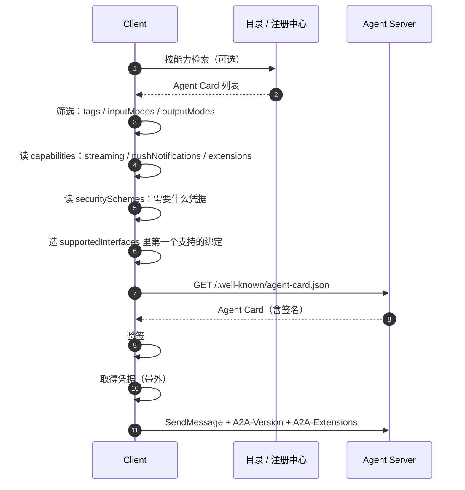
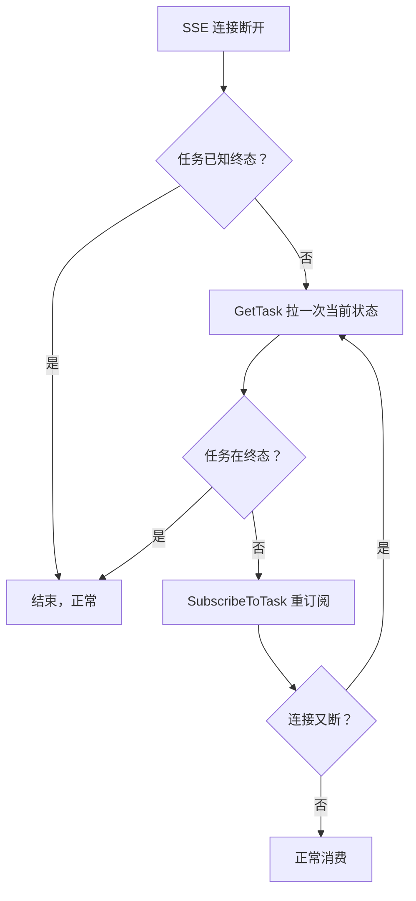

# 通信模型：智能体之间怎么对话

协议定义了消息的形状。这一篇讲通信的**模式**：谁主动找谁、怎么找到、
怎么协商、失败了怎么办。

## 一、两种通信模式

A2A 的通信可以分成两种模式，它们的信任假设、拓扑、失败处理都不一样。

### 1.1 模式 A：客户端直连 Agent



- **发起方是人或应用**。Agent 形态的发起方属于下一种模式。
- 客户端知道 Agent 的地址（配置里写死，或从注册中心查）。
- 信任关系是**应用 → 服务**。鉴权由客户端负责携带凭据。

这是最常见也最简单的模式。企业内部把"报销助手""客服机器人"这类
Agent 暴露成服务，前端直连，就是这个模式。

**要点**：客户端仍然要做能力协商——读 Agent Card，确认 `inputModes`
兼容、`capabilities.streaming` 满足需求，再决定调哪个接口。

### 1.2 模式 B：Agent ↔ Agent 对等通信



- **发起方本身是 Agent**。
- 同一段代码在两端都可能扮演 Client 或 Server。
- 信任关系是**组织 → 组织**，或者**团队 → 团队**。

关键差异在于：**Client 角色意味着"我要把活交给你，并且要为结果负责"。**
这带来两个额外义务：

1. **Client 侧要做结果校验**。对方返回的 Artifact 未必可信，要校验
   `mediaType`、结构、来源。
2. **Client 侧要处理对方的拒绝**。`REJECTED` 意味着要换路，重试解决不了问题。

### 1.3 模式 C：编排器驱动的链式调用

现实中最常见的是第三种，它是前两种的组合：



编排器同时是 A 的 Client 和 B 的 Client。它负责串行、并行、条件分支、
重试补偿——这些都不在 A2A 协议里。

**三种模式的共同点**：每一次跨 Agent 的调用，都是一次
"读 Agent Card → 选接口 → SendMessage → 跟踪 Task → 取 Artifact"。

## 二、协商流程

规范把"协商"拆成了几个可以独立决策的环节。

### 2.1 完整的协商链路



### 2.2 能力发现的三个层次

**第一层：静态目录。** 配置里写死 Agent 的 URL。这是最简单的方式，
Agent 数量少（个位数）时够用。

**第二层：注册中心 / 目录服务。** 集中管理所有 Agent 的卡片，
支持按标签检索：

```sql
-- 注册中心自己的表结构，按需设计
SELECT card FROM agent_registry
WHERE tags @> ARRAY['expense', 'compliance']
  AND 'image/png' = ANY(input_modes)
  AND protocol_version = '1.0';
```

规范把"查询策划过的 Agent 目录"列为三种发现机制之一。实践中这层
价值最高——**它是让 Agent 数量从 3 涨到 30 的关键**。

**第三层：Agent 之间的转介。** 最有意思的一层。一个 Agent 回答
"我不做这个，但我知道谁做"，并在 Artifact 里给出对方的标识。

```json
{
  "artifactId": "a-handoff",
  "name": "转介信息",
  "parts": [
    {
      "data": {
        "referredAgent": {
          "name": "差旅供应商比价 Agent",
          "cardUrl": "https://agents.example.com/supplier-price/.well-known/agent-card.json",
          "reason": "本 Agent 不含实时报价数据"
        }
      },
      "mediaType": "application/json"
    }
  ]
}
```

**这一层没有标准协议**。它是一个约定：上游 Agent 在无法完成时，
返回一个"指路"的产物。规范并没有为它定义专门的数据结构，实践中
通常用一个自定义扩展来实现。

### 2.3 基于 Agent Card 的路由决策

拿到卡片后，客户端要做一串判断。这是路由的核心逻辑：

```python
def select_interface(card, supported_bindings, supported_versions):
    """按 supportedInterfaces 的偏好顺序挑第一个双方都支持的接口。"""
    for iface in card.get("supportedInterfaces", []):
        if iface["protocolBinding"] not in supported_bindings:
            continue
        if iface.get("protocolVersion") not in supported_versions:
            continue
        return iface
    raise NoCompatibleInterface(card["name"])


def route(card, request_modes, wanted_output_modes):
    """在技能里找一个输入格式兼容、输出格式也合适的。"""
    for skill in card.get("skills", []):
        in_modes = set(skill.get("inputModes", card["defaultInputModes"]))
        out_modes = set(skill.get("outputModes", card["defaultOutputModes"]))
        if set(request_modes) <= in_modes and set(wanted_output_modes) & out_modes:
            return skill
    raise NoMatchingSkill(card["name"])
```

**路由决策的四个输入**：

| 输入 | 来源 | 用途 |
| --- | --- | --- |
| 技能匹配 | `skills[].tags` / `description` | 能不能干这活 |
| 格式兼容 | `defaultInputModes` / `skills[].inputModes` | 干得了但格式对不对 |
| 能力开关 | `capabilities` | 走不走流式、要不要 webhook |
| 协议绑定 | `supportedInterfaces` | 用哪条线连 |

### 2.4 格式协商的一个细节

`skills[].inputModes` 和 `skills[].outputModes` 会**覆盖** Agent 级别的
`defaultInputModes` / `defaultOutputModes`。也就是说：

- Agent 说"我整体支持 `text/plain` 和 `application/json`"；
- 某个技能说"我这一个只吃 `application/json`"；
- 客户端要按技能来判断兼容性，不能只看 Agent 级默认值。

另外还有一个**输出格式协商**的机制：`SendMessageConfiguration` 里的
`acceptedOutputModes`，客户端可以表达"我这次希望拿到 JSON"。

```json
"configuration": {
  "acceptedOutputModes": ["application/json"]
}
```

规范用词是"Agent **应当**尽量满足"，这是软约束。客户端**必须**准备好
接收 Agent 实际返回的其它格式——**把返回的 `mediaType` 检查一遍是
客户端的活**。

### 2.5 鉴权协商

`securitySchemes` 声明"我要什么凭据"，`securityRequirements` 声明
"哪些技能需要哪些凭据"。

```json
"securitySchemes": {
  "google": {
    "openIdConnectSecurityScheme": {
      "openIdConnectUrl": "https://accounts.google.com/.well-known/openid-configuration"
    }
  }
},
"securityRequirements": [
  { "schemes": { "google": { "list": ["openid", "profile", "email"] } } }
]
```

支持的方案类型（`securitySchemes` 的每个值是 `SecurityScheme`，用一个
oneof 成员名做 key）：

| 类型 | 成员内部字段 |
| --- | --- |
| `apiKeySecurityScheme` | `location`（query / header / cookie）、`name` |
| `httpAuthSecurityScheme` | `scheme`（bearer / basic）、`bearerFormat` |
| `oauth2SecurityScheme` | `flows`、`oauth2MetadataUrl` |
| `openIdConnectSecurityScheme` | `openIdConnectUrl` |
| `mtlsSecurityScheme` | 无（表示 mTLS） |

OAuth 2.0 的流在 `flows` 里，v1.0 的形状：

| 流 | 状态 | 适用 |
| --- | --- | --- |
| `authorizationCode` | 保留 | Web 应用；带 `pkceRequired` 开关（RFC 7636） |
| `clientCredentials` | 保留 | 服务间调用 |
| `deviceCode` | **新增**（RFC 8628） | CLI、无头设备、输入受限场景 |
| `implicit` | **标记废弃** | 令牌泄露风险 |
| `password` | **标记废弃** | 凭据暴露风险 |

> `mtlsSecurityScheme` 这个名字看着别扭：proto 里的消息类型叫
> `MutualTlsSecurityScheme`，字段名是 `mtls_security_scheme`，按 ProtoJSON
> 的 camelCase 规则序列化出来就是 `mtlsSecurityScheme`。

**凭据获取是带外的。** 规范明确：客户端通过"该认证方案特有的带外流程"
获得凭据。A2A 协议本身**不定义**怎么跑 OAuth 授权码流程——那是
认证基础设施的事。

## 三、可靠性设计

这一节是工程上最实用的部分。A2A 对可靠性的态度很明确：**协议保证结构，
不保证投递**。

### 3.1 幂等性：规范的三种口径

规范 3.3.1 节原文的分类：

| 操作 | 幂等性 |
| --- | --- |
| `GetTask` / `ListTasks` / `GetExtendedAgentCard` | **天然幂等** |
| `CancelTask` | **幂等**，多次取消效果相同 |
| `SendMessage` | **MAY 幂等**——Agent 可以用 `messageId` 识别重复消息 |

`SendMessage` 的幂等性留给实现方决定。**这意味着客户端不能假设
重发是安全的**，除非知道对方做了去重。

### 3.2 用 messageId 实现去重

规范给了一个明确的抓手：`Message.messageId` 由**消息创建方**生成。
Agent 可以据此识别重复消息。

服务端去重的标准实现：

```python
class MessageDeduper:
    def __init__(self, ttl_seconds=3600):
        self._seen = {}
        self._ttl = ttl_seconds

    def is_duplicate(self, message_id):
        now = time.time()
        self._purge(now)
        if message_id in self._seen:
            return True
        self._seen[message_id] = now
        return False
```

去重之后的处理策略有讲究：

| 策略 | 做法 | 适用 |
| --- | --- | --- |
| **丢弃** | 第二次直接返回第一次的结果 | 短操作 |
| **返回已有任务** | 第二次返回同一个 `taskId` | 中等，最常用 |
| **返回 409 语义错误** | 明确告诉调用方"重复" | 调用方能处理的场景 |

推荐第二种：客户端重发时拿到的是**同一个 taskId**，后续用
`GetTask` 追踪即可，客户端逻辑最简单。

### 3.3 客户端重试的正确姿势

**可以安全重试的操作**：

- `GetTask` / `ListTasks` —— 纯读。
- `CancelTask` —— 幂等。
- `SendMessage` —— **仅当**你携带了 `messageId` 且对方做了去重。

**不能盲目重试的操作**：

- `SendMessage` 且没有 `messageId` —— 可能创建出两个任务。
- `CreateTaskPushNotificationConfig` —— 可能创建出多个配置。

```python
def send_with_retry(client, text, max_attempts=3):
    message_id = str(uuid.uuid4())
    last_error = None
    for attempt in range(max_attempts):
        try:
            return client.send_message(
                message_id=message_id,
                role="ROLE_USER",
                parts=[{"text": text}],
            )
        except TransientError as exc:
            last_error = exc
            time.sleep(backoff(attempt))
    raise last_error
```

**`message_id` 在整个重试序列里保持不变**，这是幂等的前提。

### 3.4 哪些错误可以重试

| 错误 | 可重试 | 说明 |
| --- | --- | --- |
| `-32603` Internal error | ✅ | 服务端内部故障 |
| HTTP 503 / gRPC `UNAVAILABLE` | ✅ | 临时不可用、正在重启 |
| HTTP 429 | ✅ | 限流（看 `Retry-After`） |
| HTTP 502 / 504 | ✅ | 网关问题 |
| `-32001` TaskNotFound | ❌ | 重试没有意义 |
| `-32002` TaskNotCancelable | ❌ | 状态问题 |
| `-32004` UnsupportedOperation | ❌ | 能力不匹配 |
| `-32005` ContentTypeNotSupported | ❌ | 请求本身不合法 |
| `-32009` VersionNotSupported | ❌ | 版本不匹配 |
| 401 / 403 | ❌ | 凭据问题，重试不会变好 |

**退避策略**用指数退避 + 抖动：

```python
def backoff(attempt, base=0.5, cap=30.0):
    delay = min(cap, base * (2 ** attempt))
    return delay * (0.5 + random.random() / 2)
```

### 3.5 幂等键的完整方案

对"客户端重发导致重复任务"这个问题，A2A 规范本身给的是
`messageId` 去重这一条路。生产上通常还要再加两层：

**第一层：客户端幂等键。** 在业务层生成一个稳定的键（比如
"用户ID + 业务单号"），在重试时保持不变。

**第二层：服务端幂等表。** 把 `(调用方, messageId)` → `taskId` 存起来，
重复请求直接返回已存在的任务。这张表要有 TTL，且**必须**与任务清理
策略对齐。

**第三层：业务层去重。** 有些副作用（比如"给客户发了一封邮件"）
光靠协议层去重不够，需要在业务动作上做幂等（比如按业务单号建唯一索引）。

### 3.6 任务本身的重试

Agent 内部执行失败要不要重试，是**编排器**的决策，不在协议里。
但有几点需要注意：

| 问题 | 建议 |
| --- | --- |
| 任务 `FAILED` 后能否重新发起 | 能。**新建一个 Task**，带上 `contextId` 和 `referenceTaskIds` 指明来源 |
| 能不能把失败的 Task 改回 `WORKING` | 不能。终态不可迁出 |
| 重试要不要换 Agent | 要。`REJECTED` / `FAILED` 后换一条路是常规操作 |
| 重试的间隔控制 | 在编排器里做，协议不管 |

引用来源任务的标准做法：

```json
{
  "message": {
    "role": "ROLE_USER",
    "parts": [{ "text": "换一条路重试：先用备用政策引擎" }],
    "contextId": "c-9f3e",
    "referenceTaskIds": ["t-failed-1"]
  }
}
```

### 3.7 断线重连

流式连接断掉后的处理顺序：



**先 `GetTask` 再重订阅**，这样能知道断线期间任务走到哪了。
很多实现只做重订阅，结果重连后从头开始渲染，界面闪一下。

关于补发（backfill）：规范没有强制规定服务端要补发多少历史事件。
实践中的三种做法：

| 做法 | 优点 | 缺点 |
| --- | --- | --- |
| 补发断线期间全部事件 | 客户端无感 | 需要服务端保存事件日志 |
| 只补发最新状态 | 简单，状态不会错 | 中间过程丢失 |
| 不补发，靠 `GetTask` 拉 | 服务端最省事 | 客户端要额外轮询 |

**推荐组合**：状态和产物靠 `GetTask` 拿准，流式只用来做"正在生成"的
体验增强。丢掉几个中间帧不影响正确性。

### 3.8 事件顺序与幂等消费

规范保证事件**按生成顺序投递**、**不重排**。这让客户端可以做
**顺序敏感**的处理。

但要注意：**重连后的事件流与重连前的那条属于两个独立流**，服务端如果实现了
补发，客户端可能收到重复事件。所以客户端的消费逻辑**应该幂等**：

```python
class ArtifactAssembler:
    def __init__(self):
        self._parts = {}

    def on_artifact_update(self, event):
        artifact = event["artifact"]
        key = artifact["artifactId"]
        if event.get("append"):
            self._parts.setdefault(key, []).extend(artifact.get("parts", []))
        else:
            self._parts[key] = list(artifact.get("parts", []))

    def text(self, artifact_id):
        return "".join(
            p.get("text", "") for p in self._parts.get(artifact_id, [])
        )
```

注意 `append` 的语义：v1.0 里 `append: true` 表示"追加到之前同
`artifactId` 的产物上"，`append` 缺失或 false 表示**替换**。

### 3.9 推送通知的可靠性

webhook 投递的语义比流式更弱：

| 方面 | 规范要求 | 实践含义 |
| --- | --- | --- |
| 投递次数 | 服务端**必须**至少尝试一次 | 可能只投一次，也可能有重试 |
| 重试 | 服务端**可以**指数退避重试 | 不保证 |
| 重复 | 客户端**应当**幂等处理 | 一定会重复 |
| 超时 | 服务端**应当**设 10–30 秒 | webhook 端点要扛住 |
| 放弃 | 服务端**可以**连续失败后放弃 | 通知可能永远不来 |

**"通知可能永远不来"这句话要当真。** 生产上 webhook 端点必须
自带一个补偿机制：

```python
@app.post("/webhook/a2a-notifications")
async def on_notification(req: Request):
    payload = await req.json()
    task_id = extract_task_id(payload)
    if not await repo.mark_notified(task_id, payload):
        return Response(status_code=200)
    await asyncio.create_task(process_notification(payload))
    return Response(status_code=200)
```

外加一个定时任务扫描长时间未完成的任务，用 `GetTask` 兜底。

### 3.10 可靠性对照表

| 机制 | 保证 | 不保证 |
| --- | --- | --- |
| `GetTask` | 状态一致（已完成的） | 状态实时（可能已变化） |
| SSE 流 | 事件有序、任务终态时关闭 | 断线不丢、事件不重发 |
| 多路订阅 | 各流收到相同事件 | 流之间的时序无关 |
| webhook | 至少尝试一次 | 一定送达、只送一次 |
| `Task.history` | 尽力而为 | 完整、不可篡改 |
| `Artifact` | 任务终态后可取 | 终态前一定已完整 |

## 四、跨组织通信的特殊考量

Agent 在不同组织时，有几个协议之外的问题。

### 4.1 凭据不能穿过中间人

规范在"任务内授权"一节给了明确建议：

- 凭据**应当**通过带外安全渠道（如 HTTPS）直接送到需要它的 Agent；
- 凭据**应当**绑定到发起请求的那个 Agent，其他参与链路的 Agent
  读不到；
- 含敏感信息的凭据**应当**只对发起方可读（必要时加密）。

**这直接否定了"把 OAuth token 塞进 Message 里传"的做法**——链路上
每个 Agent 都能看到。

### 4.2 幂等性要跨组织协调

不同组织的 Agent 不会共享幂等表。所以跨组织调用时：

- `messageId` 要由**发起方**生成并且稳定；
- 双方**应当**约定重试策略；
- 副作用类操作**应当**在业务层做幂等（用业务单号，不能用 messageId）。

### 4.3 错误语义要对齐

不同组织的 Agent 对"失败"的定义可能不同。规范提供的 A2A 专属错误
类型是跨组织沟通的共同词汇：

| 错误 | 对方应该理解成 |
| --- | --- |
| `TaskNotFoundError` | 任务不存在或你没权限看 |
| `UnsupportedOperationError` | 这个 Agent 不做这件事 |
| `ContentTypeNotSupportedError` | 你的数据格式我处理不了 |
| `ExtensionSupportRequiredError` | 你得先支持某个扩展 |
| `VersionNotSupportedError` | 协议版本对不上 |

**统一用这些错误类型，别自定义语义。** 这是跨组织协作能用同一套
SDK 的前提。

### 4.4 契约的演进

跨组织意味着对方会变。几个实践要点：

| 事项 | 做法 |
| --- | --- |
| 协议版本 | 每个 `AgentInterface` 声明自己的 `protocolVersion`，可以同时暴露多个版本 |
| 能力开关 | 新能力走 `capabilities.extensions` 声明，客户端不声明就别用 |
| 输出格式 | 用 `mediaType` 标清楚，客户端要按 `mediaType` 分派 |
| 破坏性变更 | 改 `AgentCard.version` 字段；`AgentSkill.id` 保持稳定 |

## 五、给客户端的检查清单

实现 A2A 客户端时，下面这些逐条对照：

- [ ] 读 Agent Card，**并验证签名**（如果卡片带签名）
- [ ] 检查 `capabilities.streaming` 再决定用不用流式
- [ ] 检查 `capabilities.pushNotifications` 再决定用不用 webhook
- [ ] 从 `supportedInterfaces` 里挑第一个支持的绑定
- [ ] 每个请求都带 `A2A-Version`
- [ ] `SendMessage` 的响应**两种都处理**（Task 和 Message）
- [ ] 重试时保持 `messageId` 不变
- [ ] 只对临时性错误重试，用指数退避 + 抖动
- [ ] 流式断线后先 `GetTask` 再 `SubscribeToTask`
- [ ] 消费事件时幂等（考虑 `append` 与重复事件）
- [ ] 检查返回的 `mediaType` 再解析
- [ ] 收到 `REJECTED` 时读 `status.message`，不要盲目重试
- [ ] 收到 `AUTH_REQUIRED` 时按带外方式取凭据，别把状态当授权
- [ ] 关键结果以 Artifact 为准，不依赖消息

## 六、小结

- 通信有三种模式：应用直连、Agent 对等、编排器驱动。共同点是每次
  跨 Agent 调用都遵循"读卡片 → 选接口 → 发消息 → 跟任务 → 取产物"。
- 协商是分层的：目录检索 → 卡片筛选 → 接口选择 → 凭据获取。
  格式协商要看技能级的 `inputModes` / `outputModes`。
- 可靠性口径：读操作天然幂等，取消幂等，发送**可能**幂等——用
  `messageId` 做去重键。
- 关键状态靠 `GetTask` 拉，事件流负责体验。消息不保证可靠投递。
- 跨组织场景：凭据带外直送，错误类型用规范的统一词汇，
  破坏性变更靠 `version` 和 `extensions` 管控。

下一篇：[成熟 A2A 系统架构拆解](/a2a/architecture)——把这些通信模式
放进一个真正能跑的生产架构里。
