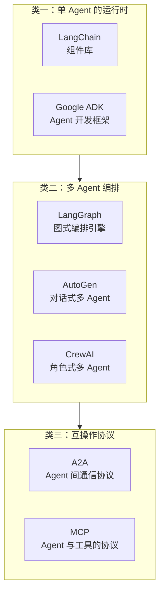
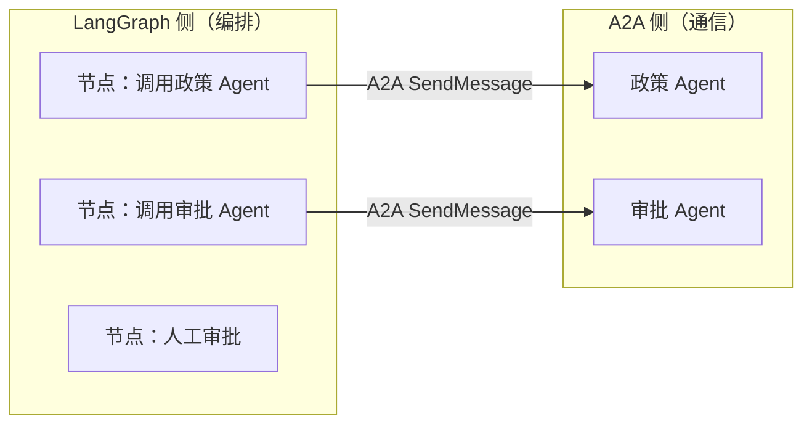
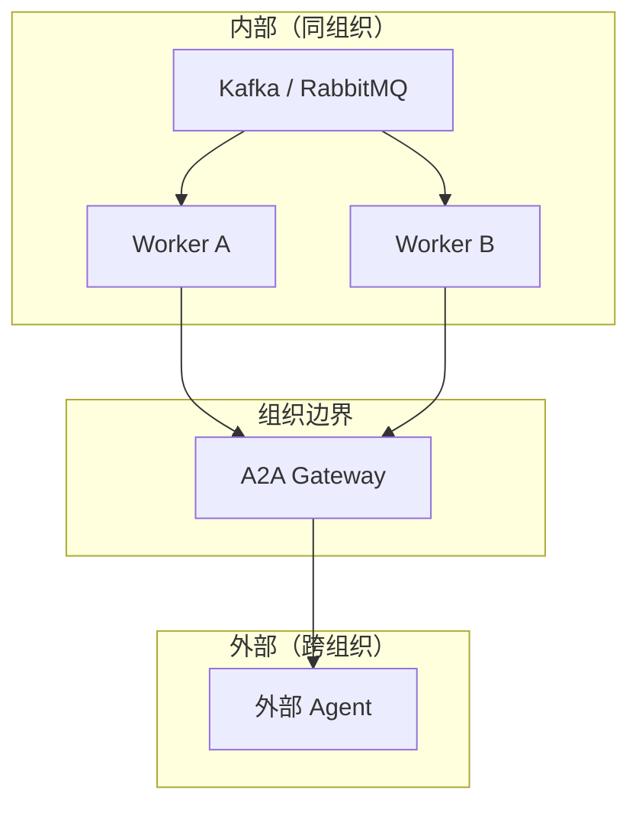
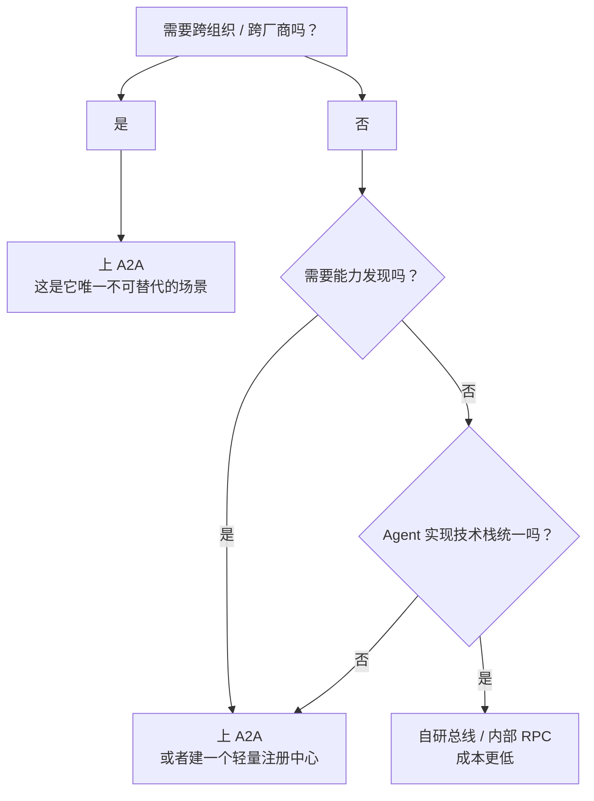
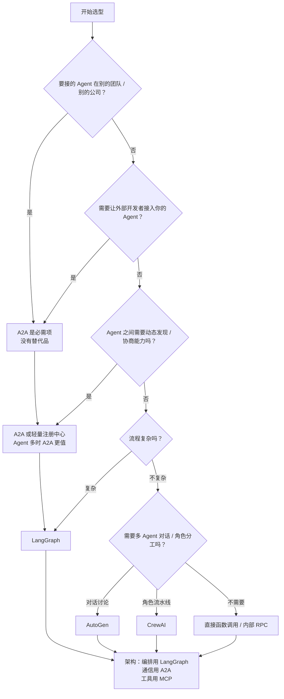

# 对比选型

A2A 常被拿来和 LangGraph、AutoGen、CrewAI 比。这几样东西的定位其实
差别很大，放在一起比容易比错维度。

这一篇先厘清各自的定位，再给出选型表。

## 一、先分清三类东西



**A2A 和 LangGraph / AutoGen / CrewAI 不在同一个维度上。** 前者是协议，
后者是框架（框架的实现里可以用协议）。

这个区分是本篇所有结论的基础。**"用 A2A 还是用 LangGraph"这个问句
本身就有问题**——你可以用 LangGraph 编排，用 A2A 通信。

## 二、四个方案各自的定位

### 2.1 LangGraph：图式编排引擎

**核心抽象**：状态图。开发者定义节点（函数）和边（迁移条件），
框架负责执行、持久化、恢复。

**关键能力**：

| 能力 | 说明 |
| --- | --- |
| 持久执行 | 每步保存检查点，崩溃后从断点恢复 |
| 人在回路 | `interrupt()` 暂停，`Command(resume=...)` 继续 |
| 记忆 | 短期（会话内）+ 长期（跨会话存储） |
| 流式 | 七种 stream mode（values / updates / messages / custom / checkpoints / tasks / debug），token 级 / 步骤级 / 自定义 |
| 并发控制 | 同线程并发可用 `multitask_strategy`（interrupt / rollback / enqueue） |

**它不提供的**：跨组织的服务契约、能力发现、异构 Agent 互操作。

**适合**：单团队内的复杂流程，需要精细控制状态和恢复。

### 2.2 AutoGen：对话式多 Agent（已归档）

::: warning 项目状态
`microsoft/autogen` 仓库已标注 **archived and no longer maintained**，
微软不再提供修复与新特性。新项目应从 **Microsoft Agent Framework** 起步
（同样内置 A2A 与 MCP 支持）。社区延续分支是 **AG2**（`ag2ai/ag2`）。
本节按历史定位介绍，读者请以现状为准。
:::

**核心抽象**：多个 Agent 通过消息互相交流，可以是单聊（`initiate_chat`），
也可以是群聊（`GroupChat`）。

**关键能力**：

| 能力 | 说明 |
| --- | --- |
| 多 Agent 对话 | 群聊 / 嵌套对话 / 代理式对话 |
| 代码执行 | 本地或 Docker 执行器 |
| 工具与模型 | 统一的 `AssistantAgent` 抽象 |
| 人在回路 | `UserProxyAgent` 参与对话 |
| 扩展 | actor 运行时（Core 层），分布式运行时是实验特性 |

**它不提供的**：跨团队的服务契约、能力发现。

**适合**：历史项目里的多 Agent 协作。新项目请评估 Microsoft Agent
Framework 或 AG2。

### 2.3 CrewAI：角色式多 Agent

**核心抽象**：给 Agent 分配"角色"（role / goal / backstory），
分配"任务"（Task），按"流程"（sequential / hierarchical）执行。

**关键能力**：

| 能力 | 说明 |
| --- | --- |
| 角色分工 | 每个 Agent 有明确的身份和目标 |
| 任务委派 | Manager 角色可以委派任务给下属 |
| 流程模式 | 顺序执行 / 层级管理 |
| Flow | 事件驱动的流程编排（更接近 LangGraph 的定位） |
| 工具 | 每个 Agent 可绑定工具 |

**它不提供的**：跨团队的服务契约、能力发现。

**适合**：业务角色清晰、流程相对固定的场景（销售、内容、研究团队）。

### 2.4 A2A：互操作协议

**核心抽象**：Agent Card（能力声明）、Task（工作单元）、Message、
Artifact。

**关键能力**：

| 能力 | 说明 |
| --- | --- |
| 能力发现 | well-known URI、注册中心、卡片签名 |
| 任务生命周期 | 9 态状态机，长任务支持 |
| 模态无关 | 文本 / 文件 / 结构化数据 |
| 三种进度机制 | 轮询 / 流式 / 推送 |
| 三种绑定 | JSON-RPC / gRPC / HTTP+JSON |
| 认证授权 | Agent Card 声明方案 |
| 扩展机制 | 协议级扩展 + 自定义绑定 |

**它不提供的**：执行引擎、编排、共享记忆、工具定义。

**适合**：跨团队、跨组织、跨厂商的 Agent 协作。

## 三、A2A vs LangGraph

### 3.1 它们的关系



**LangGraph 管"先调谁后调谁"，A2A 管"这一跳怎么走"。**

### 3.2 逐项对比

| 维度 | LangGraph | A2A |
| --- | --- | --- |
| **类型** | 编排框架（可执行代码） | 通信协议（规范文档） |
| **核心抽象** | 状态图 / 节点 / 边 | Task / Message / Artifact / Agent Card |
| **能否独立使用** | 能，且很完整 | 能（自己写执行器） |
| **执行引擎** | ✅ 有 | ❌ 没有 |
| **断点续跑** | ✅ 检查点机制 | ⚠️ 需自己实现（Task 持久化） |
| **人在回路** | ✅ `interrupt()` 原生 | ⚠️ 有 `TASK_STATE_INPUT_REQUIRED` 状态，流程编排仍需编排器 |
| **流式** | ✅ 七种 stream mode | ✅ SSE |
| **能力发现** | ❌ | ✅ Agent Card |
| **跨组织** | ❌ | ✅ |
| **跨语言** | ❌（Python / JS 两套） | ✅ 协议与语言无关 |
| **异构框架互通** | ❌ | ✅ |
| **标准错误码** | ❌ 自定义 | ✅ A2A 专属错误码 |
| **多租户** | ❌ | ✅ `tenant` 字段 |
| **数字签名** | ❌ | ✅ JWS |

### 3.3 什么时候用哪个

| 你的处境 | 建议 |
| --- | --- |
| 单团队的复杂流程，Agent 都在自己的代码里 | **LangGraph**，A2A 用不上 |
| 单团队但 Agent 已经是独立服务 | **A2A** 通信 + 简单编排（或 LangGraph） |
| 跨团队协作，需要能力发现 | **A2A** 必需，编排层按需 |
| 要给外部开发者开放平台 | **A2A** 必需 |
| 流程需要严格的状态管理和恢复 | **LangGraph** + A2A 通信 |

**最常见的正确组合就是"LangGraph 编排 + A2A 通信"**：
图里的每个节点内部是一次 A2A 调用，节点之间由图引擎调度。

### 3.4 一个必须澄清的点

**A2A 没有替代 LangGraph 的任何能力。**

A2A 提供了：

- 一次跨边界的委托怎么表达；
- 对方的能力怎么提前知道；
- 长任务怎么跟踪。

LangGraph 提供了：

- 流程的形状（分支、循环、并行）；
- 状态的一致性（检查点、恢复）；
- 人在流程中的位置。

**这四类需求在任何真实系统里都会同时出现。**

## 四、A2A vs AutoGen

> 提醒：AutoGen 已归档（见 2.2）。本节按历史定位做架构层面的对比，
> 新项目请把 AutoGen 一栏换成 Microsoft Agent Framework 或 AG2。

### 4.1 核心差异

| 维度 | AutoGen | A2A |
| --- | --- | --- |
| **类型** | Python/.NET 多 Agent 框架 | 通信协议 |
| **Agent 如何交互** | 在同一进程内通过消息传递 | 通过网络协议，跨进程跨组织 |
| **对话范式** | 中心是"对话"，GroupChat 决定谁下一句说 | 中心是"任务"，状态机决定进展 |
| **谁决定下一个动作** | 模型 / GroupChatManager | 编排器 |
| **能力发现** | ❌ 代码里写死 Agent 列表 | ✅ Agent Card |
| **远程 Agent** | ❌ 本地对象 | ✅ 天然支持 |
| **异构框架** | ❌ 参与者都得是 AutoGen Agent | ✅ 任何实现 A2A 的 Agent |
| **长任务跟踪** | 靠对话轮次 | ✅ Task 状态机 |
| **产物管理** | 消息内容里 | ✅ Artifact 独立对象 |
| **人在回路** | `UserProxyAgent` 参与对话 | ✅ 协议级状态 |

### 4.2 关键区别：对话 vs 任务

这是最本质的差异。

**AutoGen 的核心是"对话"。** 多个 Agent 通过消息来回交流，
GroupChatManager 决定下一轮谁发言。这种范式适合：

- 需要"辩论"和"多角度审视"的场景；
- Agent 数量不多（3–5 个）的探索性任务；
- 研究性质的问题求解。

**A2A 的核心是"任务"。** 请求方把工作委托出去，对方维护一个状态机，
请求方跟踪进展。这种范式适合：

- 跨组织的长任务；
- 有明确交付物的场景；
- 请求方和执行方互不信任（黑盒协作）。

**两者的典型场景几乎不重叠**。把一个简单的两 Agent 对话改造成 A2A，
通常得不偿失；把一个跨组织的审批流用 AutoGen 实现，基本做不成。

### 4.3 能一起用吗

能，而且有意义：

```text
AutoGen 内部：多个专家 Agent 讨论生成方案
     ↓ 讨论出结论
A2A 边界：把结论作为 Artifact 交付给外部
```

一个"研究团队"Agent 内部用 AutoGen 做多角色辩论，
对外暴露成一个符合 A2A 规范的 Agent。对外是清晰的契约，
对内是灵活的实现。

### 4.4 选型建议

| 需求 | 建议 |
| --- | --- |
| 本地多 Agent 辩论 | AutoGen |
| 跨组织的 Agent 协作 | A2A（内部用什么框架都行） |
| 需要能力发现 | A2A |
| 需要接别人的 Agent | A2A |
| 需要多 Agent 对话但都在自己代码里 | AutoGen |
| 需要精细的流程控制 | LangGraph |

## 五、A2A vs CrewAI

### 5.1 核心差异

| 维度 | CrewAI | A2A |
| --- | --- | --- |
| **类型** | 角色式多 Agent 框架 | 通信协议 |
| **核心抽象** | Crew / Agent(role) / Task / Process | Agent Card / Task / Message / Artifact |
| **Agent 的身份** | 硬编码在 Python 类里 | 运行时通过卡片声明 |
| **如何组装** | `crew = Crew(agents=[...], tasks=[...])` | 运行时通过卡片发现 |
| **流程** | 固定在代码里（sequential / hierarchical） | 由编排器决定 |
| **角色委派** | Manager 委派给下属 | 任意 Agent 可以发消息给任意 Agent |
| **能力发现** | ❌ | ✅ |
| **远程 Agent** | ❌ | ✅ |
| **产物** | 任务输出（字符串/结构体） | ✅ Artifact，可含文件 |
| **状态机** | 流程隐式 | ✅ 显式 9 态 |

### 5.2 关键区别：静态组装 vs 运行时发现

**CrewAI 的组装是静态的。** 你在代码里写死了有哪些 Agent：

```python
researcher = Agent(role="研究员", goal="...", backstory="...")
writer = Agent(role="作者", goal="...", backstory="...")

crew = Crew(
    agents=[researcher, writer],
    tasks=[research_task, write_task],
    process=Process.sequential,
)
```

**A2A 的组装是动态的。** 客户端运行时读卡片、筛选技能、选接口：

```python
card = await fetch_card(agent_url)
skill = pick_skill(card, query=question)
result = await call(skill, question)
```

这带来两种截然不同的架构：

| | CrewAI 式 | A2A 式 |
| --- | --- | --- |
| Agent 变更的影响 | 改代码、重新部署 | 换一个 URL 就行 |
| 新 Agent 接入 | 改 Crew 定义 | 更新注册中心 |
| 跨团队 | 要把对方的代码拉进来 | 对方提供一个 URL |

### 5.3 选型建议

| 需求 | 建议 |
| --- | --- |
| 内部固定角色的内容生产流水线 | CrewAI |
| 需要根据问题动态选择执行者 | A2A |
| 要对接外部团队 / 外部供应商的 Agent | A2A |
| 要给平台用户开放 Agent 接入 | A2A |
| 角色定义需要随任务变化（角色扮演、模拟） | CrewAI |

**CrewAI 的角色抽象是很实用的。** "给 Agent 一个 role / goal /
backstory"这种写法对 LLM 效果确实有正面影响。
A2A 的 `skills[].description` 起的是类似作用，
但它是**给外部路由看的**。喂给模型的是另一套东西，两者用途不同。

**实践中两者可以配合**：CrewAI 在内部定义角色团队，
对外把整体封装成一个 A2A Agent。

## 六、A2A vs 自研消息总线

这是最实际的一类对比：很多团队已经有一条 Kafka / RabbitMQ 消息总线，
为什么还要上 A2A？

### 6.1 逐项对比

| 维度 | 自研消息总线 | A2A |
| --- | --- | --- |
| **传输** | Kafka / RabbitMQ / Pulsar | HTTP(S) + JSON-RPC / gRPC |
| **消息体规范** | 自己定 | 标准化（Task/Message/Artifact） |
| **能力发现** | 自己维护服务注册表 | ✅ Agent Card |
| **任务状态机** | 自己设计 | ✅ 标准化 9 态 |
| **长任务进度** | 自己造（进度条字段？状态 topic？） | ✅ 三种标准机制 |
| **产物交付** | 自己造 | ✅ Artifact |
| **鉴权** | 消息级 ACL | ✅ 复用 Web 安全 |
| **跨组织** | 很难（网络、证书、语义都要协调） | ✅ 有明确规范 |
| **异构实现** | 双方要按你的内部文档写 | ✅ 对方实现 A2A 就行 |
| **上手成本** | 低（已有基础设施） | 中 |
| **改造已有系统** | 容易 | 难 |

### 6.2 自研总线其实也很常见且合理

**如果你的场景全部在内部，自研总线是很好的选择。** 原因：

1. **消息总线能提供的语义比 A2A 丰富。** Kafka 的分区、事务、
   消费者组、重试主题、死信主题，这些 A2A 都不提供。
2. **A2A 的任务模型和 Kafka 的消息模型不匹配。** Kafka 是"消息流"，
   A2A 是"有状态任务"。硬套的话，要么在消息里塞状态字段
   （等于自己实现 A2A），要么用 Kafka 搭一套任务协议（也在自己实现 A2A）。
3. **已有系统的调用链深度耦合在总线上。** 换协议成本很高。

### 6.3 A2A 的增量价值在哪

自研总线给不了的四样东西：

**第一，跨组织的可行性。** 消息总线要跨公司，需要协调网络连通、
证书体系、消息格式、语义约定。A2A 把这些一次性标准化了。

**第二，能力发现的标准化。** 自研方案里，"谁能做什么"这件事
散落在各个服务注册表、配置中心、文档里。A2A 把它统一成一张卡片。

**第三，异构框架互通。** 如果你的团队用 LangGraph、另一个团队用
AutoGen、供应商用自研框架，A2A 是这几套框架之间最通用的一种互操作约定。
**自研总线是"我们的框架的互操作"**，A2A 是"所有框架的互操作"。

**第四，工具与 Agent 的边界清晰。** MCP 管工具，A2A 管 Agent，
这个划分让生态不会混在一起。

### 6.4 现实答案：两者共存

**实践中最常见的架构是共存**：



- **内部**：用消息总线。性能好、语义丰富、改造代价小。
- **外部**：用 A2A。有标准契约、能能力发现、跨组织可行。
- **Gateway 负责翻译**：从内部总线的消息，转成 A2A 的 Task + Message。

**这正是 A2A 架构里 MessageBus 层通常在 Agent 内部的原因**
（见[系统架构](/a2a/architecture#四、messagebus-层)）。

### 6.5 决策树



## 七、多方案组合速查

### 7.1 常见组合

| 场景 | 组合 |
| --- | --- |
| 企业内部复杂流程 | LangGraph + 内部函数调用 |
| 企业内部多服务 Agent | LangGraph + A2A（内部 JSON-RPC） |
| 跨组织 Agent 平台 | A2A（对外）+ LangGraph（对内编排） |
| 多角色内容生产 | CrewAI + 对外包装成 A2A Agent |
| 研究型多 Agent 辩论 | AutoGen + 对外包装成 A2A Agent |
| Agent 接工具 | MCP（无论哪种编排框架） |
| 已有 Kafka 架构 + 新增外部协作 | Kafka（内部）+ A2A（外部） |

### 7.2 选型矩阵

| 需求 | A2A | LangGraph | AutoGen | CrewAI | 自研总线 |
| --- | --- | --- | --- | --- | --- |
| 跨组织协作 | ✅ | ❌ | ❌ | ❌ | ⚠️ |
| 能力发现 | ✅ | ❌ | ❌ | ❌ | ⚠️ |
| 流程精细控制 | ❌ | ✅ | ⚠️ | ⚠️ | ⚠️ |
| 断点续跑 | ⚠️ | ✅ | ❌ | ❌ | ✅ |
| 人在回路 | ⚠️ | ✅ | ✅ | ✅ | ⚠️ |
| 多 Agent 对话 | ❌ | ⚠️ | ✅ | ✅ | ⚠️ |
| 角色定义 | ❌ | ❌ | ⚠️ | ✅ | ❌ |
| 长任务跟踪 | ✅ | ✅ | ⚠️ | ⚠️ | ⚠️ |
| 异构框架互通 | ✅ | ❌ | ❌ | ❌ | ❌ |
| 消息语义丰富 | ❌ | ❌ | ❌ | ❌ | ✅ |
| 上手成本 | 中 | 中 | 中 | 低 | 低（已有） |

**看这张表的正确方式**：A2A 那一列的 ✅ 全落在"跨边界"一侧
（跨组织协作、能力发现、长任务跟踪、异构框架互通），而流程精细控制、
多 Agent 对话、角色定义、消息语义丰富它一律不做。
这说明 A2A 的价值非常集中——它解决的就是"跨边界"这一个问题。
选型时先看这个问题在不在你的场景里。

## 八、A2A 与 MCP 的边界

最后再说一次这个最常被问的问题。

| | A2A | MCP |
| --- | --- | --- |
| **连接方向** | 横向：Agent ↔ Agent | 纵向：Agent ↔ 工具 |
| **参与者自主性** | 高（有状态、多轮、决策） | 低（工具式调用） |
| **典型交互** | 委托一个任务，跟踪进展 | 调一个函数，拿结果 |
| **作用域** | 跨进程、跨网络、跨组织 | 通常同进程或同服务 |
| **状态** | 任务有生命周期 | 一般无状态 |
| **发现机制** | Agent Card | 工具列表 / resources / prompts |

**为什么需要两个协议**：

- 工具是**确定性的**——输入输出固定，快，无状态。
- Agent 是**自主的**——需要推理，可能多轮，状态复杂。

用一套协议表达两者，会把工具的表达方式搞复杂、把 Agent 的表达方式搞简单。
分开之后各自都能做到最好。

**最典型的组合**：

```text
┌─────────────────────────────────────┐
│  报销 Agent                          │
│  对外：A2A（能力声明 + 任务）         │
│  对内：MCP（OCR 工具、政策检索工具）    │
│  对内：A2A（调政策 Agent）            │
└─────────────────────────────────────┘
```

一个 Agent 可以同时是 A2A 的 Server 和 Client，也可以同时通过 MCP
访问工具。两个协议互不干扰。

## 九、选型决策树



## 十、小结

- A2A 是**协议**，LangGraph / AutoGen / CrewAI 是**框架**。
  "二选一"这个问法本身有问题——框架内部用协议是最常见的组合。
- A2A vs LangGraph：管通信 vs 管流程，可以完全配合。
- A2A vs AutoGen：任务委托 vs 对话辩论，场景几乎不重叠。
- A2A vs CrewAI：运行时动态发现 vs 静态代码组装。
- A2A vs 自研总线：跨组织、异构互通上 A2A 有增量价值；
  内部场景自研总线成本更低。现实中两者共存，Gateway 做翻译。
- A2A 与 MCP：横向 vs 纵向，Agent 协作 vs 工具调用，互补。
- 看选型矩阵时记住：A2A 的价值高度集中在"跨边界"这一个维度上。
  这个问题不在你的场景里，A2A 就是过度设计。

下一篇：[收尾：未来方向与资源清单](/a2a/future)。
