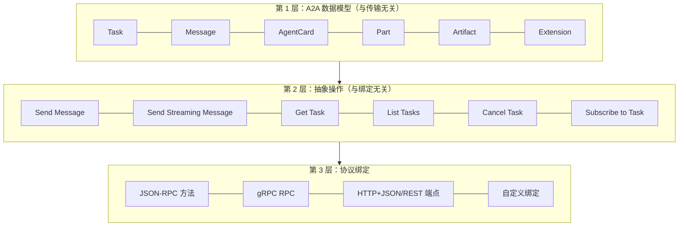
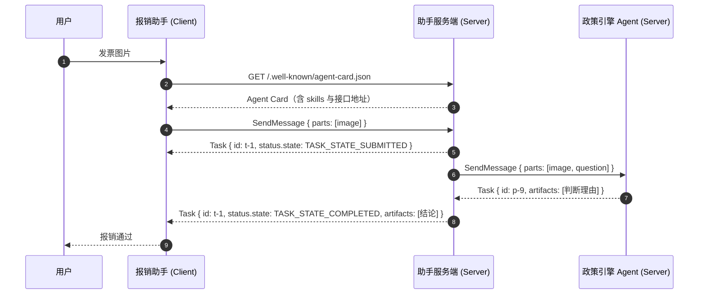
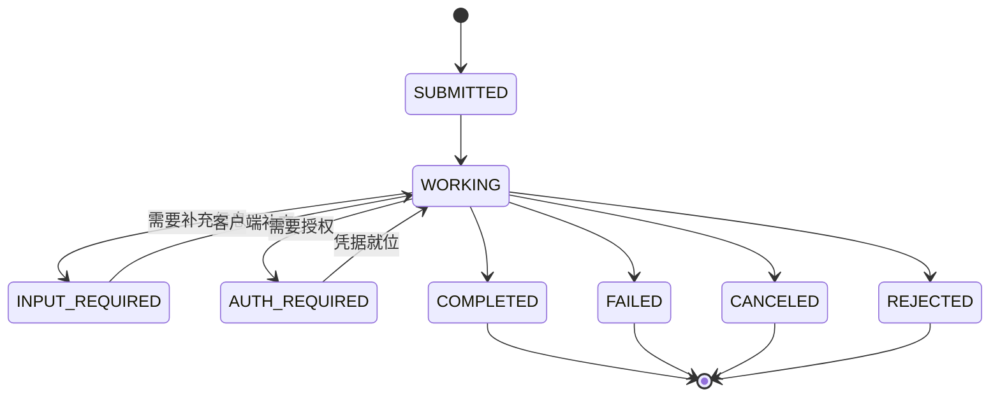
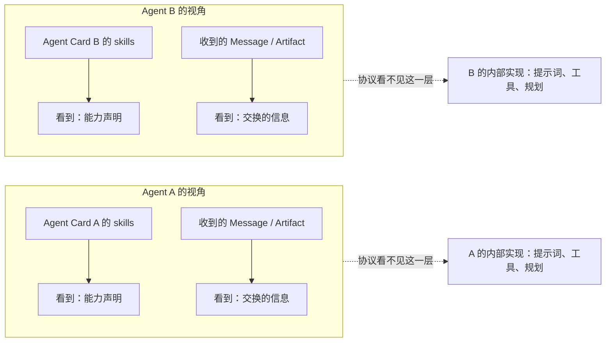

# 核心认知：什么是 Agent-to-Agent 协议

上一篇讲清了 A2A 为什么存在。这一篇把协议本身拆开看：**它由哪几层组成、
每个核心角色负责什么、能力边界落在哪里。**

读完应该能回答一个问题：给出一个 A2A 请求，接收方靠什么知道该干什么、
做完之后结果应该长什么样。

## 一、协议的三层结构

A2A v1.0 的规范组织成一个清晰的三层栈。这是理解整个协议最省力的切入点。



这个分层的意义：

- **语义只写一遍**。"发一条消息"这个操作在三层里只定义一次
  （`Send Message`），绑定层只负责把它翻译成具体的方法名、端点或 RPC 名。
- **加新绑定不用改数据模型**。想把 A2A 接到一条自定义传输上，定义一套
  字段映射即可，Task / Message 的形状保持不变。
- **开发者可以分层思考**。设计协议扩展时动第 1、2 层；对接某家特定框架的
  现有实现时只看第 3 层。

第 1 层的权威定义是 `specification/a2a.proto`（Protocol Buffers）。规范文档、
JSON Schema、各语言 SDK 全部由它生成——这是 v1.0 相对 v0.3 的一处重要
改进，规范里称为"单一权威来源"。

### 1.1 第 2 层：11 个核心操作

| 操作 | 作用 | 必选性 |
| --- | --- | --- |
| Send Message | 发消息，发起或继续一个任务 | 必选 |
| Send Streaming Message | 发消息并订阅实时更新 | 必选（`capabilities.streaming` 为 false 或缺失时必须返回 `UnsupportedOperationError`） |
| Get Task | 查任务当前状态 | 必选 |
| List Tasks | 按条件列出任务（v0.3 只在 gRPC / REST 上有，v1.0 补齐 JSON-RPC） | 必选 |
| Cancel Task | 取消进行中的任务 | 必选 |
| Subscribe to Task | 订阅已有任务的更新 | 必选（同样受 `capabilities.streaming` 约束） |
| Create Push Notification Config | 注册 webhook | 可选（受 capability 约束） |
| Get Push Notification Config | 读 webhook 配置 | 同上 |
| List Push Notification Configs | 列 webhook 配置 | 同上 |
| Delete Push Notification Config | 删 webhook 配置 | 同上 |
| Get Extended Agent Card | 取鉴权后的扩展卡片 | 可选（受 capability 约束） |

另外"读公开 Agent Card"不走 JSON-RPC，走 well-known URI。

### 1.2 第 3 层：三种官方绑定

| 绑定 | 方法名形态 | 典型场景 |
| --- | --- | --- |
| **JSON-RPC 2.0 over HTTP** | `SendMessage`、`GetTask` | 最通用，跨语言、跨厂商的首选 |
| **gRPC** | 同名的 RPC | 内部服务间、需要强类型与高性能 |
| **HTTP+JSON / REST** | `POST /message:send`、`GET /tasks/{id}` | 与现有 REST 网关风格融合 |

三种绑定的**功能等价性**是规范的要求：任何 A2A 能力，在三种绑定下的
语义必须一致。错误类型到各绑定错误码的映射也是强制的（见下表节选）。

| A2A 错误 | JSON-RPC | gRPC | HTTP |
| --- | --- | --- | --- |
| `TaskNotFoundError` | `-32001` | `NOT_FOUND` | 404 |
| `TaskNotCancelableError` | `-32002` | `FAILED_PRECONDITION` | 400 |
| `PushNotificationNotSupportedError` | `-32003` | `FAILED_PRECONDITION` | 400 |
| `UnsupportedOperationError` | `-32004` | `FAILED_PRECONDITION` | 400 |
| `ContentTypeNotSupportedError` | `-32005` | `INVALID_ARGUMENT` | 400 |
| `VersionNotSupportedError` | `-32009` | `FAILED_PRECONDITION` | 400 |

## 二、六个核心角色

A2A 的词汇表很短，六个概念撑起整个协议。

| 角色 | 是什么 | 关键点 |
| --- | --- | --- |
| **A2A Client** | 发起请求的应用或智能体 | 可以是普通前端，也可以是另一个 Agent |
| **A2A Server / Remote Agent** | 暴露 A2A 端点、处理任务的智能体 | 内部实现完全自由 |
| **Agent Card** | 服务端发布的 JSON 元数据 | 声明身份、能力、端点、鉴权要求 |
| **Message** | 客户端与服务端之间的一次通信轮次 | 有角色（`ROLE_USER` / `ROLE_AGENT`），含若干 Part |
| **Task** | 有状态的工作单元 | 有唯一 ID，走状态机，产出 Artifact |
| **Artifact** | 任务的产出物 | 文本、文件、结构化数据 |

再加一个辅助角色：

| 角色 | 是什么 |
| --- | --- |
| **Part** | Message / Artifact 里内容的最小单位（文本、文件引用、内联字节、结构化数据） |

### 2.1 一个把六个角色串起来的场景

用户对"报销助手"说"帮我报销这张发票"：



这个图里出现了四次"角色切换"，每一次都对应协议里的一个定义：

| 时刻 | 协议要素 |
| --- | --- |
| 读卡片 | Agent Card 规定了它该长什么样、放在哪 |
| 首次发消息 | `SendMessage` 操作 + `Message` 数据模型 |
| 拿到 t-1 | `Task` 数据模型 + 状态机 |
| 助手调政策引擎 | 助手此时是 Client，政策引擎是 Server——**双方角色可互换** |
| 拿到结论 | `Artifact` 数据模型 |

最后一行值得展开：**Client 和 Server 是相对角色。**
同一个 Agent 在不同链路上扮演不同角色。
助手在这条链路上是 Client，在接收用户请求时又是 Server。这种对称性
是"Agent-to-Agent"这个命名最实质的含义。

### 2.2 关于 Agent Card 的额外说明

Agent Card 是整个协议的**入口**，因为没有它客户端连门都敲不开。它在
v1.0 里承担四件事：

1. **身份**：我是谁，什么版本，谁维护的。
2. **能力**：我会哪些技能，每个技能收什么格式、产什么格式。
3. **接入**：我支持哪些协议绑定，地址是哪个，协议版本是哪个。
4. **安全**：我需要什么凭据才能访问我。

一份最小的 Agent Card 长这样：

```json
{
  "name": "报销助手",
  "description": "接收发票并判断是否合规，产出报销结论。",
  "supportedInterfaces": [
    {
      "url": "https://expense.example.com/a2a",
      "protocolBinding": "JSONRPC",
      "protocolVersion": "1.0"
    }
  ],
  "version": "1.0.0",
  "capabilities": {
    "streaming": true,
    "pushNotifications": false
  },
  "defaultInputModes": ["text/plain", "image/png"],
  "defaultOutputModes": ["text/plain", "application/json"],
  "skills": [
    {
      "id": "expense-review",
      "name": "发票合规审核",
      "description": "识别发票信息，对照差旅政策给出合规结论与理由。",
      "tags": ["expense", "invoice", "compliance"]
    }
  ]
}
```

详细字段见[核心模型详解](/a2a/data-model)。

## 三、A2A 能做什么

把规范里的能力点摊开，逐条对应到工程含义。

### 3.1 能力发现与自动路由

客户端拿到 Agent Card 后，可以：

- 按 `tags` 筛选技能（"谁能处理差旅报销"）；
- 按 `inputModes` / `outputModes` 判断格式是否兼容（"它能吃 PDF 吗"）；
- 按 `capabilities` 判断走不走流式（"它支持 SSE 吗"）；
- 按 `supportedInterfaces` 选择协议绑定（"它有 gRPC 端点吗"）。

这四问构成了一套**无需人工配置的路由决策**。在一个有几十个 Agent 的
企业内部平台上，这套机制就是"能力注册中心"的基础。

### 3.2 长任务与进度可见

规范内置三种进度获取机制，可以按场景混用：

| 机制 | 客户端要做什么 | 延迟 | 适合 |
| --- | --- | --- | --- |
| **轮询** `GetTask` | 定时调接口 | 高 | 简单集成、客户端在严格防火墙后 |
| **流式** `SendStreamingMessage` / `SubscribeToTask` | 保持一条 SSE 连接 | 低 | 交互式应用、实时看板 |
| **推送** webhook | 什么都不用做 | 低 | 服务器到服务器、客户端会断线 |

### 3.3 人在回路

A2A 有一个专门的状态叫 `TASK_STATE_INPUT_REQUIRED`——任务在等用户补充
信息时挂起，等到了再继续，不会超时死掉。配套的还有
`TASK_STATE_AUTH_REQUIRED`——任务在等授权。

这两个"中断态"是 A2A 相对"一问一答"式 RPC 的显著特征：



注意 `INPUT_REQUIRED` 和 `AUTH_REQUIRED` 都是**可恢复的**中断态，
流程可以继续往下走；`COMPLETED` / `FAILED` / `CANCELED` / `REJECTED`
是终态，进了就不出来。

协议给的是"挂起—恢复"这套契约：挂起时把要什么写进 `status.message`，
恢复时带着同一个 `taskId` 再发一条消息。审批页面、通知谁、审批结果怎么
落库，这些**流程由编排层实现**（见 4.2 的对照表）。同一进程内编排器自己
就握着状态，A2A 这层契约用不上；跨组织、跨网络、对方只能看到协议时，
它才是刚需。

### 3.4 模态无关

Part 统一了四种内容形态：

| 形态 | 字段 | 用在哪 |
| --- | --- | --- |
| 文本 | `text` | 自然语言、结构化文本 |
| 文件引用 | `url` | 大文件、图片、文档，指向对象存储或预签名 URL |
| 内联字节 | `raw` | 小文件，base64 编码内联 |
| 结构化数据 | `data` | 任意 JSON 值，字段级契约 |

这个统一让"传一张发票图片"和"传一段结构化参数"用同一套代码处理，
也让 Agent 的输出可以被下游系统直接消费。

### 3.5 端到端鉴权

A2A 把智能体当作**普通的企业应用**对待，直接复用 Web 安全实践：
Agent Card 声明 `securitySchemes`，客户端按声明去拿凭据，每个请求带上。

支持的安全方案包括 API Key、HTTP Auth、OAuth 2.0、OpenID Connect、
双向 TLS。OAuth 2.0 在 v1.0 里做了现代化处理：implicit 流与 password 流
被标记为 deprecated（`a2a.proto` 里保留了定义并加了 `deprecated = true`），
新增 Device Code 流（RFC 8628），给授权码流加了 `pkceRequired` 开关
（RFC 7636）。

## 四、A2A 不做什么（边界重述）

上一篇已经划过一次，这里从协议规范的角度再看一遍，因为这是最容易
踩的坑。

### 4.1 协议不提供执行能力

A2A 是一份规范文档。装完 A2A SDK 之后你得到的是：

- 数据模型类（`Task`、`Message`、`Artifact`……）
- 一个请求处理器骨架
- 一个把骨架挂到 Web 框架上的应用对象

**任务怎么执行、状态怎么流转、产物怎么产生，全部是你的代码。**
SDK 给你的 `AgentExecutor` 接口就两个方法：`execute` 和 `cancel`。

### 4.2 协议不提供编排

规范里找不到"并行分支""条件路由""重试补偿""超时熔断"这些词，
因为它们不在协议的管辖范围。

| 你想要的 | A2A 提供 | 你要自己做的 |
| --- | --- | --- |
| 把活交给别的 Agent | ✅ `SendMessage` | 交给谁？顺序如何？ |
| 跟踪长任务 | ✅ `Task` + 三种进度机制 | 什么算失败？要不要重试？ |
| 并行跑多个子任务 | ❌ | 扇出、汇聚、取消传播 |
| 失败补偿 | ❌ | Saga / 补偿事务 |
| 人审批 | ✅ `INPUT_REQUIRED` 状态 | 审批页面、权限、通知 |
| 工具调用 | ❌ | MCP / 函数调用 |
| 共享记忆 | ❌ | 你的存储 |

### 4.3 协议不规定内部实现

规范反复强调 **Opaque Execution（不透明执行）**：

> 智能体基于**声明的能力**和**交换的信息**进行协作，
> 无需共享它们的内部思考、计划或工具实现。

这有三层含义：

1. 你无需暴露自己的提示词、规划过程、工具清单。
2. 对方也不需要暴露。对方只需要在 Agent Card 里声明能力。
3. 跨组织协作时这是刚需——供应商 Agent 不可能把实现给你看。

代价是：**A2A 只能做"黑盒协作"**。如果两个 Agent 共享同一份记忆、
需要精细的互相调用顺序、或者需要在同一次推理里来回拉扯，A2A 的抽象
就太粗了。这时候应该用进程内调用。

### 4.4 协议不承载传输

JSON-RPC over HTTP 是**当前最主流**的绑定。gRPC 和
HTTP+JSON/REST 同样是官方绑定。规范还定义了**自定义绑定的准入要求**
（见第 12 章的扩展治理）。

这一点直接影响部署形态：如果你的 Agent 在 gRPC 服务网格里，A2A 完全
可以跑在 gRPC 上；如果你的组织有强制的 REST 网关规范，A2A 也有对应的
REST 绑定。

### 4.5 协议不定义"什么是一个智能体"

这是最容易被误解的一条。规范对 Agent 内部是什么样毫无约束：

```text
┌──────────────────────────────────────────┐
│  A2A 服务端（外壳）                        │
│  ┌────────────────────────────────────┐  │
│  │  你的智能体（内容）                   │  │
│  │  · 规则引擎                         │  │
│  │  · LLM + 工具                       │  │
│  │  · 遗留的 SOAP 服务                  │  │
│  │  · 纯查表代码                        │  │
│  │  · 什么都没干，只是把输入换个格式       │  │
│  └────────────────────────────────────┘  │
└──────────────────────────────────────────┘
```

从协议视角看，第二个框里是什么完全无所谓。**"Echo Agent"（原样返回
输入）是一个完全合规的 A2A 服务端。** 这是 A2A 能在如此异构的生态里
落地的原因，也是它容易被滥用的地方——光实现协议不构成价值。

## 五、协议的"不透明执行"如何落地

这一节单独展开，因为它是 A2A 与"框架化多 Agent"最本质的区别。

### 5.1 协作双方各自看到什么



协议里能看到的只有两块：**能力声明**（Agent Card）与**交换的信息**
（Message / Artifact）。中间的虚线部分协议完全不看。

### 5.2 这个设计的三个直接后果

**后果一：换实现不影响对方。** 你把内部从规则引擎换成 LLM，对方的
Agent Card 一个字都不用改。这在"每个团队独立演进"的组织里极其重要。

**后果二：无法做细粒度协同优化。** 双方无法约定"你用哪种提示词、
我给你喂什么中间结果"这类只有紧耦合才能做的事。**代价换来的是
松耦合。**

**后果三：调试链路变长。** 出问题时你看到的是"对方说它完成了"，
看不到"对方第 3 步用错了工具"。所以 A2A 生态里，**可观测性必须
由平台补齐**——这是[生产落地](/a2a/production)那章的核心议题。

## 六、协议演进留下的痕迹

读 v1.0 规范时会发现几处"历史包袱"的痕迹，值得知道，免得以为是设计缺陷：

| 痕迹 | 情况 |
| --- | --- |
| JSON-RPC 基础模板写的是 `"method": "category/action"` | JSON-RPC 官方示例的通用写法，A2A 实际用 PascalCase |
| 部分示例仍用 `application/problem+json` | 早期基于 RFC 9457 的错误模型，v1.0 正式改用 `google.rpc.Status` |
| 规范第 3.2.5 / 3.2.6 章节号引用不一致 | IANA 注册章节（§14.2）把服务参数指向 §3.2.5（实际是 §3.2.6 Service Parameters） |
| 字段名 `mediaType`（v1.0）与历史 `mimeType` 并存 | v1.0 统一为 `mediaType` |
| 扩展声明示例里的 `protocolVersion: "0.3"` | 写于 v0.3 时期，v1.0 应为 `"1.0"` |
| `SubscribeToTask` 的 REST 方法 | §5.3 / §11.3.2 写 `POST`，`a2a.proto` 的 `google.api.http` 标注是 `GET` |

读规范时遇到这些，按 v1.0 的正式条款理解即可。完整的 v0.3 → v1.0
破坏性变更清单见[避坑专题](/a2a/pitfalls)。

## 七、小结

- A2A 规范分三层：数据模型 → 抽象操作 → 协议绑定。语义只写一遍。
- 六个核心角色：Client、Server、Agent Card、Task、Message、Artifact（外加 Part）。
- Client / Server 是相对角色，一个 Agent 在不同链路上可以扮演不同角色。
- 能力边界：**协议管通信，编排管分工**。A2A 不提供执行引擎、不提供编排、
  不管工具、不管记忆、不看内部实现。
- 值得用的场景特征：跨组织协作、长任务可见、人在回路、生态规模效应。
- 读规范时注意 v0.3 遗留痕迹，以 v1.0 条款为准。

下一篇：[核心模型详解](/a2a/data-model)——把 Task、Message、Artifact、
Agent Card 四件套彻底拆开。
