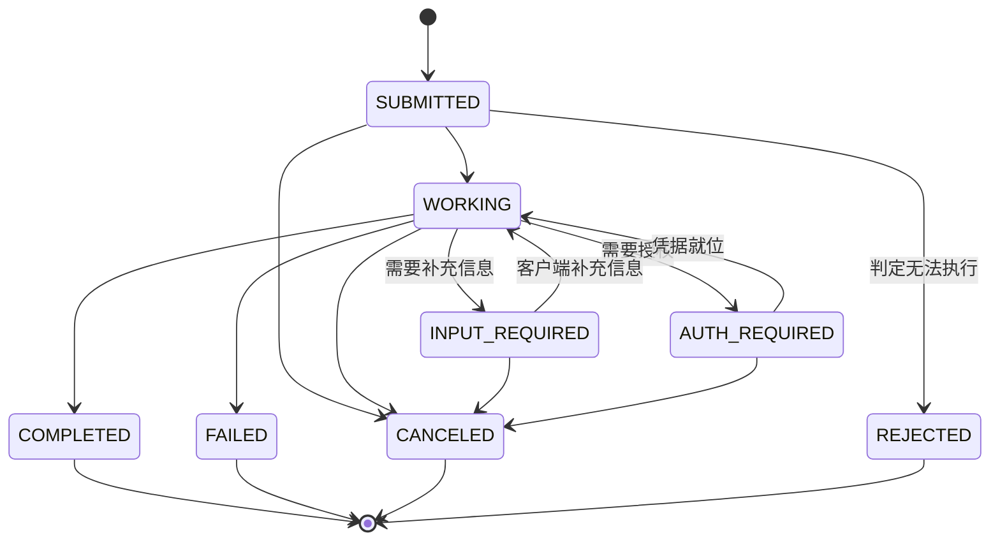
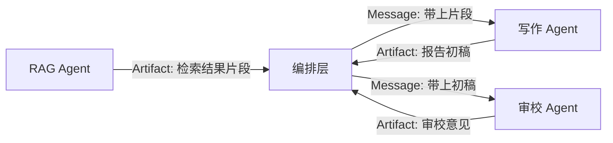
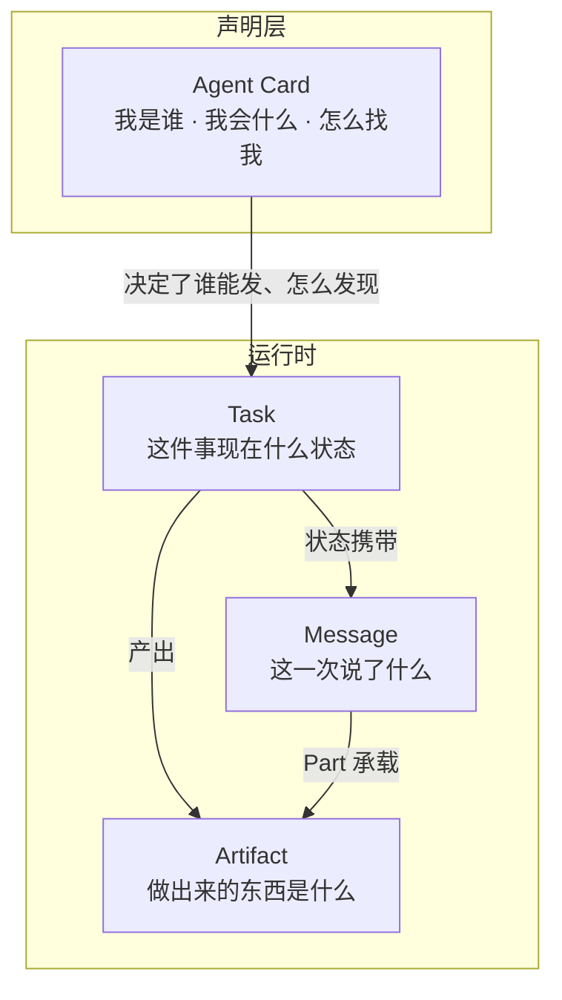

# 核心模型详解

A2A 规范第 4 章叫"Protocol Data Model"。这一章是整个协议的骨架，
后面所有接口、时序、架构都建立在这里。

四个主角：**Task**（工作单元）、**Message**（交流）、**Artifact**（产出）、
**Agent Card**（自我介绍），一个配角：**Part**（内容单元）。

## 一、Part：内容的最小单位

先讲 Part，因为它被 Message 和 Artifact 共用。

### 1.1 统一结构

v1.0 把 v0.3 里的 `TextPart` / `FilePart` / `DataPart` 三种类型合并成了
**一个 `Part`**，用"哪个字段存在"来区分内容形态（ProtoJSON 的 `oneof` 风格）：

| 形态 | 字段 | JSON 示例 |
| --- | --- | --- |
| 文本 | `text` | `{ "text": "分析结果如下" }` |
| 文件引用 | `url` | `{ "url": "https://s3/x.png", "filename": "x.png", "mediaType": "image/png" }` |
| 内联字节 | `raw` | `{ "raw": "iVBORw0KGgo...", "filename": "x.png", "mediaType": "image/png" }` |
| 结构化数据 | `data` | `{ "data": { "total": 42 }, "mediaType": "application/json" }` |

**一个 Part 必须且只能包含 `text` / `raw` / `url` / `data` 中的一个。**

另外三个通用字段：

| 字段 | 类型 | 说明 |
| --- | --- | --- |
| `mediaType` | string | MIME 类型，如 `text/plain`、`application/json`、`image/png` |
| `filename` | string | 文件名 |
| `metadata` | object | 附加元数据 |

### 1.2 v0.3 → v1.0 的迁移

这是 v1.0 影响面最大的破坏性变更，代码里到处都是判断：

```python
# v0.3
if part["kind"] == "text":
    text = part["text"]
elif part["kind"] == "file":
    uri = part["file"]["fileWithUri"]
elif part["kind"] == "data":
    payload = part["data"]

# v1.0
if "text" in part:
    text = part["text"]
elif "url" in part:
    uri = part["url"]
elif "raw" in part:
    blob = base64.b64decode(part["raw"])
elif "data" in part:
    payload = part["data"]
```

字段对应关系：

| v0.3 | v1.0 |
| --- | --- |
| `kind: "text"` | 有 `text` 字段 |
| `kind: "file"` + `file.fileWithUri` | 有 `url` 字段 |
| `kind: "file"` + `file.fileWithBytes` | 有 `raw` 字段 |
| `kind: "data"` | 有 `data` 字段 |
| `file.mimeType` | `mediaType`（平铺到 Part 顶层） |
| `file.name` | `filename`（平铺到 Part 顶层） |

### 1.3 选 `url` 还是 `raw`

| 场景 | 选择 | 理由 |
| --- | --- | --- |
| 文件 < 几十 KB | `raw` | 一次往返搞定，无需额外存储 |
| 文件较大 | `url` | 避免消息体膨胀；可指向对象存储的预签名 URL |
| 外部系统只给链接 | `url` | 天然匹配 |
| 需要落地到本地再处理 | `url` 拉下来后转存 | 避免在消息里搬大文件 |

**别把 50MB 的 PDF base64 塞进 `raw`。** 消息体会先撑爆内存，再撑爆
网关的 body size 限制，最后撑爆对端的解析器。

## 二、Task：有状态的工作单元

### 2.1 字段

| 字段 | 类型 | 必填 | 说明 |
| --- | --- | --- | --- |
| `id` | string | 是 | 任务唯一 ID，服务端生成 |
| `contextId` | string | 否 | 上下文分组 ID，服务端生成 |
| `status` | TaskStatus | 是 | 当前状态 |
| `artifacts` | Artifact[] | 否 | 产出的产物列表 |
| `history` | Message[] | 否 | 交互历史 |
| `metadata` | object | 否 | 自定义元数据 |

`TaskStatus` 的字段：

| 字段 | 类型 | 必填 | 说明 |
| --- | --- | --- | --- |
| `state` | TaskState | 是 | 状态枚举 |
| `message` | Message | 否 | 与该状态相关的说明消息 |
| `timestamp` | string | 否 | ISO 8601 UTC，毫秒精度 |

### 2.2 状态机

v1.0 的 `TaskState` 有 9 个值：

| 枚举值 | v0.3 对应 | 含义 | 类别 |
| --- | --- | --- | --- |
| `TASK_STATE_UNSPECIFIED` | — | 未知或不确定状态 | — |
| `TASK_STATE_SUBMITTED` | `submitted` | 已提交并被受理 | 进行中 |
| `TASK_STATE_WORKING` | `working` | 正在处理 | 进行中 |
| `TASK_STATE_INPUT_REQUIRED` | `input-required` | 等待用户补充信息 | **中断态** |
| `TASK_STATE_AUTH_REQUIRED` | `auth-required` | 等待授权 | **中断态** |
| `TASK_STATE_COMPLETED` | `completed` | 成功结束 | **终态** |
| `TASK_STATE_FAILED` | `failed` | 出错结束 | **终态** |
| `TASK_STATE_CANCELED` | `canceled` | 被取消 | **终态** |
| `TASK_STATE_REJECTED` | `rejected` | Agent 拒绝执行 | **终态** |

下面的状态图与文字里为了排版一律用短名（`WORKING`、`INPUT_REQUIRED`…），
线上传输的字段值始终是上面这组 `TASK_STATE_*`。

典型迁移路径：



### 2.3 四个终态的区别

`COMPLETED` / `FAILED` / `CANCELED` / `REJECTED` 都是终态，语义上有明确分工：

| 终态 | 谁做的决定 | 语义 | 客户端该怎么办 |
| --- | --- | --- | --- |
| `COMPLETED` | 系统 | 成功 | 读 artifacts |
| `FAILED` | 系统 | 执行出错 | 读 `status.message` 里的原因，决定重试 |
| `CANCELED` | 客户端（或系统） | 被取消 | 结束等待 |
| `REJECTED` | Agent | 主动拒绝执行 | 读原因，**不要盲目重试** |

`REJECTED` 值得单独说：它表示 Agent 判断"这个任务我不会做 / 不该做"。
可能原因是超出能力范围、违反策略、参数明显不合法。**客户端遇到
`REJECTED` 时重试是没有意义的**，正确做法是读 `status.message` 里的
说明，改变请求或者换一条路。

### 2.4 两个中断态

**`TASK_STATE_INPUT_REQUIRED`**：Agent 需要更多信息才能继续。

```json
{
  "task": {
    "id": "t-1",
    "contextId": "c-1",
    "status": {
      "state": "TASK_STATE_INPUT_REQUIRED",
      "message": {
        "role": "ROLE_AGENT",
        "parts": [{ "text": "请问是哪个季度、哪个产品线？" }]
      },
      "timestamp": "2026-03-01T10:00:00.000Z"
    }
  }
}
```

客户端补一条带 `taskId` 的消息，任务继续：

```json
{
  "message": {
    "taskId": "t-1",
    "contextId": "c-1",
    "role": "ROLE_USER",
    "parts": [{ "text": "Q1，硬件事业部" }]
  }
}
```

**`TASK_STATE_AUTH_REQUIRED`**：Agent 需要某项授权才能继续。

规范的约束比较细，值得记住：

- Agent **必须**用 Task 跟踪这个操作，**必须**把状态切到 `AUTH_REQUIRED`，
  **必须**在 `status.message` 里说明需要什么授权。
- Agent **应当**通过带外（out-of-band）方式接收凭据，避免凭据在多个
  Agent 之间明文传递。
- 客户端**不应当**把 `AUTH_REQUIRED` 状态迁移本身当作授权。
  这个状态只表达"还需要授权"，授权的具体范围、表示、有效期、撤销语义
  由 Agent 实现或扩展定义。

最后一条经常被忽略。规范原文：

> Agents **MUST NOT** treat the `TASK_STATE_AUTH_REQUIRED` state transition,
> by itself, as authorization for any particular operation.

也就是说：`AUTH_REQUIRED` 只是个**信号**。凭证要另外拿。

### 2.5 Task 与 contextId 的关系

`contextId` 的语义在规范里有明确条款：

| 规则 | 说明 |
| --- | --- |
| Agent **可以**在收到不带 `contextId` 的消息时生成新的 | 典型首次交互 |
| Agent 生成后**必须**在响应里返回 | 客户端才知道后续要带哪个 |
| Agent **可以**接受客户端提供的 `contextId` | 客户端自己管理会话分组时有用 |
| Agent 无法接受时**必须**报错，**不得**另生成一个 | 静默换 ID 会让客户端的状态错乱 |
| 服务端生成的 `contextId` **应当**被客户端当作不透明串 | 客户端不该解析它的内容 |
| 客户端提供 `contextId` 时**必须**与 `taskId` 匹配 | 不匹配**必须**拒绝 |

典型用法：

```text
同一 contextId 下的多个 task：
  context-A
    ├── task-1  初次咨询
    ├── task-2  追问细节（带 taskId=task-1 续做）
    └── task-3  另一个子问题（只带 contextId）

不同 contextId 之间的历史不互通。
```

Agent 可以用 `contextId` 在多个任务之间维持会话记忆（规范用了
"MAY"——这是实现自由度，协议不强制）。

## 三、Message：一次通信轮次

### 3.1 字段

| 字段 | 类型 | 必填 | 说明 |
| --- | --- | --- | --- |
| `messageId` | string | 是 | 消息唯一 ID，由创建方生成 |
| `role` | Role | 是 | 发送方角色 |
| `parts` | Part[] | 是 | 内容块 |
| `contextId` | string | 否 | 关联的上下文 |
| `taskId` | string | 否 | 关联的任务 |
| `metadata` | object | 否 | 自定义元数据 |
| `extensions` | string[] | 否 | 本条消息涉及的扩展 URI |
| `referenceTaskIds` | string[] | 否 | 本条消息引用的其他任务 ID |

### 3.2 角色

| 枚举值 | v0.3 | 含义 |
| --- | --- | --- |
| `ROLE_USER` | `user` | 客户端发给服务端 |
| `ROLE_AGENT` | `agent` | 服务端发给客户端 |
| `ROLE_UNSPECIFIED` | — | 未指定 |

**只有两个值。** 注意这里跟 LangChain 的 `ai` / `human` / `system` /
`tool` 属于两套体系：A2A 的 Message 只区分"客户端说的"和"服务端说的"，
不区分这条消息到底是"最终回答"还是"过程汇报"——那个区分由
Message 在 Task 中的位置承担。

### 3.3 消息与服务端消息的一个不对称约束

规范对 Message 的 `contextId` / `taskId` 有一处不对称要求：

> 服务端发的消息**必须**带 `contextId`，只有创建了任务时才需要带 `taskId`。
> 客户端发的消息里两者都是可选的，但如果两个都提供，它们**必须**匹配
> （`contextId` 要等于任务上的那个）。如果只提供了 `taskId`，
> 服务端**会**从任务推断出 `contextId`。

这条规则的实际影响：**服务端永远要在回复里带上 `contextId`**，
哪怕任务已经完成——客户端后续要用它做同一会话下的新任务。

### 3.4 Message 承担的四类角色

规范 3.7 节把 Message 的用途归纳成四类：

| 用途 | 谁发 | 说明 |
| --- | --- | --- |
| **任务发起** | 客户端 | 触发一个新任务 |
| **澄清请求** | 服务端 | 建任务之前先问清楚 |
| **状态消息** | 服务端 | 挂在 `statusUpdate` 上，汇报进展 |
| **任务交互** | 客户端 | 给进行中的任务追加输入或指令 |

同时有一条硬约束：

> 消息**不应当**用于传递任务输出。结果**应当**通过与任务关联的 Artifact 返回。

以及一条关于可靠性的提醒：

> 使用流式获取任务更新的客户端，在断线重连后**可能收不到**全部状态更新消息。
> 消息**不得**被视为关键信息的可靠投递机制。

**这条对设计有直接影响**：不要把"任务完成了"这种关键信息只放在一条
Message 里。放在 `statusUpdate` 的状态里（状态可以重查），或者放在
Artifact 里（产物持久化）。

### 3.5 消息历史的完整度有限

规范明确说：不是所有消息都保证被持久化到 Task 历史里。

- 瞬时性的提示消息可以不存；
- 任务创建之前交换的消息可以不存；
- 是否持久化由 Agent 决定。

所以 `history` 字段要当成"尽力而为的上下文"，不能当成审计依据。
需要审计就自己写审计日志（见[生产落地](/a2a/production)）。

## 四、Artifact：任务的产出

### 4.1 字段

| 字段 | 类型 | 必填 | 说明 |
| --- | --- | --- | --- |
| `artifactId` | string | 是 | 产物唯一 ID，在任务内唯一 |
| `parts` | Part[] | 是 | 内容，至少一个 Part |
| `name` | string | 否 | 人类可读名称 |
| `description` | string | 否 | 人类可读描述 |
| `metadata` | object | 否 | 自定义元数据 |
| `extensions` | string[] | 否 | 涉及的扩展 URI |

### 4.2 Artifact 与 Message 的分工

| 维度 | Message | Artifact |
| --- | --- | --- |
| 定位 | 通信 | 交付 |
| 归属 | Task 的 `history` | Task 的 `artifacts` |
| 生命周期 | 随会话流动 | 任务完成后仍可取回 |
| 典型载荷 | 提问、澄清、进度 | 报告、图片、结构化结果 |
| 数量 | 多条 | 零到多个 |

一个任务产出多个 Artifact 是常态：

```json
{
  "task": {
    "id": "t-1",
    "contextId": "c-1",
    "status": { "state": "TASK_STATE_COMPLETED" },
    "artifacts": [
      {
        "artifactId": "a-1",
        "name": "报销结论",
        "parts": [{ "text": "符合差旅政策，予以通过。" }],
        "metadata": { "decision": "approved" }
      },
      {
        "artifactId": "a-2",
        "name": "发票结构化结果",
        "parts": [
          {
            "data": {
              "invoiceNo": "INV-2026-0031",
              "amount": 1280.5,
              "currency": "CNY",
              "category": "transport"
            },
            "mediaType": "application/json"
          }
        ]
      }
    ]
  }
}
```

### 4.3 结构化产物的价值

第二个 Artifact 用 `data` + `mediaType: application/json` 承载结构化结果，
这个设计非常实用：

- **下游 Agent 可以直接消费**，无需解析自然语言；
- **业务系统可以直接消费**，无需再调一次接口；
- **`metadata` 里放决策元数据**（`decision: approved`），让编排器可以做
  分支判断，不用去猜文本含义。

规范 6.8（结构化数据交换）里给了 `Part.metadata` 携带 Schema 描述的写法：

```json
{
  "text": "Show me a list of my open IT tickets",
  "metadata": {
    "mediaType": "application/json",
    "schema": { "type": "object", "properties": { "ticketId": { "type": "string" } } }
  }
}
```

**结构化契约走 A2A 的话，正确做法是配一个扩展**（声明在 Agent Card 的
`capabilities.extensions` 里），扩展数据按规范放进 Message / Artifact 的
`metadata`，key 用扩展 URI。塞进 `metadata` 当私有约定会失去互操作性。
规范的扩展机制见 4.6 节。

### 4.4 Artifact 作为跨 Agent 传递载体

这是 Artifact 在架构层面最有价值的用法。



三个要点：

1. **Artifact 承担"引用"的角色，产物内容不重复搬运。** 编排层把上游 Artifact 的
   `artifactId` 记下来，需要时再取，避免大文件在链路里反复搬运。
2. **Artifact 可被 `referenceTaskIds` 关联**。规范的 Message 有
   `referenceTaskIds` 字段，就是给"这条消息跟哪个任务的结果有关"用的。
3. **跨 Agent 传大文件用 `url`**。见第 1.3 节。

## 五、Agent Card：能力的自我声明

### 5.1 字段全表

| 字段 | 类型 | 必填 | 说明 |
| --- | --- | --- | --- |
| `name` | string | 是 | 人类可读名称 |
| `description` | string | 是 | 一句话描述这个 Agent 做什么 |
| `supportedInterfaces` | AgentInterface[] | 是 | 支持的接口，**按偏好排序** |
| `capabilities` | AgentCapabilities | 是 | 能力开关 |
| `defaultInputModes` | string[] | 是 | 默认接受的输入媒体类型 |
| `defaultOutputModes` | string[] | 是 | 默认产出的媒体类型 |
| `skills` | AgentSkill[] | 是 | 技能列表 |
| `version` | string | 是 | Agent 版本 |
| `provider` | AgentProvider | 否 | 运营方 |
| `documentationUrl` | string | 否 | 文档地址 |
| `iconUrl` | string | 否 | 图标地址 |
| `securitySchemes` | map | 否 | 鉴权方案定义 |
| `securityRequirements` | SecurityRequirement[] | 否 | 鉴权要求 |
| `signatures` | AgentCardSignature[] | 否 | 数字签名 |

### 5.2 supportedInterfaces：v1.0 的重要变化

v1.0 把 v0.3 的 `url` + `preferredTransport` + `additionalInterfaces[]` +
`protocolVersion` 四个字段合并成了**一个有序数组**：

```json
"supportedInterfaces": [
  { "url": "https://agent.example.com/a2a/v1", "protocolBinding": "JSONRPC", "protocolVersion": "1.0" },
  { "url": "https://agent.example.com/a2a/grpc", "protocolBinding": "GRPC",    "protocolVersion": "1.0" },
  { "url": "https://agent.example.com/a2a/json", "protocolBinding": "HTTP+JSON","protocolVersion": "1.0" }
]
```

`AgentInterface` 的字段：

| 字段 | 类型 | 必填 | 说明 |
| --- | --- | --- | --- |
| `url` | string | 是 | 接口地址。HTTP 类必须是绝对 HTTPS URL；gRPC 用 `host:port` |
| `protocolBinding` | string | 是 | `JSONRPC` / `GRPC` / `HTTP+JSON` |
| `protocolVersion` | string | 是 | 该接口暴露的 A2A 版本，如 `"1.0"` |
| `tenant` | string | 否 | 多租户路由用的不透明串 |

**第一项就是首选接口。** 规范要求客户端：

1. 解析 `supportedInterfaces`；
2. 选第一个自己也支持的绑定；
3. 用对应的 URL；
4. 把 `tenant` 填进每个请求消息。

最后一条是 v1.0 新增的多租户支持：同一个端点后面可以挂着多个租户的
Agent，客户端靠 `tenant` 字段路由。

### 5.3 capabilities：能力开关

| 字段 | 类型 | 说明 |
| --- | --- | --- |
| `streaming` | bool | 是否支持流式响应 |
| `pushNotifications` | bool | 是否支持 webhook 推送 |
| `extendedAgentCard` | bool | 是否支持鉴权后取扩展卡片 |
| `extensions` | AgentExtension[] | 支持的扩展列表 |

**这些开关是硬约束。** 规范规定：

- `pushNotifications` 为 false 或缺失时，配置 webhook 的四个操作
  **必须**返回 `PushNotificationNotSupportedError`；
- `streaming` 为 false 或缺失时，调用 `SendStreamingMessage` 或
  `SubscribeToTask` **必须**返回 `UnsupportedOperationError`；
- `extendedAgentCard` 为 false 或缺失时，调用取扩展卡片 **必须**返回
  `UnsupportedOperationError`；声明支持但没配卡片时 **必须**返回
  `ExtendedAgentCardNotConfiguredError`。

客户端**应当**先读 Agent Card 再发起操作，别等错误回来才知道。

### 5.4 skills：技能声明

| 字段 | 类型 | 必填 | 说明 |
| --- | --- | --- | --- |
| `id` | string | 是 | 技能唯一标识 |
| `name` | string | 是 | 人类可读名称 |
| `description` | string | 是 | 详细描述 |
| `tags` | string[] | 是 | 关键词，用于检索 |
| `examples` | string[] | 否 | 示例请求 |
| `inputModes` | string[] | 否 | 覆盖默认输入格式 |
| `outputModes` | string[] | 否 | 覆盖默认输出格式 |
| `securityRequirements` | SecurityRequirement[] | 否 | 该技能额外的安全要求 |

`description` 和 `tags` 是**给别的 Agent 看的**。当上游 Agent 在做
"该找谁做这件事"的决策时，它读的就是这两段文字。一个写得含糊的
`description` 会直接导致路由失败——这是实践中最常见的问题之一。

### 5.5 发现：well-known URI

客户端获取 Agent Card 的三条路：

| 方式 | 地址 | 适用 |
| --- | --- | --- |
| well-known URI | `https://{domain}/.well-known/agent-card.json` | 默认方式 |
| 注册中心 / 目录 | 自建目录服务 | 企业内多 Agent 场景 |
| 直接配置 | 配置里写死卡片地址或内容 | 少量固定 Agent |

v0.2.x 用的是 `/.well-known/agent.json`，从 v0.3.0 起改成了
`agent-card.json`，v1.0 沿用。旧路径在很多实现里还会保留一段时间，
客户端可以两个都试。

**缓存规则**（规范 8.6）：

- 服务端**应当**带 `Cache-Control: max-age=...`；
- 服务端**应当**带 `ETag`（由 `version` 字段或内容哈希派生）；
- 服务端**可以**带 `Last-Modified`；
- 客户端**应当**遵守 HTTP 缓存语义；
- 客户端在缓存过期后**应当**用条件请求（`If-None-Match` / `If-Modified-Since`）。

### 5.6 签名：卡片的可信度

Agent Card **可以**用 JWS（RFC 7515）签名，v1.0 把这套机制规范化了：

```json
"signatures": [
  {
    "protected": "eyJhbGciOiJFUzI1NiIsInR5cCI6IkpPU0UiLCJraWQiOiJrZXktMSIsImprdSI6Imh0dHBzOi8vZXhhbXBsZS5jb20vYWdlbnQvandrcy5qc29uIn0",
    "signature": "QFdkNLNszlGj3z3u0YQGt_T9LixY3qtdQpZmsTdDHDe3fXV9y9-B3m2-XgCpzuhiLt8E0tV6HXoZKHv4GtHgKQ"
  }
]
```

`protected` 解码后是 JWS Protected Header：

```json
{ "alg": "ES256", "typ": "JOSE", "kid": "key-1", "jku": "https://example.com/agent/jwks.json" }
```

签名流程：

1. 从卡片里**移除**默认值字段（遵循 Protobuf 字段存在性语义）；
2. **排除** `signatures` 字段本身（否则循环依赖）；
3. 按 **RFC 8785（JCS）** 规范化，得到确定性 JSON；
4. 计算 JWS Signing Input：`BASE64URL(UTF8(protected)) || '.' || BASE64URL(payload)`；
5. 用私钥签名，base64url 编码。

客户端验签的对应流程：取签名 → 用 `kid` + `jku`（或可信密钥库）取公钥 →
移除默认值字段 → 排除 `signatures` → RFC 8785 规范化 → 验签。

规范的安全要求：

- 客户端**应当**在信任卡片前至少验证一个签名；
- 公钥**应当**通过安全渠道（HTTPS）获取；
- 客户端**可以**维护可信密钥库；
- 过期或已吊销的密钥**不得**用于验签；
- 多个签名**可以**并存以支持密钥轮换。

**这一步的价值**：Agent Card 是路由决策的唯一输入。如果卡片能被篡改，
攻击者就能把流量劫持到自己的 Agent。签名是防这个的关键手段。

### 5.7 扩展卡片：鉴权后可见的更多信息

公开卡片只放该公开的信息。`capabilities.extendedAgentCard` 为 true 时，
客户端鉴权后可以调 `GetExtendedAgentCard` 取到更详细的版本。

规范对扩展卡片的处理有个值得注意的细节：

> 客户端取到扩展卡片后，**应当**用它的内容替换掉缓存的公开卡片，
> 替换的有效期是本次鉴权会话期间。

这意味着扩展卡片**可以临时改接口地址**——比如按租户返回不同的端点，
或者返回带短期令牌的地址。

## 六、四个模型放在一起看



一句话记忆：

- **Agent Card 是静态的**，服务启动时写好，变了才更新。
- **Task 是动态的**，一次工作一个实例，有生命周期。
- **Message 是流动的**，一次通信一条。
- **Artifact 是沉淀的**，做完就留档。

## 七、常见错误

| 错误 | 后果 | 正确做法 |
| --- | --- | --- |
| 用 Message 传结果 | 结果拿不到、无法审计 | 结果放 Artifact |
| Part 里塞大文件 base64 | 内存和网关双重爆炸 | 用 `url` |
| 客户端自己造 `taskId` | 服务端无法识别 | `taskId` 由服务端生成 |
| 客户端造 `contextId` 却被服务端改掉 | 会话状态错乱 | 接受服务端返回的值 |
| 同一 `contextId` 下塞互不相关的事 | 上下文污染 | 一个 context 一件事 |
| `REJECTED` 之后无脑重试 | 死循环 | 读 `status.message` |
| 把 `AUTH_REQUIRED` 当授权通过 | 安全事故 | 它是信号，凭证要另外拿 |
| 以为 `history` 是完整审计日志 | 审计缺漏 | 自建审计日志 |
| 忽略 Agent Card 签名 | 卡片可被篡改 | 验签 |

## 八、小结

- **Part** 统一了四种内容形态，一个 Part 只能有一种内容；
  v1.0 用字段存在性代替了 `kind` 判别。
- **Task** 是有状态的工作单元，9 个状态，4 终态 2 中断态；
  终态不可迁出，中断态可恢复。
- **Message** 只区分 user / agent 两个角色，承担交流职能；
  结果放 Artifact，消息不承担可靠投递责任。
- **Artifact** 是交付载体，可用 `data` 承载结构化结果，是跨 Agent
  传递大对象的正确通道。
- **Agent Card** 是路由决策的唯一输入，`supportedInterfaces` 有序、
  `capabilities` 是硬约束、签名保证可信度。
- `taskId` 服务端生成，`contextId` 服务端生成（或客户端提供但服务端接受），
  `messageId` 创建方生成。

下一篇：[标准接口全解析](/a2a/interfaces)——把这些模型映射到具体的
11 个操作上。
