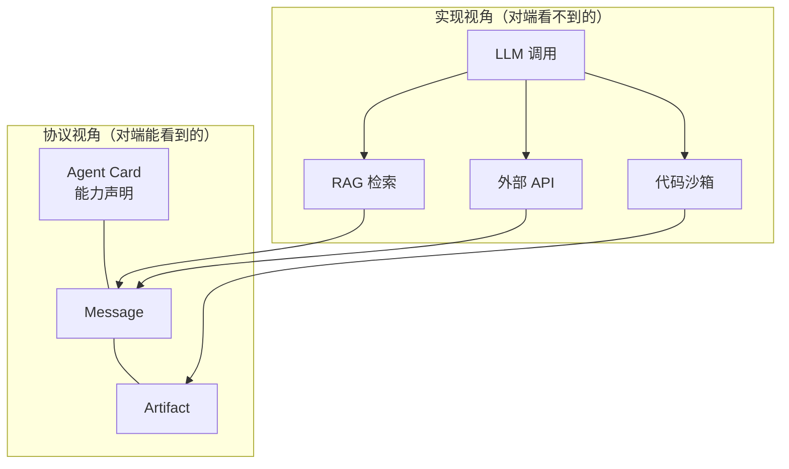
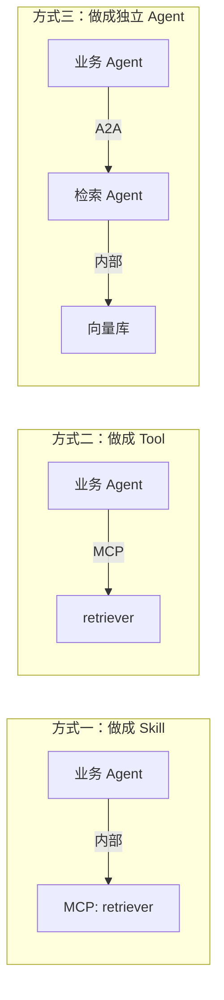
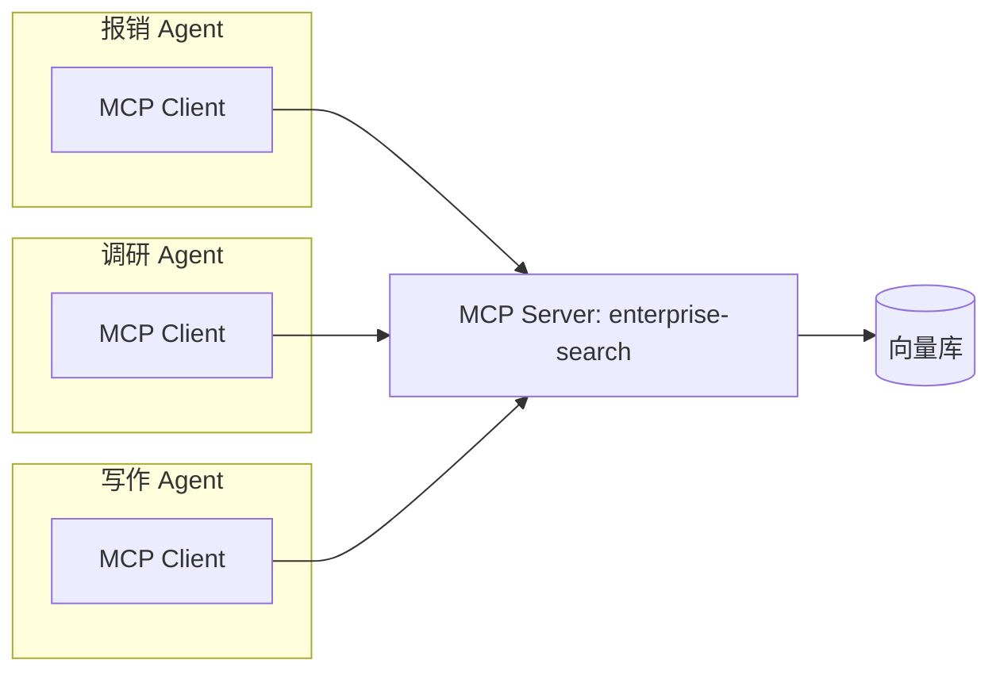
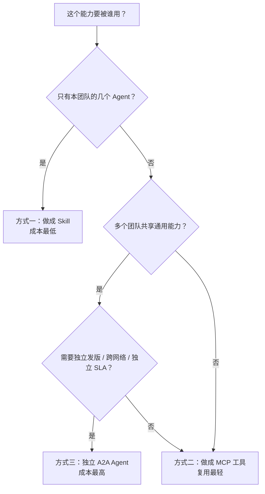
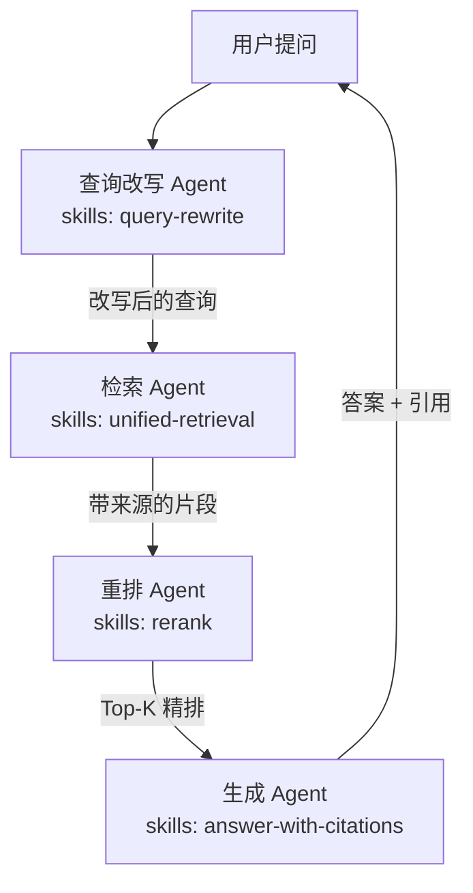
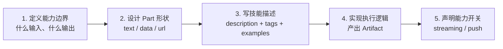

# 动手实战 2：A2A 对接 RAG 与工具调用

上一篇手写了协议骨架。这一篇把**真实的业务能力**接进去：RAG 检索、
代码沙箱、外部 API。

同时要澄清一个最常见的误解：**这些能力都不属于 A2A 协议。**
A2A 只是把它们装进一个"Agent"这个黑盒，对外提供一致的服务契约。

## 一、先划清 ToolRuntime 与 A2A 的边界

### 1.1 两种视角看同一个 Agent



| 层次 | 协议关心吗 | 谁负责 |
| --- | --- | --- |
| 我能干什么 | ✅ | Agent Card 的 `skills` |
| 干这活要什么格式 | ✅ | `inputModes` / `outputModes` |
| 干这活要多久 | ✅ | Task 状态机 |
| 干完了产出什么 | ✅ | Artifact |
| 我用哪个向量库检索 | ❌ | 你的实现 |
| 我的提示词怎么写 | ❌ | 你的实现 |
| 我怎么调 LLM | ❌ | 你的实现 |
| 我在哪个沙箱跑代码 | ❌ | 你的实现 |

### 1.2 规范怎么说

规范附录 B（与 MCP 的关系）里的意思大致是：

> A2A 与 MCP 是互补的两个协议，面向智能体系统的不同侧面。
> MCP 标准化 AI 模型与智能体如何连接并使用工具、API、数据源；
> A2A 规定独立的、通常彼此不透明的 AI 智能体如何作为对等方通信与协作。

而 A2A 的"不透明执行"原则（Opaque Execution）意味着：
**对端 Agent 永远看不到你的 ToolRuntime 里有什么。**

### 1.3 三种打包方式

把一个能力（比如 RAG）暴露出去，有三种做法：

| 方式 | 做法 | 适合 |
| --- | --- | --- |
| **做成 Skill** | RAG 是 Agent 内部实现，对外只暴露一个"知识库问答"技能 | 检索只是完整能力的一部分 |
| **做成 Tool** | RAG 是 Agent 内部的工具，通过 MCP 调用 | 多个 Agent 共享同一套工具 |
| **做成独立 Agent** | RAG 自己就是一个 A2A 服务端，有自己的卡片和任务 | 检索能力要被多个团队复用 |



**判断标准**：

- 检索只是某个更大能力的一环（比如"报销审核"要查政策库）→ **方式一**；
- 多个 Agent 要用同一套工具（比如内部通用工具集）→ **方式二**；
- 检索能力本身要被别的团队当作服务消费 → **方式三**。

**方式三是最容易过度设计的。** 如果检索 Agent 只被一个团队用，
把它独立成服务会带来部署、鉴权、监控、跨网络调用的全套成本，
收益却只有"边界清晰"。

## 二、方式一：把 RAG 做成 Skill

这是最常见也最实用的做法：**RAG 是 Agent 内部的一个工具，
Agent 对外只声明一个完整能力的技能。**

### 2.1 整体结构

```text
docs/a2a-rag/
├── requirements.txt
├── protocol.py       # 复用上一篇
├── server.py         # 复用上一篇
├── client.py         # 复用上一篇
├── knowledge.py      # 检索引擎（ToolRuntime 层）
├── kb_agent.py       # 知识库 Agent（A2A 层）
└── research_agent.py # 调研 Agent（A2A 层，调用 kb_agent）
```

### 2.2 检索引擎：ToolRuntime 层

`knowledge.py`：

```python
from __future__ import annotations

import hashlib
import math
import re
from dataclasses import dataclass

TOKEN_RE = re.compile(r"[a-z0-9]+|[\u4e00-\u9fff]")


def tokenize(text: str) -> list[str]:
    lowered = text.lower()
    tokens = TOKEN_RE.findall(lowered)
    cjk = [c for c in lowered if "\u4e00" <= c <= "\u9fff"]
    return tokens + cjk


def fake_embedding(text: str, dim: int = 64) -> list[float]:
    vec = [0.0] * dim
    for token in tokenize(text):
        digest = hashlib.sha256(token.encode("utf-8")).digest()
        idx = digest[0] % dim
        vec[idx] += 1.0
    norm = math.sqrt(sum(v * v for v in vec)) or 1.0
    return [v / norm for v in vec]


def cosine(a: list[float], b: list[float]) -> float:
    return sum(x * y for x, y in zip(a, b))


@dataclass
class Chunk:
    id: str
    doc_id: str
    title: str
    text: str
    source: str
    vector: list[float]


@dataclass
class Hit:
    chunk: Chunk
    score: float
    matched_terms: list[str]


class KnowledgeBase:
    def __init__(self) -> None:
        self._chunks: list[Chunk] = []
        self._df: dict[str, int] = {}

    def add(self, doc_id: str, title: str, text: str, source: str) -> Chunk:
        chunk = Chunk(
            id=f"{doc_id}#{len(self._chunks)}",
            doc_id=doc_id,
            title=title,
            text=text,
            source=source,
            vector=fake_embedding(text),
        )
        self._chunks.append(chunk)
        for token in set(tokenize(text)):
            self._df[token] = self._df.get(token, 0) + 1
        return chunk

    def search(self, query: str, top_k: int = 5, alpha: float = 0.5) -> list[Hit]:
        terms = tokenize(query)
        n = len(self._chunks)
        if n == 0:
            return []
        qvec = fake_embedding(query)

        scored: list[Hit] = []
        for chunk in self._chunks:
            dense = cosine(qvec, chunk.vector)
            cterms = tokenize(chunk.text)
            overlap = sum(1 for t in terms if t in cterms)
            idf = sum(
                math.log(1 + n / (1 + self._df.get(t, 0))) for t in set(terms) if t in cterms
            )
            sparse = idf / (1 + math.log(1 + len(cterms)))
            score = alpha * dense + (1 - alpha) * sparse
            matched = sorted({t for t in terms if t in cterms})
            scored.append(Hit(chunk=chunk, score=round(score, 6), matched_terms=matched))

        scored.sort(key=lambda h: h.score, reverse=True)
        return [h for h in scored[:top_k] if h.score > 0]
```

**`fake_embedding` 是为了跑通流程的假向量。** 真实项目里换成
`bge-small-zh`、`text-embedding-3-small` 之类的模型，接口不变。

**混合检索（dense + sparse）** 是 RAG 的常规做法：向量检索抓语义，
关键词检索抓专有名词和数字。`alpha` 控制两者的权重。

### 2.3 知识库 Agent

`kb_agent.py`：

```python
from __future__ import annotations

import json
from typing import Any

from corpus import CORPUS
from knowledge import KnowledgeBase
from protocol import Artifact, Part, new_id
from server import A2AServer, RequestContext

KB = KnowledgeBase()

for doc_id, title, text, source in CORPUS:
    KB.add(doc_id, title, text, source)

```

`corpus.py` 里放这四条样例文档（MCP Server 与 KB Agent 共用同一份，
否则 MCP Server 进程里的 KB 是空的，工具恒返回空列表）：

```python
CORPUS = [
    (
        "policy-2026",
        "2026 年差旅政策",
        "国内交通费单次限额 3000 元，需提供行程单。餐饮费单次限额 100 元，"
        "需提供发票原件。住宿费按城市分级，一线城市每晚上限 600 元。",
        "https://intranet.example.com/policy/2026",
    ),
    (
        "policy-2025",
        "2025 年差旅政策",
        "国内交通费单次限额 2500 元，餐饮费单次限额 80 元。",
        "https://intranet.example.com/policy/2025",
    ),
    (
        "faq-expense",
        "报销常见问题",
        "电子发票需要同时上传 PDF 原件和验真截图。差旅平台预订的机票不需要行程单。"
        "跨月发票在下月 5 日前仍可提交上月报销。",
        "https://intranet.example.com/faq/expense",
    ),
    (
        "it-policy",
        "IT 资产管理规定",
        "笔记本电脑标准配置为 16GB 内存、512GB 固态硬盘。开发岗可申请外接显示器，"
        "单次上限 2000 元。",
        "https://intranet.example.com/policy/it",
    ),
]
```

```python
async def kb_handler(ctx: RequestContext) -> None:
    await ctx.transition("TASK_STATE_WORKING", "正在检索知识库…")

    payload = ctx.message.first_data() or {}
    query = payload.get("query") or ctx.message.first_text()
    top_k = int(payload.get("top_k", 5))

    hits = KB.search(query, top_k=top_k)

    if not hits:
        await ctx.add_artifact(
            Artifact(
                artifact_id=new_id(),
                name="检索结果",
                parts=[Part.data_part({"query": query, "hits": [], "answerable": False})],
            )
        )
        await ctx.complete("知识库中未检索到相关内容")
        return

    results = [
        {
            "chunkId": hit.chunk.id,
            "docId": hit.chunk.doc_id,
            "title": hit.chunk.title,
            "text": hit.chunk.text,
            "source": hit.chunk.source,
            "score": hit.score,
            "matchedTerms": hit.matched_terms,
        }
        for hit in hits
    ]

    await ctx.add_artifact(
        Artifact(
            artifact_id=new_id(),
            name="检索结果",
            parts=[Part.data_part({"query": query, "hits": results, "answerable": True})],
            metadata={"hitCount": len(results)},
        )
    )
    await ctx.complete(f"检索到 {len(results)} 个片段")


KB_CARD = {
    "name": "企业知识库 Agent",
    "description": "对企业内部制度、FAQ 等文档做混合检索，返回带来源的片段集合。",
    "supportedInterfaces": [
        {
            "url": "http://127.0.0.1:9201/rpc",
            "protocolBinding": "JSONRPC",
            "protocolVersion": "1.0",
        }
    ],
    "version": "1.0.0",
    "capabilities": {"streaming": False, "pushNotifications": False},
    "defaultInputModes": ["application/json", "text/plain"],
    "defaultOutputModes": ["application/json"],
    "skills": [
        {
            "id": "kb-search",
            "name": "企业知识检索",
            "description": "输入自然语言问题或关键词，返回匹配的文档片段、来源与相关度。",
            "tags": ["retrieval", "knowledge-base", "rag", "search"],
            "examples": [
                "国内交通费的限额是多少？",
                "餐饮费发票有什么要求？"
            ],
            "inputModes": ["application/json", "text/plain"],
            "outputModes": ["application/json"],
        }
    ],
}

kb_server = A2AServer(KB_CARD, kb_handler)
```

**注意这张卡片的设计**：

- `skills[0].description` 写清楚了输入什么、输出什么，还给了两个
  `examples`。这直接影响上游 Agent 能不能正确路由到你。
- `outputModes` 是 `application/json`，因为返回的是结构化片段。
  上游 Agent 拿到就能直接处理，不需要解析自然语言。
- `streaming: false`——检索是秒级的，流式没有价值。**诚实地声明能力，
  上游才知道该走哪条路。**

### 2.4 调研 Agent：调用方

`research_agent.py`：

```python
from __future__ import annotations

from protocol import Artifact, Part, new_id
from server import A2AServer, RequestContext
from client import A2AClient

KB_CLIENT = A2AClient("http://127.0.0.1:9201")


def build_answer(query: str, payload: dict) -> str:
    hits = payload.get("hits", [])
    if not hits:
        return f"未在知识库中检索到与「{query}」相关的内容。"
    lines = [f"关于「{query}」，检索到 {len(hits)} 条相关规定："]
    for idx, hit in enumerate(hits, start=1):
        lines.append(f"{idx}. [{hit['title']}] {hit['text']}（来源：{hit['source']}）")
    return "\n".join(lines)


async def research_handler(ctx: RequestContext) -> None:
    await ctx.transition("TASK_STATE_WORKING", "正在整理问题…")

    payload = ctx.message.first_data() or {}
    query = payload.get("query") or ctx.message.first_text()

    result = await KB_CLIENT.send_message(
        parts=[Part.data_part({"query": query, "top_k": 4}).to_json()],
        return_immediately=False,
        accepted_output_modes=["application/json"],
    )

    state = result["status"]["state"]
    if state != "TASK_STATE_COMPLETED":
        await ctx.fail(f"知识库 Agent 返回异常状态：{state}")
        return

    kb_payload = None
    for artifact in result.get("artifacts", []):
        for part in artifact.get("parts", []):
            if "data" in part:
                kb_payload = part["data"]
                break

    if kb_payload is None:
        await ctx.fail("知识库 Agent 未返回结构化结果")
        return

    answer = build_answer(query, kb_payload)

    await ctx.add_artifact(
        Artifact(
            artifact_id=new_id(),
            name="调研结论",
            parts=[
                Part.text_part(answer),
                Part.data_part(
                    {
                        "query": query,
                        "citations": [
                            {
                                "docId": hit["docId"],
                                "title": hit["title"],
                                "source": hit["source"],
                                "score": hit["score"],
                            }
                            for hit in kb_payload.get("hits", [])
                        ],
                    }
                ),
            ],
            metadata={"citationCount": len(kb_payload.get("hits", []))},
        )
    )
    await ctx.complete("调研完成")


RESEARCH_CARD = {
    "name": "制度调研 Agent",
    "description": "把自然语言问题转成知识库检索，产出带引用的答案。",
    "supportedInterfaces": [
        {
            "url": "http://127.0.0.1:9202/rpc",
            "protocolBinding": "JSONRPC",
            "protocolVersion": "1.0",
        }
    ],
    "version": "1.0.0",
    "capabilities": {"streaming": True, "pushNotifications": False},
    "defaultInputModes": ["text/plain", "application/json"],
    "defaultOutputModes": ["text/plain", "application/json"],
    "skills": [
        {
            "id": "policy-research",
            "name": "制度条款调研",
            "description": "输入关于公司制度、规定、FAQ 的问题，输出带来源引用的答案。",
            "tags": ["research", "policy", "qa", "rag"],
            "inputModes": ["text/plain"],
            "outputModes": ["text/plain", "application/json"],
        }
    ],
}

research_server = A2AServer(RESEARCH_CARD, research_handler)
```

### 2.5 验证

```bash
curl -s -X POST http://127.0.0.1:9202/rpc \
  -H 'Content-Type: application/json' -H 'A2A-Version: 1.0' \
  -d '{
    "jsonrpc": "2.0", "id": 1, "method": "SendMessage",
    "params": {"message": {
      "messageId": "msg-2f7a",
      "role": "ROLE_USER", "parts": [
        {"text": "国内交通费的限额是多少？", "mediaType": "text/plain"}
    ]}}
  }' | python3 -m json.tool
```

预期输出（节选）：

```json
{
  "result": {
    "task": {
      "status": { "state": "TASK_STATE_COMPLETED" },
      "artifacts": [
        {
          "name": "调研结论",
          "parts": [
            {
              "text": "关于「国内交通费的限额是多少？」，检索到 2 条相关规定：\n1. [2026 年差旅政策] 国内交通费单次限额 3000 元，需提供行程单。…（来源：https://intranet.example.com/policy/2026）\n2. [2025 年差旅政策] 国内交通费单次限额 2500 元，餐饮费单次限额 80 元。…",
              "mediaType": "text/plain"
            },
            {
              "data": {
                "query": "国内交通费的限额是多少？",
                "citations": [
                  {
                    "docId": "policy-2026",
                    "title": "2026 年差旅政策",
                    "source": "https://intranet.example.com/policy/2026",
                    "score": 0.83
                  }
                ]
              },
              "mediaType": "application/json"
            }
          ],
          "metadata": { "citationCount": 1 }
        }
      ]
    }
  }
}
```

### 2.6 这个设计的三个要点

**第一，双 Part 输出。** 一个 `text` Part 给人看，一个 `data` Part 给
下游系统用。同一个 Artifact 同时服务两类消费者。

**第二，引用单独结构化。** `citations` 数组让下游能渲染成可点击的
引用列表，也能做"这个结论有没有依据"的校验。

**第三，结构化数据走 `data` Part + `mediaType`。** 不要把 JSON 塞进
`text` Part 里让对方去解析。

## 三、方式二：把 RAG 做成 MCP 工具

如果多个 Agent 都要用同一套检索能力，做成 MCP Server 更合适。



### 3.1 MCP Server

```python
from mcp.server.fastmcp import FastMCP

from corpus import CORPUS
from knowledge import KnowledgeBase

mcp = FastMCP("enterprise-search")
KB = KnowledgeBase()
# 语料放在 corpus.py 里，MCP Server 与 KB Agent 共用同一份，
# 否则这个进程里的 KB 是空的，工具恒返回空列表。
for doc_id, title, text, source in CORPUS:
    KB.add(doc_id, title, text, source)


@mcp.tool()
def search_knowledge(query: str, top_k: int = 5) -> list[dict]:
    """在企业知识库中检索，返回带来源的片段。"""
    hits = KB.search(query, top_k=top_k)
    return [
        {
            "docId": h.chunk.doc_id,
            "title": h.chunk.title,
            "text": h.chunk.text,
            "source": h.chunk.source,
            "score": h.score,
        }
        for h in hits
    ]
```

### 3.2 A2A Agent 内部调 MCP

```python
from contextlib import asynccontextmanager

from mcp import ClientSession, StdioServerParameters
from mcp.client.stdio import stdio_client


class McpSearchTool:
    def __init__(self, command: list[str]) -> None:
        self.command = command

    @asynccontextmanager
    async def _session(self):
        params = StdioServerParameters(command=self.command, args=[])
        async with stdio_client(params) as (read, write):
            async with ClientSession(read, write) as session:
                yield session

    async def call(self, tool_name: str, arguments: dict) -> list[dict]:
        async with self._session() as session:
            await session.initialize()
            result = await session.call_tool(tool_name, arguments)
            return result.content
```

Agent 的执行逻辑里：

```python
async def research_handler(ctx: RequestContext) -> None:
    await ctx.transition("TASK_STATE_WORKING", "正在检索…")
    query = ctx.message.first_text()

    hits = await mcp_tool.call("search_knowledge", {"query": query, "top_k": 5})
    ...
```

### 3.3 两种方式的对比

| 维度 | 方式一（RAG 做成 Skill） | 方式二（RAG 做成 MCP 工具） |
| --- | --- | --- |
| 复用范围 | 单个 Agent 内部 | 多个 Agent 共享 |
| 协议边界 | 工具调用在 Agent 内部 | 工具调用在 Agent 内部 |
| 部署成本 | 低 | 一个额外服务 |
| 检索逻辑改动的影响面 | 只影响这个 Agent | 影响所有调用方 |
| 独立演进 | 检索和业务耦合 | 检索可以独立升级 |
| 适合 | 业务绑定深的检索 | 通用检索能力 |

**注意两个方案里 A2A 的位置完全一样。** 协议层看不到差别。

### 3.4 一个重要判断

**工具调用不属于 A2A 协议。** 判断依据很直接：

- A2A 的 Agent Card 里没有"工具列表"这个字段——只有 `skills`；
- A2A 的 Message 里没有"tool_call"这种 Part——Part 只有 text / url /
  raw / data 四种；
- A2A 的 Task 状态机里没有"等待工具执行"这种状态。

**工具是 Agent 的内部实现细节。** 这一点在设计对外契约时要特别注意：
不要试图在 A2A 消息里表达"我现在要调某个工具"——那是泄漏内部实现，
违背不透明执行原则。

## 四、方式三：RAG 做成独立 Agent

当检索能力要被多个团队消费时。

### 4.1 什么时候该拆成独立 Agent

| 信号 | 说明 |
| --- | --- |
| 不同团队要独立发布检索逻辑 | 独立部署才能独立发版 |
| 检索要跨网络访问 | 独立服务有独立鉴权和网络策略 |
| 检索有独立的 SLA | 独立监控和限流 |
| 检索要支持多种模态 | 独立演进多模态索引 |
| 检索要给多个上层 Agent 提供不同抽象 | 独立卡片可以做能力协商 |

### 4.2 独立检索 Agent 的卡片

```json
{
  "name": "企业检索 Agent",
  "description": "提供跨模态的文档检索服务，支持文本、图片、表格的统一索引与召回。",
  "supportedInterfaces": [
    { "url": "https://search.corp.example.com/a2a", "protocolBinding": "JSONRPC", "protocolVersion": "1.0" }
  ],
  "version": "1.0.0",
  "capabilities": { "streaming": false, "pushNotifications": false },
  "defaultInputModes": ["application/json", "text/plain", "image/png"],
  "defaultOutputModes": ["application/json"],
  "skills": [
    {
      "id": "unified-retrieval",
      "name": "统一检索",
      "description": "输入查询与过滤条件，返回统一召回后的片段列表，含来源、页码、置信度。",
      "tags": ["retrieval", "search", "multimodal"],
      "inputModes": ["application/json"],
      "outputModes": ["application/json"]
    }
  ]
}
```

### 4.3 独立方案的额外成本

拆成独立 Agent 会引入这些额外工作：

| 额外成本 | 说明 |
| --- | --- |
| 鉴权 | 调用方要拿凭据，凭据要传递 |
| 网络 | 跨服务调用，延迟 + 故障点 |
| 限流 | 独立配额，防止被刷 |
| 监控 | 独立的 SLO 和告警 |
| 版本兼容 | 卡片和契约要独立管理 |
| 调试 | 多一跳，出问题多一层 |

**所以判据是"有没有跨团队的复用需求"。** 只有自己用的时候，拆出去
纯粹是给自己添麻烦。

### 4.4 三种方式最终选型



## 五、代码沙箱：把执行能力封装成 Agent

代码沙箱是另一个典型场景。Agent 生成的代码要跑在隔离环境里。

### 5.1 沙箱 Agent 的形态

```text
┌──────────────────────────────────────────────┐
│  代码执行 Agent（A2A 层）                      │
│  - 接收代码 + 输入                            │
│  - 管理沙箱生命周期                            │
│  - 收集 stdout / stderr / 产物                 │
│  - 控制超时与资源限额                          │
├──────────────────────────────────────────────┤
│  Sandbox Runtime（ToolRuntime 层）             │
│  - 容器 / Firecracker / gVisor                │
│  - 网络隔离、文件系统隔离、CPU/内存限额         │
└──────────────────────────────────────────────┘
```

### 5.2 卡片设计

```json
{
  "name": "代码执行 Agent",
  "description": "在隔离沙箱中执行 Python 代码，返回标准输出、错误与生成的文件。",
  "supportedInterfaces": [
    { "url": "https://sandbox.corp.example.com/a2a", "protocolBinding": "JSONRPC", "protocolVersion": "1.0" }
  ],
  "version": "1.0.0",
  "capabilities": { "streaming": true, "pushNotifications": false },
  "defaultInputModes": ["application/json"],
  "defaultOutputModes": ["application/json", "text/plain"],
  "skills": [
    {
      "id": "python-exec",
      "name": "Python 代码执行",
      "description": "输入 code 与 stdin 参数，在隔离环境执行，返回 stdout、stderr、退出码与产物文件列表。",
      "tags": ["code", "sandbox", "python", "execution"],
      "inputModes": ["application/json"],
      "outputModes": ["application/json"]
    }
  ]
}
```

> `pushNotifications` 写 `false`：本篇的沙箱 Agent 没有实现
> `CreateTaskPushNotificationConfig` 等推送配置方法。规范规定
> `capabilities.pushNotifications` 为 true 时，这四个方法必须可用，
> 声明了就得真的提供。

### 5.3 执行逻辑

```python
import asyncio
import uuid

SANDBOX_TIMEOUT = 30
SANDBOX_MEMORY_MB = 512


async def sandbox_handler(ctx: RequestContext) -> None:
    await ctx.transition("TASK_STATE_WORKING", "正在分配沙箱…")

    payload = ctx.message.first_data() or {}
    code = payload.get("code", "")
    stdin = payload.get("stdin", "")

    if not code:
        await ctx.fail("缺少 code 参数")
        return

    sandbox_id = f"sbx-{uuid.uuid4().hex[:8]}"
    try:
        result = await asyncio.wait_for(
            run_in_sandbox(sandbox_id, code, stdin, memory_mb=SANDBOX_MEMORY_MB),
            timeout=SANDBOX_TIMEOUT,
        )
    except asyncio.TimeoutError:
        await ctx.fail(f"代码执行超时（{SANDBOX_TIMEOUT}s）")
        return
    except SandboxRejected as exc:
        await ctx.fail(f"沙箱拒绝执行：{exc}")
        return

    await ctx.add_artifact(
        Artifact(
            artifact_id=new_id(),
            name="执行结果",
            parts=[
                Part.data_part(
                    {
                        "sandboxId": sandbox_id,
                        "exitCode": result.exit_code,
                        "stdout": result.stdout,
                        "stderr": result.stderr,
                        "durationMs": result.duration_ms,
                        "files": [
                            {"name": f.name, "mediaType": f.media_type, "size": f.size}
                            for f in result.files
                        ],
                    }
                )
            ],
        )
    )
    await ctx.complete("代码执行完成")
```

### 5.4 沙箱 Agent 的能力声明要保守

`capabilities.pushNotifications: true` 值得讨论。代码执行可能跑好几分钟，
用 webhook 通知比让客户端一直挂着连接更合理——前提是沙箱真的支持
断线后继续跑（**任务状态和执行环境必须解耦**）。

**这一点是架构上的硬要求**：如果 Agent 的执行和它的进程绑定，
进程一挂任务就死了。生产实现里，执行应该跑在独立的沙箱池里，
Agent Server 只负责接收回调。

### 5.5 产物的文件传输

沙箱产出的文件通常比较大，走 `url`（不要用 `raw`）：

```json
{
  "artifactId": "a-files",
  "name": "执行产物",
  "parts": [
    {
      "url": "https://sandbox-storage.example.com/out/result.csv?token=xxx",
      "filename": "result.csv",
      "mediaType": "text/csv"
    }
  ]
}
```

`url` 可以是预签名 URL，权限和有效期由对象存储管，不需要在 A2A 层面
再做一套文件授权。

## 六、RAG 场景的工程要点

### 6.1 检索质量的问题往往不在协议层

| 症状 | 可能的原因 |
| --- | --- |
| 检索到不相关的片段 | 切分策略、embedding 模型、query 改写 |
| 片段相关但答案不对 | 生成环节的提示词、上下文组织 |
| 答案对但没有引用 | 提示词没要求引用 |
| 时好时坏 | 检索结果不稳定，需要 rerank |

**A2A 层面能做的是把边界划清楚**：检索 Agent 只负责"给出带来源的片段"，
生成 Agent 只负责"基于给定的片段写答案"。**两个职责混在一个 Agent 里，
出问题就分不清是检索的锅还是生成的锅。**

### 6.2 上下文的组织方式

一个常见的错误是把检索到的所有片段拼成一大段文本塞给 LLM。更好的做法
是让检索 Agent 返回结构化片段，上层 Agent 自己决定怎么用：

```json
{
  "hits": [
    {
      "docId": "policy-2026",
      "title": "2026 年差旅政策",
      "text": "国内交通费单次限额 3000 元…",
      "source": "https://intranet.example.com/policy/2026",
      "score": 0.83,
      "publishedAt": "2026-01-01"
    }
  ]
}
```

有了 `publishedAt` 和 `score`，上层就能做"只取最新版本""只取高相关度
的前 N 条"这类过滤——**这些决策属于生成侧，不该写死在检索侧**。

### 6.3 缓存

跨 Agent 的调用会放大延迟。检索 Agent 加一层缓存很有效：

```python
import time
from collections import OrderedDict


class RetrievalCache:
    def __init__(self, ttl=300, maxsize=1000):
        self._data = OrderedDict()
        self._ttl = ttl
        self._maxsize = maxsize

    def get(self, key: str) -> dict | None:
        item = self._data.get(key)
        if item is None:
            return None
        if time.time() - item[0] > self._ttl:
            del self._data[key]
            return None
        return item[1]

    def put(self, key: str, value: dict) -> None:
        self._data[key] = (time.time(), value)
        self._data.move_to_end(key)
        while len(self._data) > self._maxsize:
            self._data.popitem(last=False)
```

缓存键要包含**影响结果的全部参数**：

```python
def cache_key(query: str, top_k: int, filters: dict) -> str:
    raw = json.dumps({"q": query, "k": top_k, "f": filters}, sort_keys=True)
    return hashlib.sha256(raw.encode()).hexdigest()
```

**别忘了把 `filters` 放进键里。** 漏了会造成租户之间的数据串用——
这是安全事故级别的 bug。

### 6.4 上下文与 token 成本

多 Agent 链路会重复传大段文本。成本优化点：

| 手段 | 效果 |
| --- | --- |
| 片段用 `artifactId` 引用，不重复传全文 | 省一半以上的 token |
| 检索 Agent 侧做截断 | 上层收到的就是精炼版 |
| `top_k` 按需设置 | 别无脑取 20 条 |
| 结构化字段优先于自由文本 | 结构化数据的信息密度更高 |

"用引用代替复制"的实现：

```python
async def research_handler(ctx: RequestContext) -> None:
    kb_result = await KB_CLIENT.send_message(parts=[...])
    kb_artifact_id = kb_result["artifacts"][0]["artifactId"]

    await ctx.add_artifact(
        Artifact(
            artifact_id=kb_artifact_id,
            name="检索结果",
            parts=[Part.data_part({"artifactId": kb_artifact_id, "hitCount": 4})],
        )
    )
```

下游需要全文时，用 `GetTask` 取（返回的 Task 里带 `artifacts`），或者让
上游 Agent 在 `Message` 里只传摘要 + `artifactId`。
（`historyLength` 裁的是 `history` 里的消息条数，跟产物正文无关。）

## 七、多 Agent RAG 流水线

把上面的模式组合起来，就是一条典型的多 Agent RAG 流水线。



每一环都是一个独立的 A2A Agent，各自有卡片和任务。

### 7.1 各环节的卡片要点

| Agent | 输入 | 输出 | streaming | 备注 |
| --- | --- | --- | --- | --- |
| 查询改写 | 自然语言问题 | 结构化查询 | 否 | 快，微秒级 |
| 检索 | 查询 | 片段列表 | 否 | 取决于后端 |
| 重排 | 片段列表 | 精排列表 | 否 | 模型推理，需要时间 |
| 生成 | 精排片段 | 答案 + 引用 | 是 | 长，天然适合流式 |

**这个流水线的关键设计**：每一环的输出都是**结构化的**，
所以中间的 Agent 完全可以替换——换检索引擎不影响改写 Agent，
换生成模型不影响检索 Agent。

> 上面几次 `ctx.transition("TASK_STATE_WORKING", ...)` 是**同态迁移**，
> 状态没变、只更新进度说明。上一篇的 `assert_transition` 显式放行了同态
> 迁移，因为 A2A 的 `TaskStatusUpdateEvent` 每次都会带一份新的
> `TaskStatus`，进度上报本来就不该受状态机约束。

### 7.2 一个完整的多 Agent 调用示例

```python
async def answer_pipeline(ctx: RequestContext) -> None:
    await ctx.transition("TASK_STATE_WORKING", "正在改写查询…")
    question = ctx.message.first_text()

    rewrite = await REWRITE_CLIENT.send_message(
        parts=[Part.text_part(question).to_json()],
        return_immediately=False,
    )
    queries = _extract_data(rewrite)["queries"]

    await ctx.transition("TASK_STATE_WORKING", "正在检索…")
    retrieved = await RETRIEVE_CLIENT.send_message(
        parts=[Part.data_part({"queries": queries, "top_k": 20}).to_json()],
        return_immediately=False,
    )
    candidates = _extract_data(retrieved)["hits"]

    await ctx.transition("TASK_STATE_WORKING", "正在重排…")
    reranked = await RERANK_CLIENT.send_message(
        parts=[Part.data_part({"query": question, "candidates": candidates}).to_json()],
        return_immediately=False,
    )
    top = _extract_data(reranked)["hits"]

    await ctx.transition("TASK_STATE_WORKING", "正在生成答案…")
    final = await GENERATE_CLIENT.send_message(
        parts=[
            Part.data_part({"question": question, "contexts": top}).to_json(),
        ],
        return_immediately=False,
    )
    answer = _extract_text(final)

    await ctx.add_artifact(
        Artifact(
            artifact_id=new_id(),
            name="答案",
            parts=[Part.text_part(answer)],
            metadata={"pipeline": "rewrite→retrieve→rerank→generate"},
        )
    )
    await ctx.complete("完成")
```

**注意每一步的 `await ctx.transition(...)`**。多 Agent 链路上，
上游需要能看到进展——否则链路里任何一个环节慢，客户端就是一片空白。

## 八、把工具调用暴露成 A2A 能力的通用套路

最后总结一下把任意内部能力包装成 A2A 能力的套路。

### 8.1 五步法



### 8.2 每一步的要点

| 步骤 | 要点 | 常见错误 |
| --- | --- | --- |
| **1. 边界** | 一句话说清"输入什么、输出什么" | 描述含糊导致路由失败 |
| **2. Part 形状** | 机器消费用 `data`，人消费用 `text` | 把 JSON 塞进 `text` 让对方解析 |
| **3. 技能描述** | `description` 写输入输出，`examples` 给 2 个真实例子 | 只有名字没有描述 |
| **4. 执行逻辑** | 产出 Artifact，状态机驱动 | 直接回 Message 丢了产物 |
| **5. 能力开关** | 诚实声明，不支持就写 false | 声明了但实际不支持 |

### 8.3 能力声明的诚实原则

这一条值得单独强调，因为它是实践中问题最多的地方。

```python
# 有问题的写法
CAPABILITIES = {
    "streaming": True,      # 实际上没有实现 SSE
    "pushNotifications": True,  # 实际上没有实现 webhook
}
```

**声明了但不支持，后果比不声明严重得多。**

- 客户端读了卡片会走流式路径，收到 `UnsupportedOperationError`，
  还得回退，白白多一轮错误处理；
- 推送场景下客户端注册了 webhook 却收不到通知，只能靠轮询兜底，
  相当于既没省事也没省心。

规范的硬约束帮了忙：`streaming: false` 时调用流式接口**必须**返回
`UnsupportedOperationError`。这保证了失败表现为"快速失败"，不会退化成"挂起"。

**但更该做的是在源头把声明写对。**

## 九、自检

1. 你的 Agent Card 里 `skills[].description` 能让一个不了解这个 Agent
   的人判断出"这事该不该找它"吗？
2. `outputModes` 写对了吗？下游知道拿到的是什么格式吗？
3. 结构化结果是放在 `data` Part 里还是被塞进 `text` 了？
4. `capabilities` 里的每个 true 都真的实现了吗？
5. 你的 RAG 返回里带来源吗？下游能渲染引用吗？
6. 检索 Agent 是不是在返回结果里塞了不该有的决策（比如"最终答案"）？
7. 缓存键包含全部影响结果的参数了吗？特别是租户和过滤条件。

## 十、小结

- 工具不属于 A2A 协议。Agent Card 里只有 `skills`，没有工具列表；
  Message 里没有 tool_call 这种 Part。
- RAG 有三种打包方式：做成 Skill（成本最低）、做成 MCP 工具（复用最轻）、
  做成独立 A2A Agent（成本最高）。判据是"有没有跨团队复用需求"。
- 独立检索 Agent 值得拆的信号：独立发版、跨网络、独立 SLA、多模态。
- RAG 链路上每个 Agent 的输出都应该是结构化的，这样中间环节才能替换。
- 检索质量问题通常在切分、embedding、query 改写和重排，
  不在协议层。把检索和生成的职责分开才能定位问题。
- 沙箱 Agent 的执行环境必须和 Agent Server 解耦，否则任务无法在
  进程重启后继续。
- 能力声明要诚实。声明了不实现是最糟的情况。
- 大产物走 `url`，中间环节用 `artifactId` 引用代替复制，省 token。

下一篇：[生产落地：A2A 平台必备能力](/a2a/production)。
