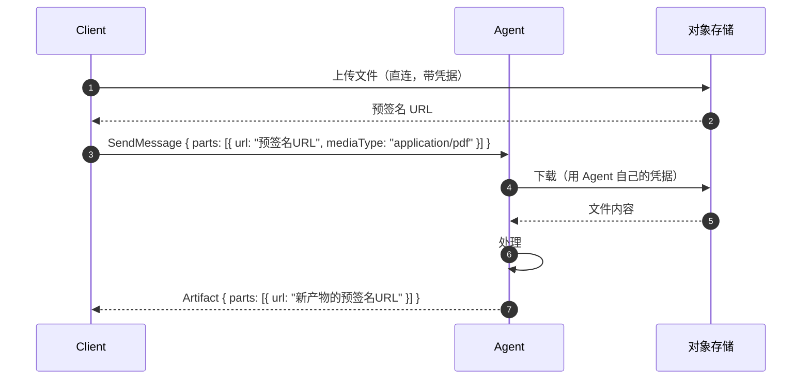
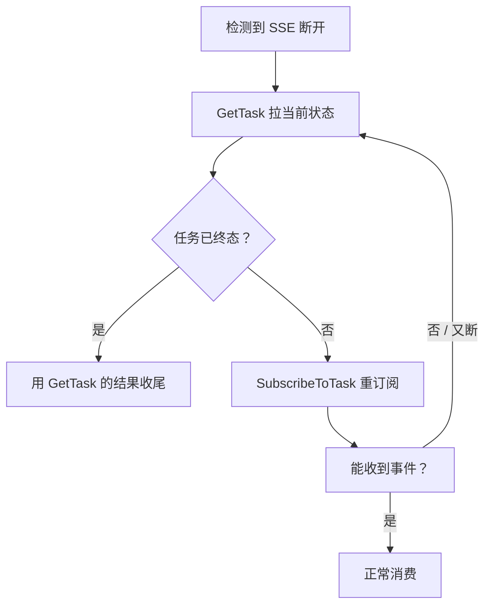
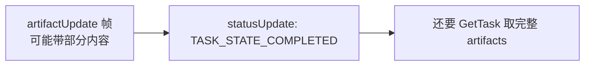

# 避坑专题：高频误区与踩坑总结

这一篇是踩坑清单。前半是**认知层面的误区**——想错了，代码写多少都白搭；
后半是**工程层面的坑**——想对了，但实现细节没处理对。

## 一、误区类

### 误区 1：用 A2A 替代编排框架

**这个想法的来源**：A2A 定义了 Agent 之间的通信，编排框架定义了
Agent 之间的流程。于是有人认为：既然 A2A 能让 Agent 互相说话，
流程自然也就跑起来了。

**问题出在协议只解决了一半。** 回到规范第 3 章的抽象操作列表，
11 个操作里没有一个是关于流程的：

| 需要的能力 | A2A 有吗 | 归谁 |
| --- | --- | --- |
| 发消息 | ✅ `SendMessage` | A2A |
| 查任务状态 | ✅ `GetTask` | A2A |
| 取消任务 | ✅ `CancelTask` | A2A |
| 串行 / 并行 | ❌ | 编排器 |
| 条件分支 | ❌ | 编排器 |
| 循环与迭代 | ❌ | 编排器 |
| 失败重试 | ❌ | 编排器 |
| 补偿 / Saga | ❌ | 编排器 |
| 扇出汇聚 | ❌ | 编排器 |
| 人工审批节点 | 部分：`TASK_STATE_INPUT_REQUIRED` 状态存在，但流程编排仍需编排器 |

**协议管"这一跳怎么走"，编排器管"整体往哪走"。** 两者是配套关系。

**正确的组合方式**：

```python
from langgraph.graph import StateGraph, START, END

from a2a.types import Message, Part, SendMessageConfiguration, SendMessageRequest
from a2a.utils import proto_utils


class State(TypedDict):
    question: str
    policy_result: dict
    final: dict


def ask_policy(state: State) -> State:
    result = a2a_client.send_message(
        SendMessageRequest(
            message=Message(
                role=Role.ROLE_USER,
                parts=[Part(text=state["question"], media_type="text/plain")],
            ),
            configuration=SendMessageConfiguration(return_immediately=True),
        )
    )
    task = result.task
    task = wait_for_terminal(a2a_client, task.id)
    if task.status.state != TaskState.TASK_STATE_COMPLETED:
        raise PolicyCheckFailed(task.status)
    return {"policy_result": extract_data(task)}


def submit_approval(state: State) -> State:
    result = a2a_client.send_message(
        SendMessageRequest(
            message=Message(
                role=Role.ROLE_USER,
                parts=[Part(data=state["policy_result"], media_type="application/json")],
            ),
            configuration=SendMessageConfiguration(return_immediately=True),
        )
    )
    return {"final": result.task}


graph = StateGraph(State)
graph.add_node("ask_policy", ask_policy)
graph.add_node("submit_approval", submit_approval)
graph.add_edge(START, "ask_policy")
graph.add_edge("ask_policy", "submit_approval")
graph.add_edge("submit_approval", END)
```

**每个节点内部是一次 A2A 调用，节点之间的流转由 LangGraph 管。**
重试、条件分支、人工审批这些能力都从编排框架来。

**什么时候确实可以不用编排框架**：

- 流程只有两三步，线性推进；
- 上下游就是固定的几个 Agent；
- 编排逻辑本身很简单。

这种情况下直接写函数链，A2A 只当通信层用。

**判据**：如果你的流程需要"根据 A 的结果决定调 B 还是 C"，
并且这个判断有三种以上分支——上编排框架。

---

### 误区 2：所有 Agent 都必须走 A2A

**这个想法的来源**：既然 A2A 是通用协议，那统一了多好。

**问题在于它忽略了通信成本。** 一次 A2A 调用至少包含：

- JSON 序列化 + 反序列化；
- HTTP 请求建立（TCP 握手、TLS 握手，连接复用的话少一点）；
- 协议层元数据（messageId、contextId、taskId、状态机维护）；
- 一次完整的任务生命周期（建任务 → 执行 → 落产物 → 返回）。

一次进程内函数调用是纳秒级，一次 A2A 调用是毫秒级。**差六个数量级。**

更关键的是**架构上的收益差异**：

| 场景 | 通信方式 | 理由 |
| --- | --- | --- |
| 同一进程内的两个模块 | 直接函数调用 | 省掉一切序列化开销 |
| 同一服务的两个子组件 | 进程内调用 / 轻量 RPC | 同上 |
| 同一团队的独立服务 | HTTP + 内部协议 | 网络是必须的，但 A2A 的任务抽象未必需要 |
| 跨团队的 Agent 服务 | **A2A** | 需要能力发现、任务生命周期、长任务跟踪 |
| 跨组织的 Agent 服务 | **A2A** | 同上，且需要鉴权协商、扩展协商 |

**判断标准**：**这次调用需要"任务"这个抽象吗？**

- 需要对方异步跑、可能跑几分钟、要能查进度 → 上 A2A；
- 就是一次同步的函数调用 → 直接调。

**一个具体的例子**。假设你要做一个"文档摘要"服务，内部有三个模块：
文本提取、分块、摘要。假设这三个模块分别由三个团队维护。

如果三个模块之间是同步的函数调用，那么封装成 A2A 之后：

```text
用户 → 摘要 Agent（HTTP 接收请求）
         │  A2A 调用提取 Agent（可能 30 秒）
         │  A2A 调用摘要 Agent（可能 60 秒）
         ▼
       返回
```

用户等 90 秒，其中 89.5 秒花在三跳网络往返和任务管理上。
**这个场景下，直接在同一个服务里调用三个模块是最优解。**

**但如果"提取"这一步需要 GPU、跑 10 分钟、要排队**，
那它就该是一个独立的 Agent，走 A2A。

**A2A 的价值来自"跨边界"，不来自"统一"。** 统一的价值在能跨边界的时候
才兑现。

---

### 误区 3：A2A 是一种"编排方式"

**这个误解很常见，因为 A2A 确实有"任务"这个看起来很像工作流的概念。**

但两者解决的是不同层次的问题：

| | 编排框架 | A2A |
| --- | --- | --- |
| 关注 | 流程的**形状** | 交互的**形状** |
| 元素 | 节点、边、条件、循环 | 消息、任务、产物 |
| 表达力 | 任意 DAG / 图 | 单次委托 + 有限的多轮 |
| 谁执行 | 编排引擎 | 对方 Agent |
| 失败恢复 | 断点续跑、补偿 | 重试、取消、查状态 |
| 存储 | 流程状态 | 任务状态 |

**A2A 的"任务"是给对方 Agent 的一次委托的执行单元。**
它不知道整个流程长什么样，只知道自己这一件事的状态。

**一个类比**：A2A 像 HTTP，编排框架像工作流引擎。
HTTP 定义"一次请求-响应"的形状，工作流引擎定义"多个步骤怎么串起来"。

---

### 误区 4：Agent Card 里的 skill 越多越好

**问题**：卡片是路由决策的唯一输入。把所有能力都塞进去，会让路由
决策变难，也让卡片变得难以维护。

**实践建议**：

- **一个卡片描述一个清晰的业务角色**。需要"报销审核"和"发票 OCR"
  两个角色，就做两个 Agent。
- **`description` 写"输入什么、输出什么"**，不要写"我们提供全方位的
  数字化解决方案"。
- **每个技能给 2 个真实例子**。例子比描述更能帮助上游判断。
- **技能数量控制在十几个以内**。超过这个量，说明该拆了。

---

### 误区 5：用了 A2A 就不用管错误处理了

**误解来源**：以为协议统一了错误码，所以错误处理也统一了。

**现实**：协议给的是**错误类型的分类**，不替你做恢复决策。

| 错误 | 协议给了你什么 | 你还要决定什么 |
| --- | --- | --- |
| `TaskNotFoundError` | 明确的错误码 | 是不是拼错了 ID？要不要刷新卡片？ |
| `REJECTED` 状态 | 状态值 | 换路还是放弃？要不要通知人？ |
| `INPUT_REQUIRED` | 状态 + 提问消息 | 谁来回答？自动答还是转人工？ |
| `AUTH_REQUIRED` | 状态 | 走哪个认证流程？凭据怎么送达？ |
| 超时 | 客户端异常 | 任务还在跑吗？要不要用同一个 `messageId` 重发？ |

**"对方拒绝了我的请求"这件事，协议只负责表达，不负责处理。**
这恰恰是最需要业务决策的地方。

---

### 误区 6：Message 越多越好

**问题**：把 Agent 内部的所有推理步骤都放进 Message 发出去，
对方就"能理解我在干什么"了。

**这违背不透明执行原则**，而且有实际代价：

- 消息体膨胀，序列化开销上升；
- 内部实现细节泄漏给了对端；
- 对端无法消费这些内容（A2A 没有"接收推理过程"这个概念）。

**正确做法**：`statusUpdate` 里的 `status.message` 放**面向人的进展说明**，
不要放内部的推理链。

```
❌ status.message: "我先调用了 retriever，top_k=20，召回 18 条，
   然后用 cross-encoder 打了分，取了 top 5，现在准备生成……"

✅ status.message: "正在检索相关制度条款…"
```

## 二、工程类坑

### 坑 1：消息乱序

#### 现象

Agent 的产出到达客户端时顺序错了。比如本该是"步骤 1 → 步骤 2 → 结果"，
实际收到"结果 → 步骤 1 → 步骤 2"。

#### 原因

三种情况会乱序：

| 场景 | 原因 |
| --- | --- |
| **同一个任务的多个事件** | 多个 worker 并发写状态，DB 里的 `updated_at` 和实际顺序不一致 |
| **多路流** | 同一任务有多个订阅者，各自从不同的 DB 读 |
| **多 Agent 链路** | A2A 调用链上的事件混在一条总线上 |

#### 规范怎么说

规范的要求很硬：

> 所有实现**必须**按生成顺序投递事件，**不得**在传输过程中重排。

**多路流的情况**：

> 事件**必须**广播给该任务的所有活动流；每条流**必须**收到相同顺序的
> 相同事件。

所以**乱序属于实现 bug，协议并不允许这种行为。**

#### 怎么解

**服务端保证顺序**。核心是给每个任务一个单调递增的序号：

```python
class EventSequencer:
    def __init__(self) -> None:
        self._seq: dict[str, int] = {}

    def next_seq(self, task_id: str) -> int:
        seq = self._seq.get(task_id, 0)
        self._seq[task_id] = seq + 1
        return seq
```

事件落库时带上序号，读取时按序号排序：

```sql
SELECT payload FROM task_events
 WHERE task_id = $1
 ORDER BY seq ASC;
```

**更根本的做法：按 `taskId` 分区。** 同一个任务的所有消息进同一个分区，
队列保证单进单出，天然有序。

```python
# 这是消息总线的内部信封，不是 A2A 协议对象
envelope = BusEnvelope(
    task_id=task.id,
    partition_key=task.id,   # 同任务串行，不同任务并行
    payload=...,
)
```

#### 客户端也要防

即使服务端保证了顺序，客户端也不该完全信任。原因：

- 重连时如果服务端做了 backfill，补发的事件和断线前的事件可能交错；
- 未来可能有别的传输实现。

```python
class OrderedEventBuffer:
    def __init__(self) -> None:
        self._next_seq = 0
        self._buffer: dict[int, dict] = {}

    def push(self, seq: int, event: dict) -> list[dict]:
        self._buffer[seq] = event
        ready = []
        while self._next_seq in self._buffer:
            ready.append(self._buffer.pop(self._next_seq))
            self._next_seq += 1
        return ready
```

#### 更隐蔽的一种：状态被旧事件覆盖

流式场景下，客户端先收到 `WORKING`（慢的网络延迟），再收到
`COMPLETED`（快），然后之前的 `WORKING` 才到——状态被回退。

**解法：状态只能前进。**

```python
_STATE_ORDER = {
    "TASK_STATE_SUBMITTED": 0,
    "TASK_STATE_WORKING": 1,
    "TASK_STATE_INPUT_REQUIRED": 2,
    "TASK_STATE_AUTH_REQUIRED": 2,
    "TASK_STATE_COMPLETED": 3,
    "TASK_STATE_FAILED": 3,
    "TASK_STATE_CANCELED": 3,
    "TASK_STATE_REJECTED": 3,
}

def should_apply(new_state: str, current_state: str) -> bool:
    if current_state in TERMINAL_STATES:
        return False
    return _STATE_ORDER.get(new_state, 0) >= _STATE_ORDER.get(current_state, 0)
```

**终态一旦确定就不能被覆盖。** 这是最容易漏的一条。

### 坑 2：Artifact 里的超大文件

#### 现象

传一个 30MB 的 PDF，消息体膨胀，内存飙升，网关报 413，
或者对端解析超时。

#### 三种错误做法

| 错误做法 | 后果 |
| --- | --- |
| base64 塞进 `raw` | 体积膨胀 33%，内存翻倍，撞 body size 限制 |
| 自己实现分片上传协议 | 重复造轮子，且和 A2A 的模型脱节 |
| 把大文件截断 | 数据丢失 |

#### 正确做法

**用 `url` 字段。** 上传和下载都走 A2A 的文件交换流程：



**要点**：

1. **客户端直传对象存储**，不经过 Agent。Agent 只是拿到一个 URL。
2. **预签名 URL 自带权限和有效期**，不需要额外的文件授权机制。
3. **Agent 下载时用自己的凭据**重新签发，不要复用客户端的 URL
   （那等于把客户端的权限泄漏给 Agent）。

服务端做 URL 校验：

```python
ALLOWED_HOSTS = {"s3.internal.example.com", "blob.example.com"}

def validate_part_url(url: str) -> None:
    parsed = urlparse(url)
    if parsed.scheme != "https":
        raise GuardrailViolation("只允许 https 协议的文件 URL")
    if parsed.hostname not in ALLOWED_HOSTS:
        raise GuardrailViolation(f"文件主机不在白名单：{parsed.hostname}")
    if parsed.username or parsed.password:
        raise GuardrailViolation("文件 URL 不能内嵌凭据")
```

**URL 白名单是防 SSRF 的关键。** 没有它，恶意 Agent 可以传
`http://169.254.169.254/latest/meta-data/` 让你的 Agent 去取云元数据。

> 这里的 `GuardrailViolation` 是你自己定义的网关级错误。规范里的
> `ContentTypeNotSupportedError`（`-32005`）讲的是 **media type** 不受支持，
> 拿来表达"这个 URL 不许访问"会让对端按错误类型做出错误反应。

#### 多模态大文件的补充

图像、音频、视频这类内容，除了 URL 还要考虑：

- **大小上限**。v1.0 的 Agent Card 没有大小字段（`defaultInputModes`
  只能表达 media type），要声明就在扩展卡片里自定义，或写进文档；
- **格式支持**。`defaultInputModes` 里列出支持的 mediaType；
- **处理耗时**。大文件处理是长任务，要走流式或推送。

#### 中间环节的引用代替复制

多 Agent 链路里，同一份大文件不要反复传：

```python
# 上游产出了文件
artifact = Artifact(
    artifact_id=new_id(),
    name="解析后的文档",
    parts=[Part(url=file_url, filename="parsed.pdf", media_type="application/pdf")],
)

# 下游只传引用
await downstream.send_message(
    SendMessageRequest(
        message=Message(
            role=Role.ROLE_USER,
            parts=[
                Part(
                    data={
                        "documentArtifactId": artifact.artifact_id,
                        "documentUrl": file_url,
                    },
                    media_type="application/json",
                )
            ],
        )
    )
)
```

## 三、流式断线重连

### 坑 3：断线之后不知道任务到哪了

#### 现象

SSE 连接被中间代理掐断（nginx 的 `proxy_read_timeout` 默认 60 秒），
客户端重连后要么从头开始渲染，要么收不到后续事件。

#### 规范怎么说

规范提供 `SubscribeToTask` 用于重订阅，但**没有强制规定服务端补发多少
历史事件**。这意味着：

> **服务端可能什么都不补发。**

规范的另一句话划定了责任边界：

> 使用流式获取任务更新的客户端，在断线重连后**可能**收不到全部状态更新消息。
> 消息**不得**被视为关键信息的可靠投递机制。

#### 完整的重连流程



**先 `GetTask` 再 `SubscribeToTask`**，这是推荐顺序。原因有二：
`GetTask` 给出权威快照；任务若已是终态，订阅会直接返回
`UnsupportedOperationError`，不如先用一次读把结果收掉。
（`SubscribeToTask` 的流首帧本身也是一份任务快照，所以单靠订阅不会
"看不到断线期间发生了什么"，但先读一次更省事。）

#### 客户端的重连实现

```python
class ResilientStream:
    def __init__(self, client, task_id, max_retries=5):
        self._client = client
        self._task_id = task_id
        self._max_retries = max_retries

    async def consume(self):
        attempt = 0
        while attempt < self._max_retries:
            try:
                state = await self._get_state()
                if state.status.state in TERMINAL_STATES:
                    return state
                async for event in self._client.subscribe(
                    SubscribeToTaskRequest(id=self._task_id)
                ):
                    yield event
                    attempt = 0
                return
            except (httpx.ReadTimeout, httpx.RemoteProtocolError) as exc:
                attempt += 1
                await asyncio.sleep(min(30, 2 ** attempt))
                continue
        raise StreamExhausted(self._task_id)
```

**注意 `attempt = 0` 的重置**：一旦成功收到事件，重试计数就清零。
否则一次长任务的正常抖动会耗尽重试次数。

#### 服务端要做的两件事

**第一，SSE 响应头关缓冲。** 这是最常见的"流式不流式"的原因：

```http
Content-Type: text/event-stream
Cache-Control: no-cache
Connection: keep-alive
X-Accel-Buffering: no
```

nginx 还要配：

```nginx
location /rpc/stream {
    proxy_pass http://agent_upstream;
    proxy_http_version 1.1;
    proxy_set_header Connection "";
    proxy_buffering off;
    proxy_cache off;
    proxy_read_timeout 3600s;
    chunked_transfer_encoding on;
}
```

`proxy_buffering off` 是关键。不开的话 nginx 会攒够缓冲区才发给客户端，
流式就变成了"最后一次性吐出"。

**第二，实现 backfill。** 让重连能补上断线期间的事件：

```python
class EventLog:
    def __init__(self) -> None:
        self._events: dict[str, list[dict]] = {}

    def append(self, task_id: str, event: dict) -> None:
        self._events.setdefault(task_id, []).append(event)

    def since(self, task_id: str, last_seq: int) -> list[dict]:
        return [e for e in self._events.get(task_id, []) if e["seq"] > last_seq]
```

客户端在重连时带上最后收到的序号：

```json
{
  "jsonrpc": "2.0",
  "id": 5,
  "method": "SubscribeToTask",
  "params": { "id": "t-1a2b" }
}
```

`SubscribeToTaskRequest` 在 v1.0 的 proto 里只有 `tenant` 和 `id` 两个字段，
**没有续传游标位**。想带上"我从第几条之后继续"这类语义，得自己约定：
可以走扩展机制（用 `A2A-Extensions` 头协商 + 在请求体里放扩展数据），
也可以在你们自己的 API 网关层加。规范对此不作要求。

#### 关键状态靠轮询，不靠事件

**最稳的做法**：SSE 只用来做"正在生成"的体验增强，
**关键状态一律用 `GetTask` 拉**。

```python
async def wait_for_completion(client, task_id):
    while True:
        task = await client.get_task(GetTaskRequest(id=task_id))
        if task.status.state in TERMINAL_STATES:
            return task
        await asyncio.sleep(3)
```

这个循环在断线、超时、网关抽风的情况下都能正常工作。
SSE 断了只是界面上的进度条不动，任务本身不受影响。

### 坑 4：把流式响应当成"最终结果的传输通道"

**误解**：`SendStreamingMessage` 收到最后一帧就是完整结果。

**实际**：最后的状态帧里通常**不含产物内容**，产物要另外取。



**正确的收尾流程**：流式结束后，**再调一次 `GetTask`** 拿完整产物。

```python
async for resp in client.send_message(
    SendMessageRequest(
        message=Message(role=Role.ROLE_USER, parts=parts),
        configuration=SendMessageConfiguration(return_immediately=True),
    )
):
    ...  # 渲染增量

final = await client.get_task(GetTaskRequest(id=task_id))
for artifact in final.artifacts:
    render_complete(artifact)
```

> `send_message` 返回的是事件流迭代器（v1.0 的 Python SDK 里
> `Client.send_message` 直接给 `AsyncIterator[StreamResponse]`），
> 流式与非流式走的是同一个方法，服务端按能力决定给不给 SSE。

**原因**：产物可能很大（分多次 `artifactUpdate` 推送），
也可能是服务端在完成时才发现要补一些东西。`GetTask` 拿到的
是权威的最终状态。

## 四、其他容易踩的坑

### 坑 5：忽略 `returnImmediately` 的默认值

**默认是 `false`，也就是阻塞等待。** 长任务场景下客户端会一直挂着
连接直到网关超时。

```json
{
  "configuration": {
    "returnImmediately": true
  }
}
```

**但是**：规范 3.3.3 节（异步处理）写着"操作立即返回 `Task` 对象或
`Message` 对象；返回 `Task` 时，处理在后台继续"，而 3.2.2 节
（执行模式）规定 `returnImmediately: false` 时**必须**等到任务进入终态
或中断态才返回。

**这两处表述有张力。** 实践中的做法：

| 场景 | 建议 |
| --- | --- |
| 服务端能秒回 | 不传 `configuration` 也很快（默认阻塞到终态，秒回任务终态来得快） |
| 长任务 | 显式 `returnImmediately: true` |
| 拿不准 | 用 `SendStreamingMessage`（前提是 `capabilities.streaming` 为 true） |

### 坑 6：`GetTask` 的 `historyLength` 语义

`historyLength` 的语义由规范 3.2.4 节统一规定，所有用到它的操作一致。
常见误解：

| 误解 | 实际 |
| --- | --- |
| `historyLength: 0` 表示不返回历史 | 对。规范规定此时 `history` 字段**应当**被省略；只有**不传**这个参数时，返回多少才由服务端决定 |
| `historyLength: 10` 表示最后 10 条 | 是"最近 N 条" |
| 负数表示"全部" | 无效参数，应该报错 |

**稳妥做法**：不传这个参数，要历史就传一个明确的正整数。

### 坑 7：忘了 `contextId` 的服务端归属

规范说得很清楚：

> 如果 Agent 不能接受客户端提供的 `contextId`，它**必须**拒绝请求，
> 并且**不得**为响应生成新的 `contextId`。

**如果 Agent 实现成"客户端带的 `contextId` 我不用，我自己生成一个"，
客户端的状态就全乱了**——它以为在同一个会话里，实际是两个。

**正确实现**：

```python
if message.context_id:
    if not self._accepts_client_context(message.context_id):
        raise ProtocolError(-32602, "不接受客户端提供的 contextId")
    context_id = message.context_id
else:
    context_id = new_id()
```

### 坑 8：把 `TASK_STATE_REJECTED` 当成 `TASK_STATE_FAILED` 处理

| 状态 | 含义 | 正确处理 |
| --- | --- | --- |
| `TASK_STATE_FAILED` | 执行出错 | 可以重试（同样的输入） |
| `TASK_STATE_REJECTED` | Agent 决定不做 | **重试没有意义**，要换路 |

重试一个被拒绝的任务是最常见的浪费——同样的请求再发一次，
对方还会拒绝。

### 坑 9：任务 ID 用复合格式

v1.0 把所有 ID 简化成**简单字面量**。v0.3 的 `tasks/{taskId}`
这种复合 ID 已经不用了。

```python
# v0.3 风格
task_ref = f"tasks/{task_id}"

# v1.0
task_ref = task_id
```

**好处是 ID 可以直接映射到数据库主键**，不用解析。

### 坑 10：升级 v1.0 时忘了改判别方式

v1.0 的破坏性变更远不止三处，下面是最容易"静默失效"的几类：

| 变更 | v0.3 | v1.0 |
| --- | --- | --- |
| **Part 类型合并** | `TextPart` / `FilePart` / `DataPart` 三种类型 | 统一的 `Part` + `text` / `raw` / `url` / `data` |
| **Part 判别** | `part.kind === "text"` | `"text" in part` |
| **事件判别** | `event.kind === "status-update"` | `"statusUpdate" in event` |
| **Agent Card 结构** | 顶层 `url` / `preferredTransport` / `additionalInterfaces` / `protocolVersion` | 合并进 `supportedInterfaces[]`；`supportsAuthenticatedExtendedCard` → `capabilities.extendedAgentCard` |
| **枚举值** | `"completed"` | `"TASK_STATE_COMPLETED"` |
| **Role 值** | `"user"` / `"agent"` | `"ROLE_USER"` / `"ROLE_AGENT"` |
| **`final` 字段** | `TaskStatusUpdateEvent.final` | 移除，用流的关闭表示结束 |
| **分页** | `page` / `perPage` | `pageSize` / `pageToken` 游标分页 |
| **错误模型** | `error.data` 是对象 | `error.data` 是数组，每项带 `@type` |
| **URL 前缀** | `/v1/message:send` | `/message:send` |

```python
# v0.3
if part.get("kind") == "file":
    uri = part["file"]["fileWithUri"]

# v1.0
if "url" in part:
    uri = part["url"]
elif "raw" in part:
    blob = base64.b64decode(part["raw"])
```

**这些改动是静默失效的**——旧代码不会报错，只是走到错误的分支。
比如 `part.get("kind") == "file"` 在 v1.0 下永远是 False，
文件就无声无息地丢了。

**升级时的自检方法**：全局搜索 `.kind`、`fileWithUri`、`fileWithBytes`、
`mimeType`、`preferredTransport`、`additionalInterfaces`、
`supportsAuthenticatedExtendedCard`、`"final"`、`/v1/`、
`"completed"`、`"working"`、`"input-required"`、`"auth-required"`、
`"user"`、`"agent"` 这些字符串。

### 坑 11：假设 `Task.history` 是完整审计日志

规范明确说不是所有消息都保证持久化，而且 `history` 可能不含任务创建
之前的消息。

**审计要另建。** 前面[生产落地](/a2a/production#五、审计日志)讲的审计
日志是独立的一套。

### 坑 12：在消息里传凭据

```python
# ❌ 绝对不要
await downstream.send_message(
    SendMessageRequest(
        message=Message(
            role=Role.ROLE_USER,
            parts=[
                Part(
                    data={"apiKey": "sk-xxx"},
                    media_type="application/json",
                )
            ],
        )
    )
)
```

**链路上每个 Agent 都能看到这个凭据。** 规范的替代方案是
`TASK_STATE_AUTH_REQUIRED` + 带外送达。

### 坑 13：多 Agent 循环调用

A2A 协议不限制调用深度。两个 Agent 互相调用会无限递归。

**必须在编排层做环检测**，同时在网关层限制最大调用深度。

### 坑 14：Agent Card 缓存不失效

服务端更新了 Agent Card（加了新技能），客户端还在用缓存的旧卡片，
于是找不到新技能。

**规范给了工具**：

- 服务端带 `ETag`（由 `version` 派生）和 `Cache-Control: max-age=...`；
- 客户端用 `If-None-Match` 做条件请求。

**变更频繁的 Agent，`max-age` 要短**；变更极少的可以设几小时。

### 坑 15：生产环境忘了关 SSE 缓冲

这个坑太常见了，单列一条。

**症状**：本地开发一切正常，部署到 nginx 后面，流式变成了"等 60 秒后
一次性吐出所有内容"。

**原因**：nginx 的 `proxy_buffering` 默认开启。

**解法**：

```nginx
proxy_buffering off;
proxy_read_timeout 3600s;
```

加上响应头 `X-Accel-Buffering: no`（双保险）。

## 五、坑的速查表

| 类别 | 坑 | 一句话解法 |
| --- | --- | --- |
| 认知 | A2A 替代编排框架 | 协议管跳，编排器管流程 |
| 认知 | 所有 Agent 都走 A2A | 需要"任务"抽象才用 |
| 认知 | A2A 是一种编排方式 | A2A 定交互形状，编排定流程形状 |
| 认知 | skill 越多越好 | 一个卡片一个业务角色 |
| 认知 | 统一了错误码就不用管错误处理 | 协议给分类，决策归你 |
| 认知 | Message 越多越好 | 进展说明写给流程看，不要写推理链 |
| 工程 | 消息乱序 | 事件带序号 + 按 taskId 分区 + 终态不可覆盖 |
| 工程 | Artifact 大文件 | 用 `url` + 主机白名单 + 中间环节传引用 |
| 工程 | 断线重连 | 先 `GetTask` 再 `SubscribeToTask` |
| 工程 | 流式当最终结果通道 | 流结束后再 `GetTask` 取完整产物 |
| 工程 | 忘了 `returnImmediately` | 长任务显式设 `true` |
| 工程 | `contextId` 被服务端改写 | 不接受就报错，别静默换 |
| 工程 | `REJECTED` 当 `FAILED` | 拒绝不重试，换路 |
| 工程 | 复合 ID | v1.0 全部是简单字面量 |
| 工程 | 升级没改判别方式 | 搜 `kind` / `fileWithUri` / 小写枚举 |
| 工程 | `history` 当审计日志 | 审计另建 |
| 工程 | 消息里传凭据 | `AUTH_REQUIRED` + 带外送达 |
| 工程 | 循环调用 | 环检测 + 深度限制 |
| 工程 | 卡片缓存不失效 | `ETag` + 条件请求 + 合理 `max-age` |
| 工程 | 忘关 SSE 缓冲 | `proxy_buffering off` + `X-Accel-Buffering: no` |

## 六、给新人的十条建议

如果你是刚开始接触 A2A，这十条按优先级排序：

1. **先读 Agent Card。** 理解"能力声明"这个概念，比读代码重要。
2. **Task 是核心。** 所有的状态、错误、重试都围绕 Task 转。
3. **结果放 Artifact。** Message 只用来交流。
4. **读规范时注意版本。** v1.0 和 v0.3 差别很大，先确认你看的是哪一版。
5. **先手写一遍协议再上 SDK。** 出问题时你会知道该改哪儿。
6. **用 `messageId` 做幂等键。** 从第一天就这么设计，比后来补容易得多。
7. **关键状态靠 `GetTask`。** SSE 只做体验增强。
8. **凭据不进消息体。**
9. **能力声明要诚实。** 不支持就写 `false`。
10. **先在同团队内部用起来。** 跨组织的价值更大，但坑也更多。

## 七、小结

- 三个认知误区：A2A 替代编排框架、所有 Agent 都走 A2A、A2A 是一种
  编排方式。核心判断是**这次调用需不需要"任务"这个抽象**。
- 消息乱序的根因是实现没保证顺序，根治办法是事件带序号 + 按
  `taskId` 分区；客户端还要防"旧状态覆盖新状态"。
- 大文件走 `url` + 白名单，中间环节传引用，不复制。
- 断线重连的标准流程是"先 `GetTask` 再 `SubscribeToTask`"，
  关键状态靠轮询拿准。
- 流式结束不等于拿到完整结果，要再 `GetTask` 一次。
- v1.0 的三处判别方式变更会**静默失效**，升级时必须全局搜索检查。

下一篇：[对比选型](/a2a/comparison)。
