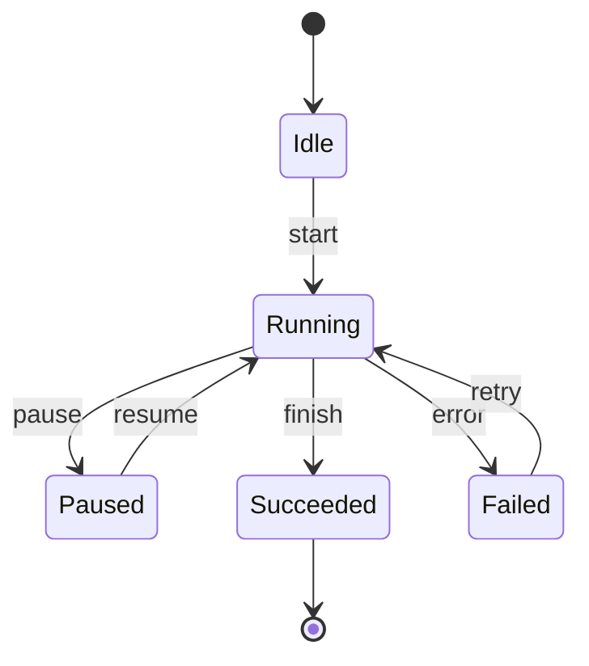

# 前置知识准备

A2A 规范的正文大量使用"任务""状态""消息""流"这些词。这些词的含义在
Agent 圈、JSON-RPC 圈、Web 前端圈各有各的习惯用法，不先对齐很容易读着
读着就偏了。

这一篇做三件事：补齐 **Agent 基础**、**JSON-RPC**、**SSE** 三个缺口，
最后把它们和 A2A 的概念做一次映射。

## 一、LLM Agent 基础

### 1.1 一个最小 Agent 长什么样

剥掉所有框架包装，Agent 就是一个"反复调用模型直到它不再要求调工具"的循环：

```python
messages = [system_prompt, user_input]
while True:
    response = llm.invoke(messages)
    if not response.tool_calls:
        break
    messages.append(response)
    for call in response.tool_calls:
        messages.append(execute(call))
```

关键点有两个：

1. **Agent 自己不产生"最终答案"，它产生一个循环**。循环何时停下由模型决定。
2. **Agent 的状态就是消息列表**。所谓"多轮对话""上下文记忆"，落地形态
   就是这个 list 越来越长。

这个朴素实现在真实场景里会立刻崩：

1. 进程一重启上下文全丢；
2. 没法在中间插入人工审核；
3. 没法在中间把活交给另一个 Agent。

这三件事的归属不同：

| 问题 | 谁来解决 |
| --- | --- |
| 1. 上下文持久化 | 编排框架 + 存储（LangGraph 的 checkpointer、你的数据库） |
| 2. 人工审核 | 编排框架负责流程；A2A 只在跨边界时提供"挂起—恢复"的协议契约 |
| 3. 委托给另一个 Agent | A2A，这正是协议本身要解决的问题 |

第 2 点最容易被误解，值得展开。**审批流程本身是编排层的活**——审批页面、
通知谁、超时怎么办、审批结果怎么落到业务表里，这些 LangGraph 用
`interrupt()` + `Command(resume=...)` 就能完成，进程内根本用不上 A2A。

A2A 在这里贡献的是**协议层的挂起—恢复契约**：

- **挂起**：Agent 把任务切到 `TASK_STATE_INPUT_REQUIRED`（或
  `TASK_STATE_AUTH_REQUIRED`），并在 `status.message` 里说明要什么；
- **观察**：任何持有 `taskId` 的一方都能用 `GetTask` 看到"它在等谁"；
- **恢复**：对方带着同一个 `taskId` + `contextId` 再发一条 `SendMessage`，
  任务接着往下走。

这三点在同进程内是多余的，编排器自己就知道状态存在哪。它们在**跨组织、
跨网络、对方只能看到协议**的场景里才成为刚需——这就是[对比选型](/a2a/comparison)
里"人在回路"那一行的真实含义。

### 1.2 工具调用

模型输出里可能带一个"我要调用 `get_weather(city)`"的结构化请求，运行时
执行它，把结果塞回消息列表，让模型继续。几个必须记住的细节：

- **工具描述就是提示词**。模型只看得到工具名、参数 JSON Schema、一段
  人类可读描述，就靠这些决定调不调、怎么传参。
- **工具调用是模型的一个"输出类型"**，和输出文本并列。模型本轮要么
  返回文本，要么返回工具调用，要么两者都有。
- **执行权在运行时手里**。模型没有执行任何东西的能力，它只是"说"要调。

这一点在 A2A 里会再次出现：A2A 协议完全不碰工具。**工具调用的封装与
执行发生在 Agent 内部**，A2A 只关心这个 Agent 作为一个整体对外提供什么
能力（体现为 Agent Card 里的 skills）。

### 1.3 状态机：三种常见形态

读 A2A 的 Task 状态机之前，先把"状态机"这件事本身讲清楚。

**状态机 = 一个有有限个状态的对象 + 一张合法的迁移表。**



三条基本规则：

1. **状态是离散的、可枚举的**。不能是"正在 37% 完成中"这种连续量。
2. **迁移是受限的**。`Succeeded → Running` 非法，收到这种请求要报错，
   不能默默接受。
3. **终态是吸收态**。一旦进入终态（成功 / 失败 / 取消），后续状态迁移
   一律拒绝。

Agent 系统里常见的两种状态机：

| 形态 | 状态集合 | 典型实现 |
| --- | --- | --- |
| **对话流** | 用户问 → 助手答 → （可能）工具调用 → 助手答 | 消息列表 + 工具调用循环 |
| **任务流** | 排队 → 执行中 → 等输入 → 完成 | 工作流引擎、队列消费者 |

**A2A 的 Task 状态机属于第二种**，并且覆盖得更全——它额外加了两个
"被打断"的状态（等待用户输入、等待授权），这两个状态的存在是 A2A 与
一般工作流引擎的关键差别，下文详述。

### 1.4 同步与异步

- **同步**：客户端发起请求，服务端把活干完再返回。客户端一直阻塞。
  简单，但长任务会把连接占死。
- **异步**：客户端发起请求，服务端立刻返回一个"任务句柄"，客户端之后
  用句柄查进度或订阅更新。

A2A 的设计是**异步优先**。规范里明确写着：

> A2A 操作被设计为异步任务执行。操作立即返回 `Task` 对象或 `Message` 对象；
> 返回 `Task` 时，处理在后台继续。

同步在 A2A 里也有位置：`SendMessage` 在服务端能秒回的时候，直接返回一个
`Message` 而不建 Task。这种"快路径"在规范里是允许的，见
[核心模型详解](/a2a/data-model)。

## 二、JSON-RPC 2.0

A2A 的 JSON-RPC 绑定就是 JSON-RPC 2.0，一个字没改。搞清楚三种消息
结构就够用了。

### 2.1 Request

```json
{
  "jsonrpc": "2.0",
  "id": "req-001",
  "method": "SendMessage",
  "params": {
    "message": {
      "role": "ROLE_USER",
      "parts": [{ "text": "查一下明天的天气" }]
    }
  }
}
```

- `jsonrpc` 固定为字符串 `"2.0"`。
- `id` 是请求标识。响应必须带回同一个 `id`，客户端据此配对。
  通知（notification）没有 `id`，服务端不回复。
- `method` 是方法名。**A2A v1.0 用 PascalCase**，如 `SendMessage`、`GetTask`。
- `params` 是参数对象。

### 2.2 Response

成功时：

```json
{
  "jsonrpc": "2.0",
  "id": "req-001",
  "result": { "...": "返回值" }
}
```

失败时：

```json
{
  "jsonrpc": "2.0",
  "id": "req-001",
  "error": {
    "code": -32001,
    "message": "Task not found",
    "data": [
      {
        "@type": "type.googleapis.com/google.rpc.ErrorInfo",
        "reason": "TASK_NOT_FOUND",
        "domain": "a2a-protocol.org"
      }
    ]
  }
}
```

`result` 和 `error` **二选一**，不会同时出现。`data` 数组里的对象遵循
ProtoJSON 的 `Any` 表示法，必须带 `@type` 标识类型。

### 2.3 错误码

标准 JSON-RPC 错误码（协议层通用）：

| 码 | 名称 | 含义 |
| --- | --- | --- |
| `-32700` | Parse error | JSON 语法错误 |
| `-32600` | Invalid Request | 不合法的 Request 结构 |
| `-32601` | Method not found | 方法不存在或不可用 |
| `-32602` | Invalid params | 参数非法 |
| `-32603` | Internal error | 服务端内部错误 |

A2A 自定义的错误码落在 `-32001` ~ `-32099`：

| 码 | 错误类型 | 典型触发场景 |
| --- | --- | --- |
| `-32001` | `TaskNotFoundError` | taskId 不存在或不可见 |
| `-32002` | `TaskNotCancelableError` | 任务已在终态，还要取消 |
| `-32003` | `PushNotificationNotSupportedError` | Agent 不支持推送，却来配置 webhook |
| `-32004` | `UnsupportedOperationError` | Agent 不支持流式，却调用流式接口 |
| `-32005` | `ContentTypeNotSupportedError` | Part 的 mediaType 超出 Agent 支持范围 |
| `-32006` | `InvalidAgentResponseError` | Agent 返回了不符合规范的数据 |
| `-32007` | `ExtendedAgentCardNotConfiguredError` | 声明支持扩展卡片但没配 |
| `-32008` | `ExtensionSupportRequiredError` | 服务端要求扩展，客户端没声明支持 |
| `-32009` | `VersionNotSupportedError` | `A2A-Version` 头里的版本不支持 |

这套错误码在三种绑定里有一一对应的映射表（JSON-RPC 数字码 / gRPC 状态码 /
HTTP 状态码），详见[标准接口全解析](/a2a/interfaces)。

### 2.4 批量请求

JSON-RPC 2.0 允许一次发多个请求。但 A2A **不要求也不建议**使用批量——
流式场景下一个请求对应一条 SSE 流，批量会把这层对应关系弄乱。
A2A 客户端 SDK 基本都是单请求单响应。

## 三、SSE：Server-Sent Events

### 3.1 它是什么

SSE 是 HTTP 之上的单向文本流协议。服务端把响应头设成
`Content-Type: text/event-stream`，然后不断往响应体里写"帧"：

```http
HTTP/1.1 200 OK
Content-Type: text/event-stream
Cache-Control: no-cache
Connection: keep-alive

data: {"type": "status", "state": "WORKING"}

data: {"type": "chunk", "text": "正在分析"}

data: {"type": "done"}
```

浏览器端一行 `EventSource` 就能消费。命令行端用 `curl -N`，Python 端用
`httpx.stream` 或 `aiohttp`。

### 3.2 帧格式

一帧以空行结束，内容是若干行 `字段: 值`：

```
event: status
id: 42
retry: 3000
data: {"state": "WORKING"}

```

- `data:` 是数据内容，可多行，多行之间用 `\n` 连接。
- `event:` 是事件名（可选，默认 `message`）。
- `id:` 是事件 ID（可选）。
- `retry:` 是重连间隔毫秒数（可选）。

只要有 `data:`，这个帧就有内容；空行是帧分隔符。

### 3.3 在 A2A 里的形态

A2A 的 SSE 帧里，`data:` 装的是一个 `StreamResponse` 对象。而 `StreamResponse`
是一个"四选一"的包装器：

```json
{ "task": { "id": "t-1", "status": { "state": "TASK_STATE_WORKING" } } }
```

```json
{ "statusUpdate": { "taskId": "t-1", "status": { "state": "TASK_STATE_COMPLETED" } } }
```

```json
{ "artifactUpdate": { "taskId": "t-1", "artifact": { "parts": [{ "text": "报告正文…" }] } } }
```

```json
{ "message": { "role": "ROLE_AGENT", "parts": [{ "text": "直接答复" }] } }
```

这四者互斥，一次帧里只会有一个。流式响应有两条形态：

| 形态 | 帧序列 |
| --- | --- |
| **消息流** | 只有一帧 `message`，然后连接立即关闭 |
| **任务生命周期流** | 首帧 `task`，随后若干 `statusUpdate` / `artifactUpdate`，到达终态时关闭 |

### 3.4 SSE 的两个坑

**坑一：连接断了就丢事件。** SSE 本身没有重放机制。断线之后中间的
`statusUpdate` 就永久丢失了。A2A 的应对方式是：客户端重连时用
`SubscribeToTask` 重新订阅，**服务端负责把断线期间的事件补齐**（这叫
backfill），同时客户端仍然可以用 `GetTask` 拉取当前全量状态。

**坑二：代理会掐断长连接。** nginx 默认的 `proxy_read_timeout` 是 60 秒，
中间件、负载均衡、CDN 都可能有自己的超时策略。生产部署必须显式配置：
关掉缓冲、抬高读超时、允许长连接。见[生产落地](/a2a/production)。

## 四、Task 与消息模型的前置理解

最后一块拼图：在读 A2A 规范之前，先建立一个朴素的问题意识。

### 4.1 为什么需要"任务"这个对象

假设客户端发一条消息："帮我查一下上季度的销售数据"。

这个请求有几种可能的结果：

1. 秒回：数据早就算好了，直接返回。
2. 快但不完整：需要 30 秒，能先给个大概。
3. 慢：要跑 10 分钟。
4. 根本做不了：需要权限。
5. 做了一半卡住了：要更多信息（哪个季度？哪个产品线？）。

**一个返回值装不下这五种情况。** 于是协议需要把"这次交互"抽象成一个
有生命周期的对象——**任务**。任务有 ID、有状态、有历史、有产物，
客户端拿着 ID 可以随时查、可以取消、可以在中断后接着聊。

这就是 A2A 里 `Task` 存在的全部理由。

### 4.2 为什么消息和产物要分开

再往前一步。任务执行过程中，Agent 产生两类东西：

| | 消息（Message） | 产物（Artifact） |
| --- | --- | --- |
| 性质 | 过程性交流 | 最终交付物 |
| 例子 | "我需要更多信息"、"正在处理第 3 步" | 一份报告、一张图、一份结构化数据 |
| 消费方 | 参与对话的人 / 上游 Agent | 业务系统 / 下游流程 |

规范里对此有很明确的一句话：

> 消息**不应**用于传递任务输出。结果**应当**通过与任务关联的 Artifact 返回。

这个切分带来三个好处：产物的生命周期和任务解耦（任务完成了产物仍在）；
产物可以被索引、被存储、被引用；消息流可以保持轻量。

### 4.3 三个 ID 的分工

A2A 里出现的三个 ID 很容易混，先固定住：

| ID | 谁生成 | 语义 | 生命周期 |
| --- | --- | --- | --- |
| `messageId` | 消息创建方 | 这一条消息的唯一标识 | 消息级，用于去重 |
| `taskId` | 服务端 | 一次任务工作单元 | 任务级，从创建到清理 |
| `contextId` | 服务端 | 一组相关任务与消息的逻辑分组 | 会话级，可以跨多个任务 |

典型的一次多轮交互长这样：

```text
客户端                                     服务端
  │                                          │
  │─ SendMessage { 没有 contextId } ─────────▶│  创建 task-1, context-A
  │◀─ Task { task-1, context-A,
  │          TASK_STATE_INPUT_REQUIRED }        │
  │                                          │
  │─ SendMessage { taskId: task-1,            │
  │                contextId: context-A } ───▶│  同一任务继续
  │◀─ Task { task-1, context-A,
  │          TASK_STATE_COMPLETED }            │
  │                                          │
  │─ SendMessage { contextId: context-A } ───▶│  同一上下文，新任务 task-2
  │◀─ Task { task-2, context-A,
  │          TASK_STATE_WORKING }              │
```

`contextId` 的意义是：**"这几次对话是同一件事"**。Agent 可以用它维持
跨任务的会话记忆，上游编排器也可以用它把相关任务归到一起做批量管理。

## 五、概念映射表

进入正文前，把这一篇的术语和 A2A 术语对齐：

| 本篇概念 | A2A 对应物 | 备注 |
| --- | --- | --- |
| Agent 循环 | （A2A 不管） | 发生在 Agent 内部 |
| 工具调用 | （A2A 不管） | 用 MCP 或函数调用实现 |
| 任务句柄 | `Task.id` | 服务端生成 |
| 任务状态 | `Task.status.state` | 9 个枚举值，4 终态 2 中断态 |
| 上下文 ID | `contextId` | 逻辑分组 |
| 过程消息 | `Message`（`role: ROLE_AGENT`） | 不承载最终结果 |
| 最终结果 | `Artifact` | 承载交付物 |
| JSON-RPC 方法 | `SendMessage` / `GetTask` / … | v1.0 用 PascalCase |
| SSE 帧 | `StreamResponse` | 四选一包装器 |
| 错误 | JSON-RPC `error` + `google.rpc.ErrorInfo` | A2A 自定义码从 `-32001` 起 |

## 六、自检

1. JSON-RPC 的 `result` 和 `error` 能不能同时出现？
2. A2A 的一次 SSE 响应里，第一帧可能是哪几种对象？
3. `Task` 有几个终态？分别是哪几个？
4. `contextId` 和 `taskId` 的生成方分别是谁？
5. 任务结果应该放在 `Message` 里还是 `Artifact` 里？

答不上第 3、4 题的，把 [1.3 状态机](#13-状态机三种常见形态) 和
[4.3 三个 ID 的分工](#43-三个-id-的分工) 重看一遍。

---

下一步：[核心认知：什么是 Agent-to-Agent 协议](/a2a/core-concepts)。
