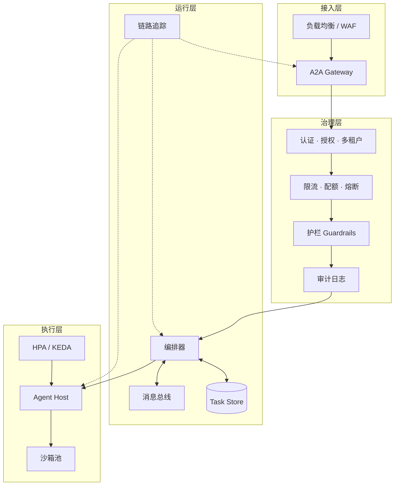
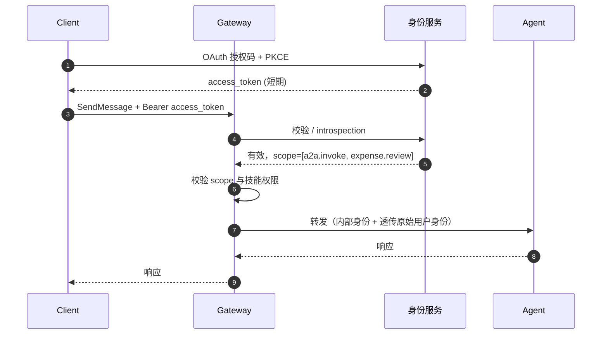
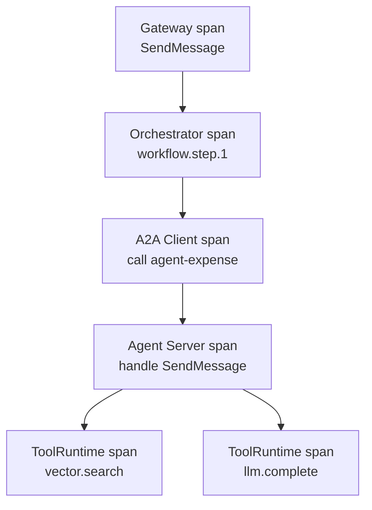
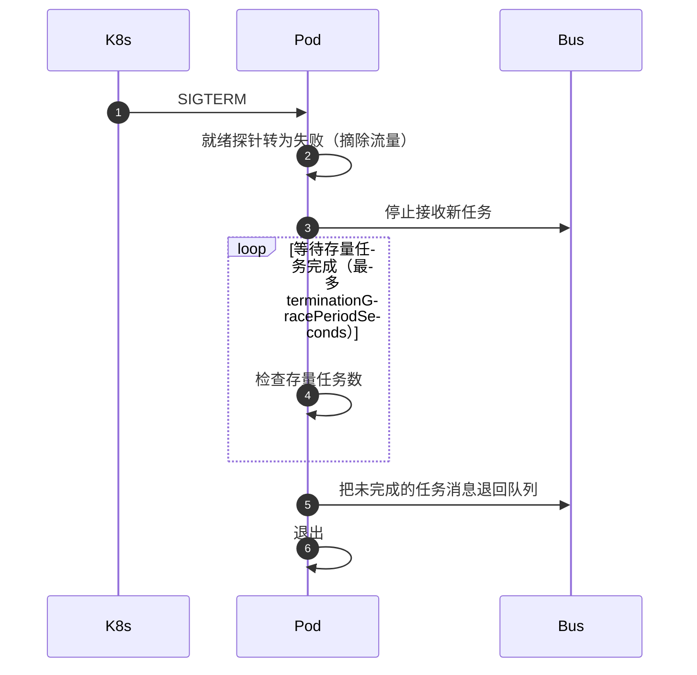

# 生产落地：A2A 平台必备能力

协议实现出来只是起点。这一篇讲要把 A2A 变成**生产可用的平台**，
需要补齐哪些能力、每个能力怎么设计、有哪些坑。

## 一、生产平台的能力全景



八个能力域，本篇逐个讲。

## 二、权限体系

### 2.1 三层身份

| 层 | 是什么 | 谁负责 |
| --- | --- | --- |
| **调用方身份** | 谁发起的这次调用 | 认证（Authentication） |
| **能力权限** | 这个身份能调哪些 Agent / 技能 | 授权（Authorization） |
| **数据权限** | 能看哪些任务、哪些数据 | 授权（Authorization） |

**三层必须分开。** 常见错误是只做第一层——token 有效就放行，
结果任何一个内部用户都能调任何一个 Agent 的任意技能。

### 2.2 认证

A2A 的认证沿用 Web 安全实践，Agent Card 声明方案，客户端携带凭据。

```json
"securitySchemes": {
  "oidc": {
    "openIdConnectSecurityScheme": {
      "openIdConnectUrl": "https://sso.example.com/.well-known/openid-configuration"
    }
  },
  "mtls": {
    "mtlsSecurityScheme": {}
  }
}
```

生产环境里的凭据流转：



**Gateway 校验外部 token，向下游注入内部身份。** Agent 内部完全不处理
外部身份体系——这大幅简化了每个 Agent 的实现。

下游收到的头：

```http
X-Internal-Identity: <signed-internal-token>
X-On-Behalf-Of: <原始用户 ID>
X-Tenant-Id: acme-corp
```

`X-On-Behalf-Of` 用来做**用户级数据隔离**——用户 A 不应该看到用户 B
的任务。

### 2.3 授权：三个粒度

**技能级授权。** 哪个身份能调哪个技能：

```python
POLICY = {
    "expense.review": {
        "roles": ["employee", "finance"],
        "scopes": ["a2a.invoke"],
    },
    "expense.admin.approve": {
        "roles": ["finance_admin"],
        "scopes": ["a2a.invoke", "expense.write"],
    },
}
```

**任务级授权。** 谁能看哪个任务。规范要求服务端**只能**返回调用方
有权访问的任务，并且**不应当**区分"不存在"和"无权访问"。

```python
async def get_task(self, task_id: str, principal: Principal) -> Task:
    task = self._tasks.get(task_id)
    if task is None:
        raise TaskNotFound()
    if not self._acl.can_read(principal, task):
        raise TaskNotFound()
    return task
```

注意两个分支抛的是**同一个错误**。如果无权访问返回 403，攻击者就能
通过错误码差异枚举出哪些 `taskId` 存在。

**数据级授权。** 任务内部的产物可能涉及更细的权限。常见做法是
在 Artifact 的 `metadata` 里带上归属信息：

```json
{
  "artifactId": "a-1",
  "name": "报销结论",
  "parts": [{ "data": { "decision": "approved" } }],
  "metadata": { "ownerUserId": "u-1024", "visibility": "owner_and_approvers" }
}
```

### 2.4 多租户

v1.0 的 `tenant` 字段是原生的多租户支持。三种隔离强度：

| 强度 | 实现 | 适用 |
| --- | --- | --- |
| **共享进程 + 逻辑隔离** | 同一进程，按 `tenant` 过滤查询 | 租户多、互不敏感 |
| **共享进程 + 独立 Schema** | 每租户一张表 | 租户少、需要租户级备份 |
| **独立部署** | 每租户一套服务 | 强合规要求、大客户 |

**逻辑隔离的坑**：所有查询必须带 `tenant` 条件。漏一处就是数据泄露。

```python
class TaskRepository:
    async def get(self, task_id: str, tenant: str) -> Task | None:
        row = await self._db.fetchone(
            "SELECT * FROM tasks WHERE id = $1 AND tenant = $2",
            task_id, tenant,
        )
        return Task.from_row(row) if row else None
```

**用数据库的行级安全（RLS）做兜底**更稳妥：

```sql
ALTER TABLE tasks ENABLE ROW LEVEL SECURITY;
CREATE POLICY tenant_isolation ON tasks
  USING (tenant = current_setting('app.tenant'));
```

这样即使应用层漏了条件，数据库也会挡住。

## 三、限流与配额

### 3.1 三个维度的限流

| 维度 | 目的 | 典型值 |
| --- | --- | --- |
| **按调用方** | 防单个调用方刷爆 | 每 Agent 每分钟 N 次 |
| **按被调 Agent** | 保护下游 Agent 不被打垮 | 每 Agent 每分钟 M 次 |
| **按租户** | 租户级资源公平 | 每租户并发 K 个任务 |

再往上一层还有**并发任务数**限制和**token 预算**限制。

### 3.2 令牌桶实现

```python
import asyncio
import time


class TokenBucket:
    def __init__(self, rate: float, capacity: float):
        self.rate = rate
        self.capacity = capacity
        self.tokens = capacity
        self.updated = time.monotonic()
        self._lock = asyncio.Lock()

    async def acquire(self, amount: float = 1.0) -> bool:
        async with self._lock:
            now = time.monotonic()
            self.tokens = min(
                self.capacity, self.tokens + (now - self.updated) * self.rate
            )
            self.updated = now
            if self.tokens >= amount:
                self.tokens -= amount
                return True
            return False
```

### 3.3 限流响应的细节

超限时的响应要**明确告诉客户端等多久**：

```http
HTTP/1.1 429 Too Many Requests
Retry-After: 12
X-RateLimit-Limit: 60
X-RateLimit-Remaining: 0
X-RateLimit-Reset: 1772345678
```

规范在系统错误一节里说：服务端**可以**在错误里包含重试指引
（HTTP 场景下比如 `Retry-After` 头）。**这是 MAY，不是 MUST**——但生产上
建议一定给：客户端没有它就只能瞎猜退避时间。

### 3.4 熔断

下游 Agent 挂掉时，网关不能被拖垮：

```python
class CircuitBreaker:
    def __init__(self, failure_threshold=5, recovery_timeout=30):
        self.state = "closed"
        self.failures = 0
        self.failure_threshold = failure_threshold
        self.recovery_timeout = recovery_timeout
        self.opened_at = 0.0

    def allow(self) -> bool:
        if self.state == "closed":
            return True
        if self.state == "open":
            if time.monotonic() - self.opened_at > self.recovery_timeout:
                self.state = "half_open"
                return True
            return False
        return True

    def record_success(self) -> None:
        self.state = "closed"
        self.failures = 0

    def record_failure(self) -> None:
        self.failures += 1
        if self.failures >= self.failure_threshold and self.state == "closed":
            self.state = "open"
            self.opened_at = time.monotonic()
```

熔断打开时，网关直接返回 `503` / `-32603`，**不要把请求透传下去**。

### 3.5 队列背压

长任务会堆积。需要在两个地方限流：

- **入口**：超过队列深度时直接拒绝新任务（快失败）；
- **执行**：每个 Agent 的并发数上限。

```python
MAX_QUEUE_DEPTH = 1000

if bus.depth("agent.expense") > MAX_QUEUE_DEPTH:
    return JSONResponse(
        ProtocolError(-32603, "Agent queue is full").to_jsonrpc(request_id),
        status_code=503,
        headers={"Retry-After": "5"},
    )
```

## 四、护栏（Guardrails）

### 4.1 护栏放在哪一层

A2A 生态里，护栏有三个位置，各管不同的事：

| 位置 | 拦什么 | 例子 |
| --- | --- | --- |
| **网关层** | 跨 Agent 的通用红线 | Prompt 注入检测、敏感词、PII 脱敏、越权调用 |
| **编排层** | 流程级的策略 | 步骤顺序、金额上限、必须人工审批的环节 |
| **Agent 内部** | 业务级规则 | 退货率超阈值就拒绝、置信度太低就转人工 |

**网关层是唯一能拦住"恶意 Agent 调用"的层。** 因为对方是外部系统，
你无法在对方代码里埋检查。

### 4.2 网关层的四类检查

**第一类：输入检查。**

```python
class InputGuard:
    def __init__(self, blocked_patterns: list[str], max_part_bytes: int = 5 * 1024 * 1024):
        self._patterns = [re.compile(p) for p in blocked_patterns]
        self._max_part_bytes = max_part_bytes

    def check(self, message: Message) -> str | None:
        for part in message.parts:
            if part.text:
                for pattern in self._patterns:
                    if pattern.search(part.text):
                        return f"命中敏感模式：{pattern.pattern}"
            if part.url:
                if not is_allowed_host(part.url):
                    return f"URL 主机不在白名单：{part.url}"
            if part.data is not None:
                # v1.0 的 Part.data 是 protobuf Value，先转成普通 JSON 值再量
                size = len(MessageToDict(part.data).encode())
                if size > self._max_part_bytes:
                    return f"结构化数据过大：{size} 字节"
        return None
```

**注意 `part.url` 的白名单检查。** 这是一类真实存在的攻击面：
恶意 Agent 传一个 `url` 指向内网地址（`http://169.254.169.254/...`），
下游 Agent 去取的时候就是 SSRF。**服务端取 URL 内容前必须做白名单校验。**

**第二类：输出检查。**

```python
class OutputGuard:
    def __init__(self, pii_patterns: list[str], redact: bool = True):
        self._pii = [re.compile(p) for p in pii_patterns]
        self._redact = redact

    def scrub(self, artifact: Artifact) -> Artifact:
        new_parts = []
        for part in artifact.parts:
            if part.text:
                text = part.text
                for pattern in self._pii:
                    if pattern.search(text):
                        if not self._redact:
                            raise GuardrailViolation(pattern.pattern)
                        text = pattern.sub("[REDACTED]", text)
                new_parts.append(
                    Part(
                        text=text,
                        media_type=part.media_type,
                        filename=part.filename,
                        metadata=part.metadata,
                    )
                )
            else:
                new_parts.append(part)
        return Artifact(
            artifact_id=artifact.artifact_id,
            parts=new_parts,
            name=artifact.name,
            description=artifact.description,
            metadata=artifact.metadata,
            extensions=artifact.extensions,
        )
```

**第三类：调用关系检查。** 防止调用环：

```python
def would_cycle(caller: str, callee: str, trace: list[str]) -> bool:
    return callee in trace or caller == callee
```

A2A 协议不限制 Agent 之间的调用深度。**A2A 链路里必须有环检测**，
否则两个互相调用的 Agent 会无限递归。

**第四类：资源护栏。** token 预算、执行时长、产物大小。

### 4.3 护栏的两种处置策略

| 策略 | 做法 | 适用 |
| --- | --- | --- |
| **拦截** | 返回错误，不执行 | 明确违规 |
| **降级** | 执行但修改结果（脱敏、截断） | 可以补救的情况 |

**默认用拦截，脱敏是例外。** 静默修改结果会让下游困惑——
拿到一个被截断的数据却不知道。

### 4.4 护栏要留审计

**每一次拦截都要记录**：谁、什么时候、调了什么、被哪条规则拦的。

```json
{
  "ts": "2026-03-01T10:22:31.000Z",
  "event": "guardrail.blocked",
  "tenant": "acme-corp",
  "caller": "agent-42",
  "callee": "expense-agent",
  "rule": "ssrf_url_blocklist",
  "detail": "http://169.254.169.254/latest/meta-data/",
  "traceId": "4bf92f3577b34da6a3ce929d0e0e4736"
}
```

没有这条日志，护栏就成了"看不见的黑洞"——出问题时无法复盘。

## 五、审计日志

### 5.1 审计要记什么

| 类别 | 内容 |
| --- | --- |
| **调用** | 调用方、Agent、技能、参数摘要、耗时、结果状态 |
| **状态变更** | 任务 ID、状态迁移、触发方、时间 |
| **凭据** | 谁申请了哪个凭据、给了什么 scope、用了多久 |
| **数据访问** | 读了哪个任务、取了哪个产物、涉及哪些数据分类 |
| **配置变更** | 谁改了 Agent Card、谁调了限流、谁授权了新技能 |
| **护栏** | 拦截记录、规则 ID、上下文 |

**"参数摘要"要脱敏也要保留可追溯性。** 完整记录请求体可能包含
PII 和商业机密；完全不记录又无法排障。折中做法是记录**结构化的摘要**：

```json
{
  "parts": [
    { "variant": "text", "length": 42, "sha256": "a1b2c3..." },
    { "variant": "url", "mediaType": "image/png", "size": 245760, "sha256": "d4e5f6..." },
    { "variant": "data", "keys": ["category", "amount", "date"] }
  ]
}
```

（`variant` 是这份审计摘要自定义的键，值与 v1.0 Part 的 `text` / `url` /
`raw` / `data` 四种形态对应；它不是协议字段，别照抄到线上协议报文里。）

哈希能用来判断"两次请求的内容是否相同"，字段名能用来排查，
敏感值不落盘。

### 5.2 审计日志的存储

| 方案 | 适合 |
| --- | --- |
| 结构化日志 → ELK / Loki | 查询灵活，成本低 |
| 审计表（PostgreSQL） | 需要强一致和事务关联 |
| 专用审计服务 | 合规要求，需要防篡改 |

**关键要求：审计日志不可篡改。** 常见做法是写入 WORM 存储，
或者用链式哈希（每条记录包含上一条的哈希）。

```python
def chain_hash(prev_hash: str, record: dict) -> str:
    payload = prev_hash + json.dumps(record, sort_keys=True)
    return hashlib.sha256(payload.encode()).hexdigest()
```

### 5.3 关联 ID 的贯穿

一个请求从网关到编排到 Agent，要能串起来：

| ID | 作用 | 生成方 |
| --- | --- | --- |
| `traceId` | 分布式追踪，跨服务 | 网关 |
| `spanId` | 单个操作 | 各服务 |
| `requestId` | JSON-RPC 请求标识 | 客户端 |
| `taskId` | A2A 任务标识 | 服务端 |
| `messageId` | 消息标识 | 消息创建方 |
| `auditId` | 审计记录标识 | 网关 |

**`traceId` 必须在 A2A 消息里传下去。** 规范没有为它定义标准位置，
实践中通常放在 `Message.metadata` 或 HTTP 头：

```json
{
  "message": {
    "role": "ROLE_USER",
    "parts": [{ "text": "..." }],
    "metadata": { "traceId": "4bf92f3577b34da6a3ce929d0e0e4736" }
  }
}
```

```python
ctx.task.metadata = {**(ctx.task.metadata or {}), "traceId": trace_id}
```

**这一步很容易被漏掉**，然后出问题时链路就断了。

## 六、持久化与断点续跑

### 6.1 需要持久化什么

| 数据 | 存哪 | 保留多久 | 丢了会怎样 |
| --- | --- | --- | --- |
| **任务状态** | 关系库 | 业务需要（如 90 天） | 客户端无法跟踪 |
| **消息历史** | 关系库 | 同上 | 上下文丢失 |
| **产物** | 对象存储 | 长期 | 结果不可取回 |
| **事件日志** | 时序库 / 关系库 | 短期（如 7 天） | 无法回放和补发 |
| **幂等索引** | Redis / 关系库 | 消息 id 的 TTL | 重试产生重复任务 |
| **编排状态** | 关系库 | 流程实例生命周期 | 流程无法恢复 |

**产物存对象存储，库里只存元数据和引用。**

```sql
CREATE TABLE tasks (
    id            UUID PRIMARY KEY,
    tenant        TEXT        NOT NULL,
    context_id    TEXT        NOT NULL,
    state         TEXT        NOT NULL,
    status_message JSONB,
    artifacts     JSONB       NOT NULL DEFAULT '[]',
    metadata      JSONB,
    created_at    TIMESTAMPTZ NOT NULL DEFAULT now(),
    updated_at    TIMESTAMPTZ NOT NULL DEFAULT now()
);

CREATE INDEX ON tasks (tenant, context_id);
CREATE INDEX ON tasks (tenant, state) WHERE state IN (
    'TASK_STATE_SUBMITTED', 'TASK_STATE_WORKING',
    'TASK_STATE_INPUT_REQUIRED', 'TASK_STATE_AUTH_REQUIRED'
);

CREATE TABLE task_messages (
    task_id    UUID NOT NULL REFERENCES tasks(id) ON DELETE CASCADE,
    seq        BIGINT NOT NULL,
    message    JSONB NOT NULL,
    PRIMARY KEY (task_id, seq)
);
```

那个部分索引很有用——**只索引非终态任务**，因为"查我的进行中任务"
是高频查询，"查半年前完成的任务"是低频查询。

### 6.2 断点续跑的三个级别

**级别一：任务状态可恢复。** 进程重启后，`GetTask` 仍然能返回正确状态。

```python
class DurableTaskStore:
    def __init__(self, db: AsyncPool):
        self._db = db

    async def save(self, task: Task) -> None:
        await self._db.execute(
            """
            UPDATE tasks
               SET state = $2,
                   status_message = $3,
                   artifacts = $4,
                   metadata = $5,
                   updated_at = now()
             WHERE id = $1
            """,
            task.id,
            task.status.state,
            json.dumps(
                MessageToDict(task.status.message) if task.status.message else None
            ),
            json.dumps([MessageToDict(a) for a in task.artifacts]),
            json.dumps(MessageToDict(task.metadata) if task.metadata else {}),
        )

    async def append_message(self, task_id: str, seq: int, message: Message) -> None:
        await self._db.execute(
            "INSERT INTO task_messages (task_id, seq, message) VALUES ($1, $2, $3)",
            task_id, seq, json.dumps(message.to_json()),
        )
```

**级别二：编排流程可恢复。** 流程状态持久化，重启后从当前节点继续。

**级别三：Agent 内部执行可恢复。** 这一级最贵。要求 Agent 的执行
逻辑本身可中断、可重入。通常用 checkpoint 机制：

```python
class CheckpointedExecutor:
    async def run(self, task: Task) -> Artifact:
        checkpoint = await self._load_checkpoint(task.id)
        step_index = checkpoint["step"] if checkpoint else 0
        for step in self.steps:
            if step_index <= checkpoint["step"] if checkpoint else False:
                step_index += 1
                continue
            result = await self._execute_step(step)
            await self._save_checkpoint(task.id, {"step": step_index, "result": result})
            step_index += 1
        return self._build_artifact()
```

**级别三只适合一部分 Agent。** 短任务（秒级）做级别一就够了；
长任务（分钟级以上）值得做级别二或三。

### 6.3 状态更新的原子性

**并发更新同一个任务是真实风险。** 两个请求同时改一个任务的状态，
后写的会覆盖先写的。解决办法：

```python
async def transition(task_id: str, target: str, expected_from: set[str]) -> bool:
    async with self._db.acquire() as conn:
        async with conn.transaction():
            row = await conn.fetchrow(
                "SELECT state FROM tasks WHERE id = $1 FOR UPDATE", task_id
            )
            if row is None:
                return False
            if row["state"] not in expected_from:
                return False
            await conn.execute(
                "UPDATE tasks SET state = $2, updated_at = now() WHERE id = $1",
                task_id, target,
            )
            return True
```

用 `SELECT ... FOR UPDATE` + 条件更新（乐观锁的变体）保证状态迁移的
原子性。**compare-and-swap 语义**（`expected_from`）比单纯加锁更准确：
它保证"从 X 迁出"这件事只发生一次。

### 6.4 产物存储

```python
class ArtifactStore:
    def __init__(self, bucket: str, base_url: str):
        self._bucket = bucket
        self._base_url = base_url

    async def put(self, artifact: Artifact) -> Artifact:
        for part in artifact.parts:
            if part.data is not None and not part.url:
                blob = json.dumps(part.data, ensure_ascii=False).encode()
                key = f"{artifact.artifact_id}/{uuid4().hex}.json"
                await self._s3.put(key, blob, content_type="application/json")
                part.url = f"{self._base_url}/{key}"
                part.data = None
            elif part.raw is not None:
                key = f"{artifact.artifact_id}/{uuid4().hex}.bin"
                await self._s3.put(key, part.raw, content_type=part.media_type or "application/octet-stream")
                part.url = f"{self._base_url}/{key}"
                part.raw = None
        return artifact
```

**大产物转成预签名 URL**，把文件传输的压力从消息体挪到对象存储。

## 七、链路追踪

### 7.1 追踪的层次



**每一层都要 span。** 只在 Gateway 打点的话，看到的只是"这次调用花了
3 秒"，无法定位是检索慢还是生成慢。

### 7.2 把 trace 传下去

```python
class TracedA2AClient:
    """包一层 v1.0 Python SDK 的 Client，注入 tracing。"""

    def __init__(self, inner: Client, tracer: Tracer):
        self._inner = inner
        self._tracer = tracer

    async def send_message(self, request: SendMessageRequest, **kw):
        with self._tracer.start_as_current_span("a2a.SendMessage") as span:
            span.set_attribute("a2a.tenant", request.tenant)
            span.set_attribute("a2a.message_id", request.message.message_id)
            # v1.0 的 send_message 返回 AsyncIterator[StreamResponse]，
            # 首个事件通常是 Task
            async for resp in self._inner.send_message(request, **kw):
                if resp.task is not None:
                    span.set_attribute("a2a.task_id", resp.task.id)
                    span.set_attribute("a2a.state", resp.task.status.state)
                yield resp
```

**在 A2A 消息里带 `traceId`**，让下游 Agent 能接上：

```python
message.metadata = {**(message.metadata or {}), "traceId": current_trace_id()}
```

gRPC 场景用 metadata 传，JSON-RPC 场景用 HTTP 头传：

```http
traceparent: 00-4bf92f3577b34da6a3ce929d0e0e4736-00f067aa0ba902b7-01
```

用 W3C `traceparent` 头最通用，OpenTelemetry 默认支持。

### 7.3 关键 span 属性

规范没有定义追踪属性，但实践中这几个最有用：

| 属性 | 类型 | 用途 |
| --- | --- | --- |
| `a2a.task_id` | string | 关联任务 |
| `a2a.context_id` | string | 关联会话 |
| `a2a.method` | string | 哪个操作 |
| `a2a.state` | string | 终态判断 |
| `a2a.tenant` | string | 租户维度分析 |
| `a2a.agent` | string | 哪个 Agent |
| `a2a.input_bytes` | int | 载荷大小 |
| `a2a.output_bytes` | int | 产物大小 |
| `a2a.tool_calls` | int | 内部工具调用次数 |
| `a2a.token_usage` | int | 成本归因 |

**`a2a.tool_calls` 和 `a2a.token_usage` 只能由 Agent 内部埋点提供。**
协议层看不到，这是不透明执行的代价。

## 八、K8s 部署与弹性伸缩

### 8.1 部署形态

```yaml
apiVersion: apps/v1
kind: Deployment
metadata:
  name: expense-agent
spec:
  replicas: 3
  selector:
    matchLabels:
      app: expense-agent
  template:
    metadata:
      labels:
        app: expense-agent
    spec:
      containers:
        - name: agent
          image: registry.internal/expense-agent:1.4.2
          ports:
            - containerPort: 9102
          env:
            - name: A2A_CARD_VERSION
              value: "1.4.2"
            - name: TASK_STORE_DSN
              valueFrom:
                secretKeyRef:
                  name: db-creds
                  key: dsn
            - name: POLICY_AGENT_URL
              value: "http://policy-agent:9101"
          resources:
            requests:
              cpu: "500m"
              memory: "1Gi"
            limits:
              cpu: "2"
              memory: "4Gi"
          readinessProbe:
            httpGet:
              path: /.well-known/agent-card.json
              port: 9102
            initialDelaySeconds: 3
            periodSeconds: 10
          livenessProbe:
            httpGet:
              path: /healthz
              port: 9102
            initialDelaySeconds: 15
            periodSeconds: 20
      terminationGracePeriodSeconds: 60
```

**就绪探针指向 Agent Card 端点**，这个设计很实用：卡片端点能返回，
说明 Agent 已经能处理请求了。

### 8.2 优雅停机

**A2A 场景的优雅停机比普通 Web 服务更复杂**，因为有长任务。



**"把未完成的任务消息退回队列"**是关键。Agent Server 收到 SIGTERM 后：

1. 立刻从就绪端点返回失败，让负载均衡摘除它；
2. 停止从消息总线拉取新任务；
3. 等存量任务完成，或等到宽限期；
4. 把没做完的任务消息 **nack 回队列**（或者发一条"重新调度"消息）；
5. 退出。

**注意第 4 步**：如果直接退出，队列里的消息会卡到可见性超时才重投，
客户端要多等几十秒。

### 8.3 弹性伸缩

**KEDA 比 HPA 更适合 Agent 场景**，因为扩容信号通常不是 CPU。

```yaml
apiVersion: keda.sh/v1alpha1
kind: ScaledObject
metadata:
  name: expense-agent
spec:
  scaleTargetRef:
    name: expense-agent
  minReplicaCount: 2
  maxReplicaCount: 30
  triggers:
    - type: rabbitmq
      metadata:
        queueName: agent.expense.execute
        queueLength: "20"
        mode: QueueLength
    - type: prometheus
      metadata:
        expression: a2a_task_waiting_seconds
        threshold: "30"
```

两种触发器：

| 触发器 | 含义 | 适用 |
| --- | --- | --- |
| **队列长度** | 待处理消息数 | 主力信号，简单直接 |
| **等待时长指标** | 任务在队列里等了多久 | SLA 敏感的场合 |
| **CPU** | 利用率 | CPU 密集型 Agent |
| **并发任务数** | 在跑的任务数 | 有并发上限约束的 Agent |

### 8.4 长任务 Agent 的扩容差异

| 维度 | 短任务 Agent | 长任务 Agent |
| --- | --- | --- |
| 扩容速度 | 快，Pod 秒级就绪 | 慢，需要预热 |
| 缩容 | 激进，收到 SIGTERM 立刻退 | 保守，必须等存量跑完 |
| 状态 | 无状态，Pod 随便杀 | 执行环境要独立于 Pod |
| 最小副本 | 0 或 1 | 至少 1，保证能接任务 |
| 扩缩容指标 | 队列长度 | 队列长度 + 等待时长 |

**长任务 Agent 的关键架构要求**：执行环境（沙箱）必须独立于 Pod。
否则 Pod 一重启，正在跑的任务就没了。

```text
Pod（无状态，任务协调）──创建──> 沙箱实例（独立生命周期）
     │                                    │
     └── 状态写 Task Store <──心跳/结果────┘
```

### 8.5 多 Agent 的资源隔离

```yaml
apiVersion: v1
kind: ResourceQuota
metadata:
  name: agent-quota
spec:
  hard:
    requests.cpu: "40"
    requests.memory: 100Gi
    limits.cpu: "100"
    limits.memory: 250Gi
    pods: "150"
```

配合 PriorityClass 给关键 Agent 保底：

```yaml
apiVersion: scheduling.k8s.io/v1
kind: PriorityClass
metadata:
  name: critical-agents
value: 1000
globalDefault: false
description: "支付、审批等关键 Agent 的调度优先级"
```

### 8.6 沙箱池

代码执行类的 Agent 需要单独的沙箱池：

```yaml
apiVersion: keda.sh/v1alpha1
kind: ScaledObject
metadata:
  name: sandbox-pool
spec:
  scaleTargetRef:
    name: sandbox
  minReplicaCount: 5
  maxReplicaCount: 100
  triggers:
    - type: prometheus
      metadata:
        expression: sandbox_queue_depth
        threshold: "10"
```

沙箱 Pod 启得快（镜像是预热的通用环境），用完即毁，比长驻更安全。

## 九、灰度与版本管理

### 9.1 协议版本的灰度

A2A 规范给了很明确的机制：**同一个端点可以暴露多个协议版本。**

```json
"supportedInterfaces": [
  { "url": "https://a.example.com/a2a", "protocolBinding": "JSONRPC", "protocolVersion": "1.0" },
  { "url": "https://a.example.com/a2a/v03", "protocolBinding": "JSONRPC", "protocolVersion": "0.3" }
]
```

客户端从 `supportedInterfaces` 里挑一个支持的。**这让协议版本迁移
可以是渐进的**，无需一刀切。

### 9.2 业务版本与协议版本分开

| 版本 | 含义 | 兼容性 |
| --- | --- | --- |
| `AgentInterface.protocolVersion` | A2A 协议版本 | 由规范保证 |
| `AgentCard.version` | 业务实现版本 | 自己保证 |
| `AgentSkill.id` | 技能标识 | **尽量保持稳定** |

**`AgentSkill.id` 稳定很重要。** 上游 Agent 可能按 `id` 做路由或策略
匹配，改了 id 等于换了个技能。

### 9.3 灰度发布

```text
10% 流量 → v1.5.0
90% 流量 → v1.4.2
```

按什么分流？几个可行维度：

| 维度 | 说明 |
| --- | --- |
| 调用方 | 按调用方 ID 哈希，稳定分桶 |
| 租户 | 大客户先留在旧版 |
| `contextId` | 同一会话的请求走同一版本（重要！） |
| 技能 | 只对某个技能灰度 |

**按 `contextId` 分流很重要**：同一个会话里一半请求走新版一半走旧版，
会出现上下文不一致。

## 十、上线检查清单

### 10.1 安全

- [ ] 所有 A2A 端点强制 HTTPS
- [ ] Gateway 校验 token，Agent 内部只用内部身份
- [ ] 任务级授权，越权返回 `TaskNotFoundError`，不返回 403
- [ ] `Part.url` 有主机白名单（防 SSRF）
- [ ] 调用图有环检测
- [ ] 产物中的 PII 按策略脱敏
- [ ] Agent Card 签名验证在客户端强制执行
- [ ] 凭据带外传递，不进消息体

### 10.2 可靠性

- [ ] 任务状态持久化，进程重启后可查
- [ ] 状态迁移用 CAS 语义，有并发保护
- [ ] 有租约/心跳机制检测悬挂任务
- [ ] 客户端有幂等键，重试不产生重复任务
- [ ] 队列有死信队列和人工介入通道
- [ ] webhook 接收方有兜底扫描器
- [ ] 取消能真正打断执行
- [ ] 优雅停机会退回未完成的消息

### 10.3 可观测

- [ ] 全链路 traceId 贯穿
- [ ] 关键 span 属性齐全
- [ ] 审计日志不可篡改且脱敏
- [ ] 有 Agent 内部工具调用的独立埋点
- [ ] 有任务状态分布的看板
- [ ] 降级次数有告警

### 10.4 容量

- [ ] 三维度限流（调用方 / 被调 Agent / 租户）
- [ ] 熔断已接入
- [ ] 并发任务数上限
- [ ] 扩缩容指标选对（队列长度 / 等待时长）
- [ ] 长任务 Agent 有预热和最小副本

## 十一、小结

- 权限分三层：调用方身份、能力权限、数据权限。**越权要返回
  `TaskNotFoundError`，不能返回 403。**
- 限流三个维度 + 队列背压 + 熔断，429 必须带 `Retry-After`。
- 护栏分三层布防，网关层是唯一能拦住恶意 Agent 的位置；
  URL 白名单是必须的（防 SSRF）。
- 审计要记调用、状态变更、凭据、数据访问、配置变更、护栏六类。
- 持久化分三个级别，按任务时长选择投入。状态更新要用 CAS 语义。
- 追踪的 span 要覆盖网关、编排、Agent、工具四层；
  `traceId` 必须在 A2A 消息里传下去。
- K8s 部署的关键在优雅停机（退回未完成消息）和长任务 Agent 的
  执行环境解耦。
- 灰度要按 `contextId` 分流，避免同一会话跨版本。

下一篇：[避坑专题：高频误区与踩坑总结](/a2a/pitfalls)。
