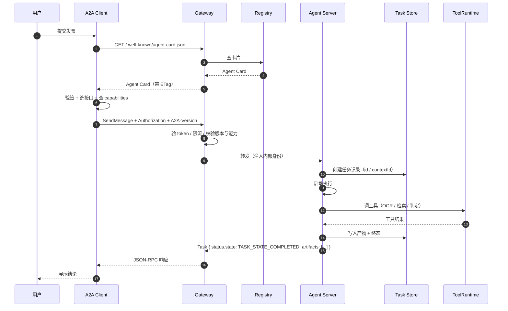
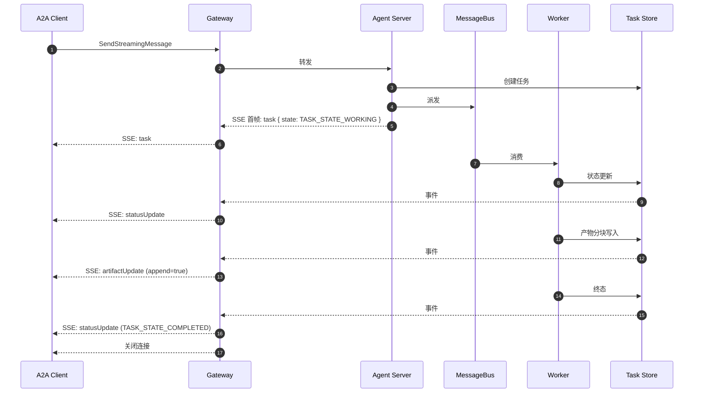
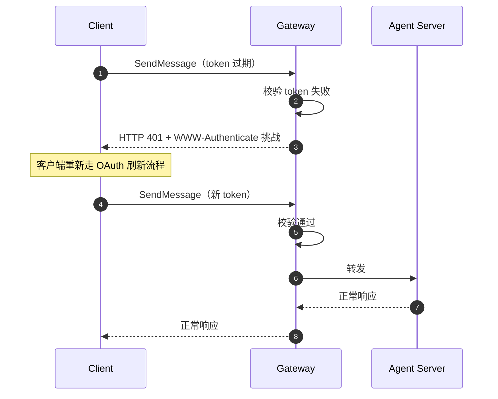
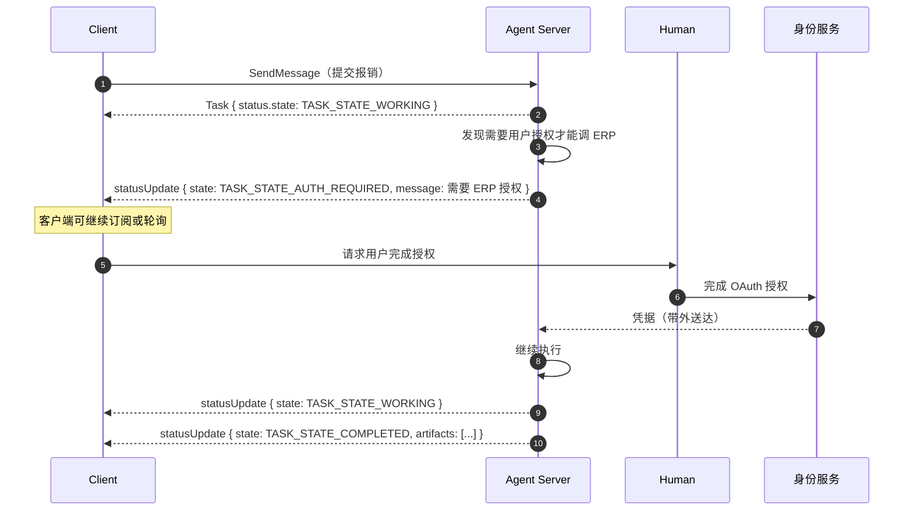
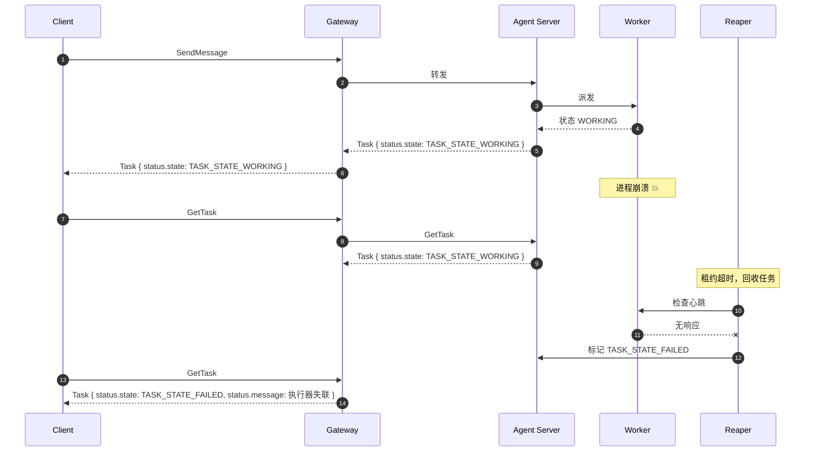
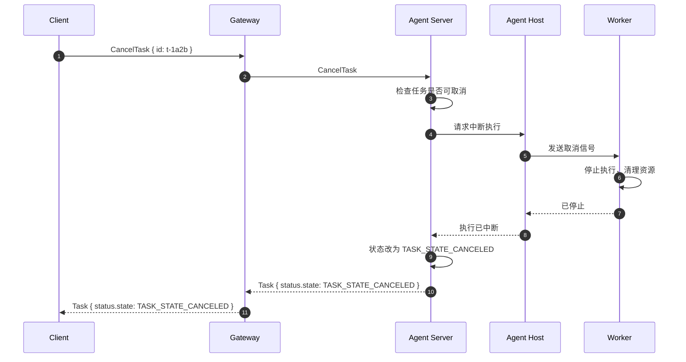
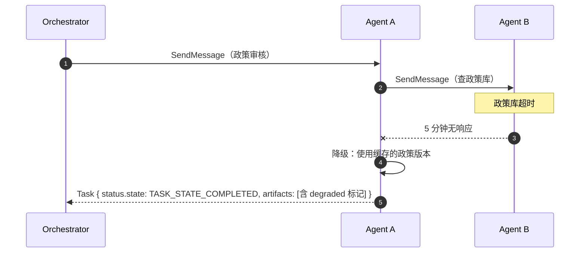
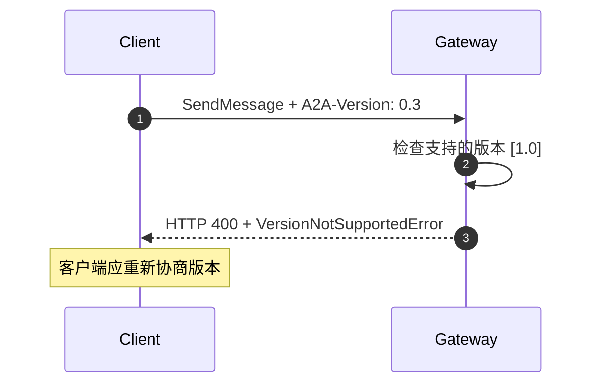
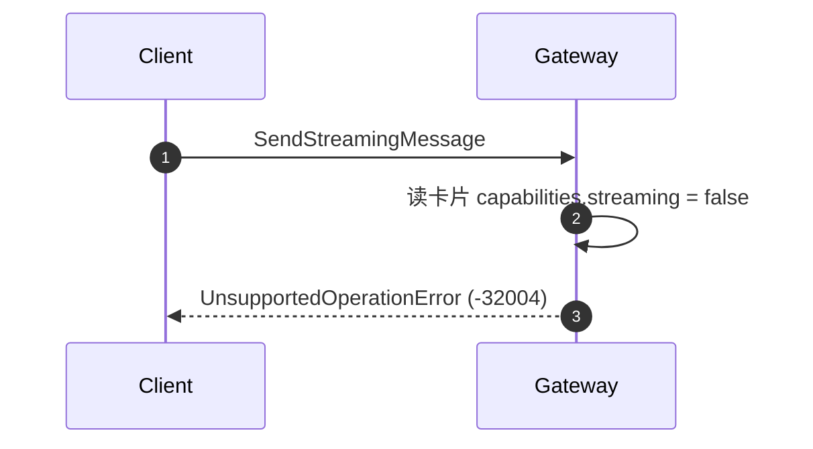

# 全流程调用时序

上一篇给了静态架构。这一篇把它变成**动态时序**——从客户端敲下回车，
到结果呈现，中间每一跳发生什么。

覆盖五条链路：正常同步、正常流式、鉴权失败、Agent 崩溃、取消与超时降级。

## 一、正常流程：同步短任务

### 1.1 完整时序



### 1.2 逐跳说明

**第 1–4 跳：发现。** 客户端拉卡片。注意这一跳通常有缓存：

- Gateway 侧缓存卡片（`Cache-Control` / `ETag`）；
- 客户端侧也可以缓存。

**第 5 跳：客户端本地决策。** 这几件事都在客户端进程里完成：

```python
card = fetch_card(url)
verify_signature(card)                      # 有签名才验
iface = pick_interface(card, client_supports)  # supportedInterfaces[0]
assert "application/json" in card["defaultOutputModes"]
assert card["capabilities"]["streaming"] is True
```

**第 6–7 跳：网关治理。** 见[系统架构](/a2a/architecture#二、gateway-层)。

**第 8 跳：任务创建。** 这里是 `taskId` 和 `contextId` 的诞生点：

```python
task = Task(
    id=str(uuid4()),
    context_id=incoming.context_id or str(uuid4()),
    status=TaskStatus(state="TASK_STATE_SUBMITTED", timestamp=now_iso()),
)
store.put(task)
```

**注意 `context_id` 的处理**：客户端带了就用客户端的，没带就生成新的。
服务端生成的值**必须**出现在响应里。

**第 9–10 跳：执行。** 这一步是 Agent 的内部实现，协议完全看不见。

**第 11 跳：落库 + 终态。** 产物写进 Task Store，状态改成终态。

### 1.3 请求与响应的完整报文

请求：

```http
POST /rpc HTTP/1.1
Host: agents.example.com
Content-Type: application/json
Authorization: Bearer eyJhbGciOi...
A2A-Version: 1.0
```

```json
{
  "jsonrpc": "2.0",
  "id": "req-7c1",
  "method": "SendMessage",
  "params": {
    "message": {
      "messageId": "msg-8a3f",
      "role": "ROLE_USER",
      "parts": [
        { "text": "帮我看看这张发票能不能报" },
        {
          "url": "https://s3.example.com/inv/inv-2026-0031.png",
          "filename": "inv.png",
          "mediaType": "image/png"
        }
      ]
    },
    "configuration": {
      "acceptedOutputModes": ["application/json"],
      "returnImmediately": false
    }
  }
}
```

响应：

```json
{
  "jsonrpc": "2.0",
  "id": "req-7c1",
  "result": {
    "task": {
      "id": "t-1a2b",
      "contextId": "c-9f3e",
      "status": {
        "state": "TASK_STATE_COMPLETED",
        "timestamp": "2026-03-01T10:00:03.120Z"
      },
      "artifacts": [
        {
          "artifactId": "a-1",
          "name": "报销结论",
          "parts": [
            {
              "data": {
                "decision": "approved",
                "reason": "符合差旅政策第 3.2 条",
                "invoiceNo": "INV-2026-0031",
                "amount": 1280.5
              },
              "mediaType": "application/json"
            }
          ]
        }
      ]
    }
  }
}
```

## 二、正常流程：流式长任务

### 2.1 完整时序



### 2.2 SSE 帧序列

```
data: {"jsonrpc":"2.0","id":"req-7c1","result":{"task":{"id":"t-1a2b","contextId":"c-9f3e","status":{"state":"TASK_STATE_WORKING"}}}}

data: {"jsonrpc":"2.0","id":"req-7c1","result":{"statusUpdate":{"taskId":"t-1a2b","contextId":"c-9f3e","status":{"state":"TASK_STATE_WORKING","message":{"role":"ROLE_AGENT","parts":[{"text":"正在 OCR…"}]}}}}}

data: {"jsonrpc":"2.0","id":"req-7c1","result":{"artifactUpdate":{"taskId":"t-1a2b","contextId":"c-9f3e","artifact":{"artifactId":"a-1","name":"报销结论","parts":[{"text":"正在分析发票信息…"}]},"append":false,"lastChunk":false}}}

data: {"jsonrpc":"2.0","id":"req-7c1","result":{"artifactUpdate":{"taskId":"t-1a2b","contextId":"c-9f3e","artifact":{"artifactId":"a-1","parts":[{"text":"符合差旅政策第 3.2 条，予以通过。"}]},"append":true,"lastChunk":true}}}

data: {"jsonrpc":"2.0","id":"req-7c1","result":{"statusUpdate":{"taskId":"t-1a2b","contextId":"c-9f3e","status":{"state":"TASK_STATE_COMPLETED","timestamp":"2026-03-01T10:05:12.000Z"}}}}
```

### 2.3 客户端消费逻辑

```python
async def consume_sse(response):
    state = {}
    async for frame in sse_frames(response):
        result = frame.get("result", {})
        if "task" in result:
            state["task"] = result["task"]
        elif "statusUpdate" in result:
            ev = result["statusUpdate"]
            state["status"] = ev["status"]
            await ui.on_status(ev)
        elif "artifactUpdate" in result:
            ev = result["artifactUpdate"]
            state.setdefault("artifacts", {}).setdefault(ev["artifact"]["artifactId"], [])
            if ev.get("append"):
                state["artifacts"][ev["artifact"]["artifactId"]].extend(ev["artifact"].get("parts", []))
            else:
                state["artifacts"][ev["artifact"]["artifactId"]] = list(ev["artifact"].get("parts", []))
            await ui.on_artifact_chunk(ev)
        elif "message" in result:
            state["message"] = result["message"]
    return state
```

**三个必须处理的细节**：

1. `append` 的语义是"追加到同 `artifactId` 的已有内容"，缺失或 false
   表示替换。
2. 四种成员互斥，用 `in` 判断（别再读 `kind` 字段）。
3. 流结束不代表任务成功——要检查最后一个 `statusUpdate` 的状态值。
   正常情况下流会在终态时关闭，但客户端**应当**做防御性检查。

## 三、异常分支一：鉴权失败

### 3.1 三种鉴权失败

| 场景 | HTTP | JSON-RPC 码 | 语义 |
| --- | --- | --- | --- |
| 凭据缺失 / 无效 | 401 | 自定义（`-32000` 段） | 认证失败 |
| 凭据有效但权限不足 | 403 | 自定义（`-32000` 段） | 授权失败 |
| 任务不存在或无权访问 | 404 | `-32001` | 资源不可见 |

规范强调**服务端不应当区分"任务不存在"和"任务无权访问"**：两种情况都返回
`TaskNotFoundError`（`-32001`），避免通过错误码差异泄露资源是否存在。

### 3.2 鉴权失败的时序



规范对认证失败的要求：

- 服务端**必须**拒绝无效或缺失凭据的请求；
- 服务端**应当**在错误响应里带**认证挑战信息**；
- 服务端**应当**说明需要哪种认证方案。

所以 401 响应**应该**带 `WWW-Authenticate` 头：

```http
HTTP/1.1 401 Unauthorized
WWW-Authenticate: Bearer realm="a2a", error="invalid_token", error_description="token expired"
Content-Type: application/json

{
  "error": {
    "code": 401,
    "status": "UNAUTHENTICATED",
    "message": "Access token expired",
    "details": [
      {
        "@type": "type.googleapis.com/google.rpc.ErrorInfo",
        "reason": "AUTHENTICATION_FAILED",
        "domain": "a2a-protocol.org"
      }
    ]
  }
}
```

### 3.3 任务内授权：AUTH_REQUIRED

这是 A2A 里比较特殊的一个流程：任务已经开始了，中途才需要授权。



**关键点**：

- 凭据**带外**送达 Agent，不经过 Message；
- 客户端在这个状态下**可能收不到**后续更新（如果没保持流），
  所以规范要求客户端在 `AUTH_REQUIRED` 时**应当**至少做一件事：
  订阅流、注册 webhook、或者轮询；
- `AUTH_REQUIRED` 是**信号**，不代表已经获得授权。

如果客户端自己也是一个 A2A Agent，它可以**把自己的**任务也切到
`AUTH_REQUIRED`，形成一条授权链。这是规范明确支持的。

## 四、异常分支二：Agent 崩溃

### 4.1 三种崩溃形态

| 形态 | 现象 | 后果 |
| --- | --- | --- |
| **进程挂掉** | 连接断开，任务永远停在 `WORKING` | 任务悬挂 |
| **执行异常** | 捕获到异常，任务可以标 `FAILED` | 状态明确 |
| **部分失败** | 已产出部分产物后失败 | 产物与状态不一致 |

### 4.2 崩溃的时序



### 4.3 悬挂任务的检测机制

**光靠客户端轮询发现不了悬挂**——任务状态永远是 `WORKING`，客户端
会一直等下去。需要服务端有独立的检测机制：

| 机制 | 说明 | 触发时机 |
| --- | --- | --- |
| **心跳** | Worker 定期上报，超时判定失联 | 周期性 |
| **租约（lease）** | 任务有租约时间，Worker 续租 | 周期性 |
| **死信队列** | 消息重投超限进死信 | 重试耗尽 |
| **对账扫描** | 定期扫 `WORKING` 超时未更新的任务 | 周期性 |

**推荐组合**：Worker 租约 + 心跳。租约到期就把任务标记为失败，
并把消息重投（换 worker 或换 Agent）。

```python
class LeaseManager:
    def __init__(self, ttl=120, heartbeat=30):
        self.ttl = ttl
        self.heartbeat = heartbeat
        self._leases = {}

    async def start(self, task_id, worker_id):
        self._leases[task_id] = {"worker": worker_id, "expires": now() + self.ttl}

    async def renew(self, task_id):
        if task_id in self._leases:
            self._leases[task_id]["expires"] = now() + self.ttl

    async def reap(self):
        for task_id, lease in list(self._leases.items()):
            if lease["expires"] < now():
                await self.on_expire(task_id)
                del self._leases[task_id]
```

### 4.4 客户端对崩溃的应对

客户端**不能假设任务一定会终止**。一个健壮的客户端要有兜底：

```python
async def wait_for_task(task_id, overall_timeout=1800, stuck_timeout=300):
    started = now()
    last_state = None
    last_change = now()
    while True:
        task = await client.get_task(task_id)
        if task.status.state != last_state:
            last_state = task.status.state
            last_change = now()
        if task.status.state in TERMINAL_STATES:
            return task
        if now() - started > overall_timeout:
            await client.cancel_task(task_id)
            raise TaskTimeout(task_id)
        if now() - last_change > stuck_timeout:
            raise TaskStuck(task_id, last_state)
        await asyncio.sleep(2)
```

**两级超时**很重要：

- `overall_timeout`：整体预算到了就放弃；
- `stuck_timeout`：状态长时间不变就判定为卡死。

只有整体超时的话，任务卡在 `WORKING` 会一直耗到预算耗尽才反应。

## 五、异常分支三：任务取消

### 5.1 取消的时序



### 5.2 取消的四种结果

| 情况 | 服务端返回 | 说明 |
| --- | --- | --- |
| 正常取消 | Task，状态 `CANCELED` | 最理想 |
| 任务已在终态 | `TaskNotCancelableError`（`-32002`） | 已经完成了，取消没意义 |
| 任务已被清理 | `TaskNotFoundError`（`-32001`） | 超过保留期 |
| 取消已发出但执行未立即停 | Task 状态可能仍是 `WORKING` | 执行方不支持中断 |

**第四种是实践中的痛点**。规范的措辞是"服务端会尝试取消，但不保证成功
——任务可能已经完成或失败，也可能当前阶段不支持取消"。至于底层执行
是否真的停了，是 Agent 实现的责任。所以**Agent Host 必须支持真正的
中断**，否则"取消"只是账面上的。

### 5.3 取消与幂等

`CancelTask` 是幂等的：多次取消效果相同。所以客户端在超时后
可以放心重发取消：

```python
async def safe_cancel(client, task_id):
    for attempt in range(3):
        try:
            return await client.cancel_task(task_id)
        except TaskNotCancelableError:
            return None
        except TaskNotFoundError:
            return None
        except TransientError:
            await asyncio.sleep(backoff(attempt))
    return None
```

**取消的传播**：如果 A2A Agent 内部又调用了别的 Agent，A 被取消时
要不要连带取消 B？**协议不定义这个行为**，是编排器的责任。实践中的
做法是在编排层维护一张"父子任务"关系表，取消时向下传播。

## 六、异常分支四：超时降级

### 6.1 三层超时

| 层次 | 谁设置 | 作用 |
| --- | --- | --- |
| **客户端整体超时** | 调用方 | 超过就放弃等待 |
| **Agent 执行超时** | Agent 服务端 | 超过就把任务标 `FAILED` |
| **下游调用超时** | Agent 调另一个 Agent 时 | 超过就返回错误给上游 |

### 6.2 超时降级的时序



### 6.3 降级的三种做法

**做法一：返回带降级标记的成功。**

```json
{
  "artifactId": "a-1",
  "name": "报销结论",
  "parts": [
    {
      "data": {
        "decision": "approved",
        "confidence": 0.62,
        "degraded": true,
        "degradationReason": "实时政策库不可用，使用 24 小时前的缓存版本",
        "policyVersion": "2026-02-28"
      },
      "mediaType": "application/json"
    }
  ]
}
```

**关键**：降级**必须显式标记**。下游编排器要能区分"确实通过"和
"降级后通过"——这两者的后续处理可能完全不同（降级结果可能需要人工复核）。

**做法二：返回失败，让编排器决定。**

```json
{
  "status": {
    "state": "TASK_STATE_FAILED",
    "message": {
      "messageId": "msg-agent-88",
      "role": "ROLE_AGENT",
      "parts": [{ "text": "政策库不可用" }]
    }
  }
}
```

适合"结果不可靠就不能用"的场景。

**做法三：返回中断态，把决定权交给人。**

```json
{
  "status": {
    "state": "TASK_STATE_INPUT_REQUIRED",
    "message": {
      "messageId": "msg-agent-89",
      "role": "ROLE_AGENT",
      "parts": [{ "text": "实时政策库不可用，是否使用缓存版本继续？" }]
    }
  }
}
```

适合"人来做这个权衡"的场景。

### 6.4 客户端超时的处理

客户端超时不等于任务失败。**任务可能还在跑**。所以超时后的正确
动作是：

```python
task = await client.send_message(..., timeout=30)   # 超时抛异常
```

超时抛异常时，客户端**可能连 `taskId` 都没拿到**。这是最麻烦的地方。
解决办法：

1. **客户端先生成 `messageId`**，超时后用同一个 `messageId` 重发，
   靠服务端去重拿到同一个任务；
2. **把 `taskId` 存在本地**，下次用 `GetTask` 查；
3. **不要在超时后立刻发新任务**，否则可能产生重复副作用。

```python
async def send_resilient(client, text):
    message_id = str(uuid.uuid4())
    try:
        return await client.send_message(message_id=message_id, parts=[{"text": text}], timeout=30)
    except TimeoutError:
        await asyncio.sleep(2)
        return await client.send_message(message_id=message_id, parts=[{"text": text}], timeout=60)
```

第二次带同一个 `messageId`，服务端去重后会返回同一个任务。

### 6.5 降级的可观测性

降级必须可观测，否则问题会被掩盖。至少要记录：

| 字段 | 用途 |
| --- | --- |
| `degraded` | 这次结果是降级的 |
| `degradationReason` | 为什么降级 |
| 降级触发的时刻 | 事后分析 |
| 影响的 `taskId` | 追溯具体任务 |

**告警规则**示例：5 分钟内降级次数 > 10 → 告警。降级率是衡量
系统健康度的一个好指标。

## 七、其他值得记录的异常

### 7.1 版本不匹配



服务端**必须**按请求的版本语义处理；不支持时**必须**返回
`VersionNotSupportedError`（`-32009`）。

客户端的正确做法是**读 Agent Card 重新选接口**。盲目重试解决不了版本不匹配。

### 7.2 能力不匹配



**这个错误完全可以避免**——客户端读了 Agent Card 就不该发这个请求。
把能力检查做在 Gateway 是兜底，做在客户端才是正解。

### 7.3 内容类型不支持

客户端发了 `application/x-protobuf` 的 Part，而 Agent 只支持
`text/plain` 和 `application/json`：

```json
{
  "code": -32005,
  "message": "Content type not supported",
  "data": [
    {
      "@type": "type.googleapis.com/google.rpc.ErrorInfo",
      "reason": "CONTENT_TYPE_NOT_SUPPORTED",
      "domain": "a2a-protocol.org",
      "metadata": {
        "mediaType": "application/x-protobuf",
        "supported": "text/plain,application/json"
      }
    }
  ]
}
```

`metadata` 里带上支持列表，是很有用的细节——客户端能据此自动降级。

### 7.4 扩展不支持

```json
{
  "code": -32008,
  "message": "Extension support required",
  "data": [
    {
      "@type": "type.googleapis.com/google.rpc.ErrorInfo",
      "reason": "EXTENSION_SUPPORT_REQUIRED",
      "domain": "a2a-protocol.org",
      "metadata": {
        "requiredExtension": "https://example.com/extensions/citations/v1"
      }
    }
  ]
}
```

客户端**应当**在 `A2A-Extensions` 头里声明支持的扩展。

## 八、错误处理速查表

| 场景 | 错误 | 客户端应该做什么 |
| --- | --- | --- |
| 凭据过期 | 401 | 刷新凭据后重试一次 |
| 权限不足 | 403 | 提示用户，别重试 |
| 任务不可见 | `-32001` | 检查 `taskId` 和租户 |
| 任务已终态 | `-32002` | 读当前状态 |
| 不支持推送 | `-32003` | 改用流式或轮询 |
| 不支持流式 | `-32004` | 改用 `SendMessage` + 轮询 |
| 类型不支持 | `-32005` | 按 `supported` 换格式 |
| 扩展不支持 | `-32008` | 声明支持或换 Agent |
| 版本不支持 | `-32009` | 重读卡片选别的接口 |
| 内部错误 | `-32603` | 退避重试 |
| 限流 | 429 | 看 `Retry-After` 退避 |
| 超时 | 客户端异常 | 用同一 `messageId` 重发 |

## 九、时序图设计的经验

写设计文档里的时序图时，A2A 场景有三条经验：

**第一，画到"状态变化"为止。** A2A 的本质是状态机，时序图的价值在于
标出每一次状态迁移。纯画调用顺序会丢掉一半信息。

**第二，把异常画成平行分支，不另起一张图。** 鉴权失败、取消、超时
通常和主流程共享前面的步骤，分成两张图读者要自己拼。

**第三，标出"谁负责重试"。** 重试策略是分布式系统里最容易扯皮的地方。
A2A 协议不定义重试，所以时序图里必须明确标出：
哪一层负责重试、重试几次、退避多久、幂等键是什么。

## 十、小结

- 正常同步链路：发现 → 协商 → 鉴权 → 建任务 → 执行 → 落产物 → 返回。
- 流式链路多了"事件回传"这一段，帧内容是 `StreamResponse`，
  四种成员互斥，事件顺序有保证。
- 鉴权失败要在响应里带认证挑战信息；任务内授权走 `AUTH_REQUIRED`
  + 带外凭据。
- Agent 崩溃靠租约 / 心跳 / 死信 / 对账来检测，客户端要设两级超时。
- 取消要真的中断执行，靠 Agent Host 配合；`CancelTask` 幂等可安全重发。
- 降级必须显式标记，否则下游无法区分"真通过"和"降级通过"。
- 客户端超时不等于任务失败，用稳定的 `messageId` 重发拿回同一个任务。
- 重试责任必须在架构里写清楚——协议不管这件事。

下一篇：[动手实战 1：最小 A2A Demo](/a2a/hands-on-minimal)。
