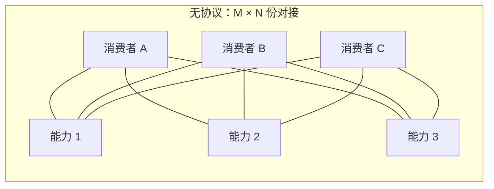
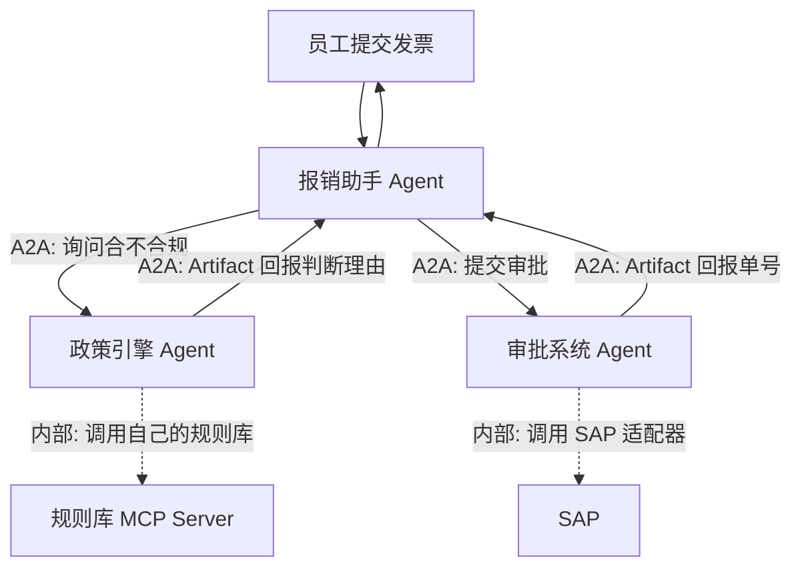

# 开篇导读：为什么需要 A2A

这一篇回答三个问题：**这个问题从哪来、A2A 管到哪一步、什么时候该用它。**
读完应该能独立判断"A2A 是不是我项目里缺的那块拼图"。

## 一、故事要从一个具体的麻烦说起

假设你在做一个"差旅报销助手"。它需要干三件事：

1. 把员工提交的发票图片 OCR 成结构化字段；
2. 查公司的差旅政策，判断这笔费用合不合规；
3. 合规就提交审批系统，不合规就退回并说明原因。

第 2 步和第 3 步属于别的团队：政策引擎是一个独立的 Java 服务，审批系统是
SAP 打通的一个中台。它们各自有 API，但这两个 API 的形态差异很大——
政策引擎返回的是一段判断理由，审批系统接收的是一张表单。

更麻烦的是**协作是动态的**。改个报销规则，政策引擎团队要发版；把审批换成
另一个中台，助手要重写对接代码；如果以后还要接"差旅供应商比价"这个第三方
Agent，助手还得再写一遍。

于是出现了一个熟悉的场景：**每个团队都在写胶水代码。**

```text
        报销助手
       /    |    \
      v     v     v
  政策引擎  审批系统  供应商Agent
   (Java)   (SAP)   (外部团队)
```

三个下游、三套鉴权、三套分页语义、三套错误码、三种"长任务怎么查进度"的做法。
每接入一个新伙伴，助手代码里就多一块 `if provider == "xxx"`。

**A2A 要消除的正是这块胶水。** 它的做法是给智能体之间定一套共同语言：
能力怎么声明、任务怎么委托、进度怎么回传、产物怎么交付。只要双方都实现
这套语言，助手面对的就永远是"一个符合 A2A 规范的智能体"，具体是谁不重要。

## 二、A2A 之前的生态状况

### 2.1 MCP 解决了纵向，没解决横向

2024 年底 Anthropic 开源 MCP（Model Context Protocol）之后，工具生态
迅速标准化。一个智能体想接数据库、接向量库、接 Jira，都用同一种方式声明
"我有哪些工具、参数是什么、返回什么"。

但 MCP 有个明确的作用域：**它服务于单个智能体内部**。一条 MCP 连接把一个
工具挂到智能体身上，智能体因此变强。它没有提供任何机制让智能体 A 去和
智能体 B 建立一次跨越组织边界的、有状态的、多轮的任务协作。

官方文档里对此有很形象的表述：

> **MCP 是纵向的。** 它让一个智能体变深——你可以在同一个屋檐下建一套智能体系统，
> 每加一条 MCP 连接，就是给这个智能体多一件工具。
>
> **A2A 是横向的。** 它把智能体连起来——对方可能属于另一个团队、另一个部门、
> 甚至是合作伙伴的公司。

### 2.2 横向协作此前靠什么

在 A2A 出现之前，横向协作基本靠下面四种土办法：

| 土办法 | 做法 | 问题 |
| --- | --- | --- |
| 裸 HTTP + 自定义 JSON | 自己定接口、自己定字段 | 每次对接都是一次定制项目 |
| 共享数据库 | 双方读写同一张表 | 耦合到表结构，演进极难 |
| 消息队列 | 各发各的消息，靠约定好的 topic 通信 | 消息体格式没标准，语义靠文档约定 |
| 单一大平台 | 所有智能体塞进同一个编排引擎 | 只能服务同一组织内部，外部接入无门 |

第二种和第三种在企业里非常常见。消息队列方案（Kafka / RabbitMQ / Pulsar）
尤其流行——它解决了"可靠投递"，也确实能用来做任务派发。但它留下了一个
**协议空洞**：消息体里放什么、任务状态怎么表达、长任务怎么续、产物怎么
回传、对方能力怎么提前知道——这些全靠两个团队开会约定。约定一旦不同步，
系统就会出现"消息收到了但不知道该干什么"的诡异故障。

**A2A 填的正是这个洞。** 它规定消息体的形状和语义。
传输通道留给现成的中间件：消息队列、gRPC、普通 HTTP 都能作为承载。

### 2.3 N×M 问题

这是判断"要不要上协议"的核心算式。

假设生态里有 M 个消费者、N 个能力提供方。

- **无协议**：M×N 份对接代码。
- **有协议**：M 份客户端 + N 份服务端 = M+N。



A2A 的价值可以概括成一句话：**把 M×N 变成 M+N**。当 N=3、M=3 时差别不大；
当 N=30、M=30 时，900 份对接和 60 份实现之间的差距就是能不能落地的差别。

## 三、A2A 到底诞生于什么

### 3.1 时间线

| 时间 | 事件 |
| --- | --- |
| 2025-04 | Google 发布 A2A 规范初版，公布 50+ 合作伙伴，仓库开放 |
| 2025-06 | 捐赠给 Linux Foundation，形成跨厂商治理 |
| 2025 年内 | 迭代出 v0.1 / v0.2 / v0.3，协议绑定从单一 JSON-RPC 扩展到 gRPC 与 HTTP+JSON |
| 2026-08 | A2A 加入 Agentic AI Foundation |
| 当前 | v1.0.0，proto 文件成为唯一权威定义 |

初版最关键的一个设计选择是**不重新发明轮子**：直接复用 HTTP、JSON-RPC 2.0、
Server-Sent Events 这三样现成标准。这意味着 A2A 的服务端可以用任何语言、
任何 Web 框架实现，只要能吐 JSON、能把长响应写成 SSE。

### 3.2 六条指导原则

规范里的指导原则，浓缩下来就是 A2A 的性格：

- **简单**：复用已有标准，不发明新的传输层。
- **企业就绪**：认证、授权、隐私、追踪、监控都按既有企业实践来。
- **异步优先**：天生为长时间运行的任务和人在回路场景设计。
- **模态无关**：文本、文件、结构化数据都能传。
- **不透明执行**：双方只靠声明的能力和交换的信息协作，互相看不到对方的
  内部思考、计划与工具实现。

最后一条是理解 A2A 边界的关键，下面会展开。

## 四、A2A 管什么，不管什么

这是最容易搞混的地方，也是最该先划清的地方。

### 4.1 A2A 管的四件事

| A2A 负责 | 具体含义 |
| --- | --- |
| **能力发现** | 我想知道你能干什么。你的技能列表、输入输出格式、支持的协议版本 |
| **任务委托与生命周期** | 我把一件事交给你，你告诉我它现在什么状态、什么时候完 |
| **过程通信** | 你做的时候能不能实时告诉我进展，做到哪一步了 |
| **产物交付** | 做完的东西怎么交回给我：文本、文件、结构化数据，都行 |

### 4.2 A2A 不管的六件事

| A2A 不负责 | 归谁管 |
| --- | --- |
| 流程编排（谁先调谁、循环几轮、失败怎么补偿） | 编排框架：LangGraph、Temporal、自研 DAG |
| 任务调度与资源分配（选哪个 Agent 实例、限流、优先级） | 平台层：调度器、消息总线 |
| 业务逻辑与决策规则 | Agent 自己的实现 |
| 工具定义与工具调用 | MCP，或 Agent 内部的函数调用 |
| 共享记忆 / 共享状态存储 | 你的数据库、向量库、缓存 |
| 代码执行沙箱 | 沙箱服务、容器运行时 |

用一句话收口：**A2A 定义"智能体之间怎么说话"，编排框架定义"智能体之间
怎么分工"。** 两者解决不同问题，可以叠加使用。

### 4.3 一个具体的边界例子

假设"报销助手"决定这样协作：



- 虚线框内是各 Agent **自己的实现**，用 MCP 或普通函数调用即可，A2A 完全不管。
- 实线是 **A2A 交互**，由协议规定了消息形状与状态语义。

"先问政策再提交审批"这个顺序，是编排逻辑，属于编排框架的管辖范围。
A2A 只保证两件事在语法和语义上是标准的。

### 4.4 为什么这个边界很重要

初学者常见的一种误解是"上了 A2A 就不用 LangGraph 了"。这个想法忽略了一个
事实：**A2A 协议本身不提供任何执行引擎。**

A2A 告诉你"A 把任务交给 B"这条消息该怎么写，但它不提供：

- 任务该交给 B 还是 C 的决策逻辑；
- B 挂了之后 A 该重试几次、换谁接管；
- 三十个 Agent 同时在跑时的并发控制；
- 整个流程跑完之后结果怎么汇总。

这些都得你自己写。实践中它们通常由编排框架承担——也就是下面这类东西：

```python
graph = StateGraph(ReimbursementState)
graph.add_node("ask_policy", ask_policy_node)      # 节点内部用 A2A 客户端调政策 Agent
graph.add_node("submit_approval", submit_node)      # 节点内部用 A2A 客户端调审批 Agent
graph.add_conditional_edges("ask_policy", route_by_result)
```

**A2A 负责节点与节点之间的"线路"；编排框架负责"跑哪几条线、什么时候跑"。**

## 五、A2A 适合什么场景

把上面的分析收敛成一张判断表：

| 你的处境 | A2A 的价值 | 建议 |
| --- | --- | --- |
| 对接的 Agent 在**另一个团队/公司**，你管不到它的代码 | 高 | 上 A2A，这是它唯一不可替代的场景 |
| 智能体需要**长时间运行**，期间要能查进度、能重连 | 高 | 上 A2A，Task 状态机就是为这个设计的 |
| 任务需要**人在回路**审批，审批期间要挂起，且审批方在**边界另一侧** | 中 | 上 A2A，`TASK_STATE_INPUT_REQUIRED` / `TASK_STATE_AUTH_REQUIRED` 给出挂起与恢复的协议契约；审批流程本身仍由编排层实现 |
| 任务需要**人在回路**审批，但所有环节都在**同一个进程** | 低 | LangGraph 的 `interrupt()` 就够了，A2A 的序列化开销是纯浪费 |
| 生态里有 10+ 个能力提供方，接入方也在增加 | 高 | 上 A2A，M+N 效应开始显现 |
| 所有智能体都在**同一个进程、同一个团队** | 低 | 直接函数调用更简单，A2A 的序列化开销是纯浪费 |
| 只是要接几个**工具**（数据库、搜索、API） | 低 | 用 MCP，A2A 用不上 |
| 流程固定、步骤固定、不需要动态发现能力 | 低 | 写个普通函数链，A2A 的任务抽象反而碍事 |

### 5.1 一个常见的误判

很多团队上 A2A 的动机是"以后可能要对接外部 Agent"。这个理由本身不成立——
**为了假想的未来付现在的复杂度代价，是不划算的。**

更有说服力的动机长这样：

- "我们要在下个季度接供应商的退换货 Agent，对方是 Java 团队，用的还是另一家
  云厂商的模型，接口我们自己定不下来。"
- "这三个 Agent 要跑二十分钟，中间客服要能看进度、要能插一句话进去。"
- "我们要开放平台，让第三方的 Agent 挂上来，还不能让他们看到我们的内部实现。"

有具体对手方的场景，A2A 立刻从"过度设计"变成"刚需"。

## 六、读完本篇应该记住什么

- A2A 补的是**横向**协作：智能体与智能体。纵向的工具接入由 MCP 负责。
- 它把 M×N 份对接代码压成 M+N 份实现，代价是引入一层协议复杂度。
- 它是**协议层**，不提供执行引擎。流程编排仍然需要编排框架。
- 它的独特价值在四个点：能力发现、任务生命周期、长任务进度、跨边界的人
  在回路。前两条是协议的基本盘，后两条只有在"对方在边界另一侧"时才成立。
  只要你的场景里这四条命中两条以上，A2A 就值得上。
- v1.0 是当前基准（v1.0.0 于 2026-03 发布，v1.0.1 于 2026-05 发布），
  v0.3 到 v1.0 有批破坏性变更。

下一步：[前置知识准备](/a2a/prerequisites)——把协议读懂需要的三个缺口补上。
